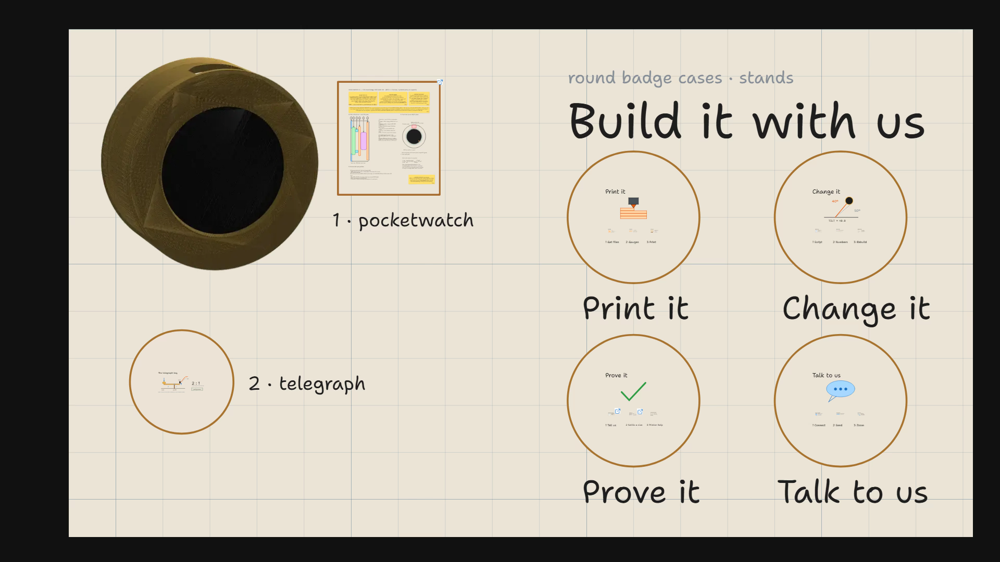
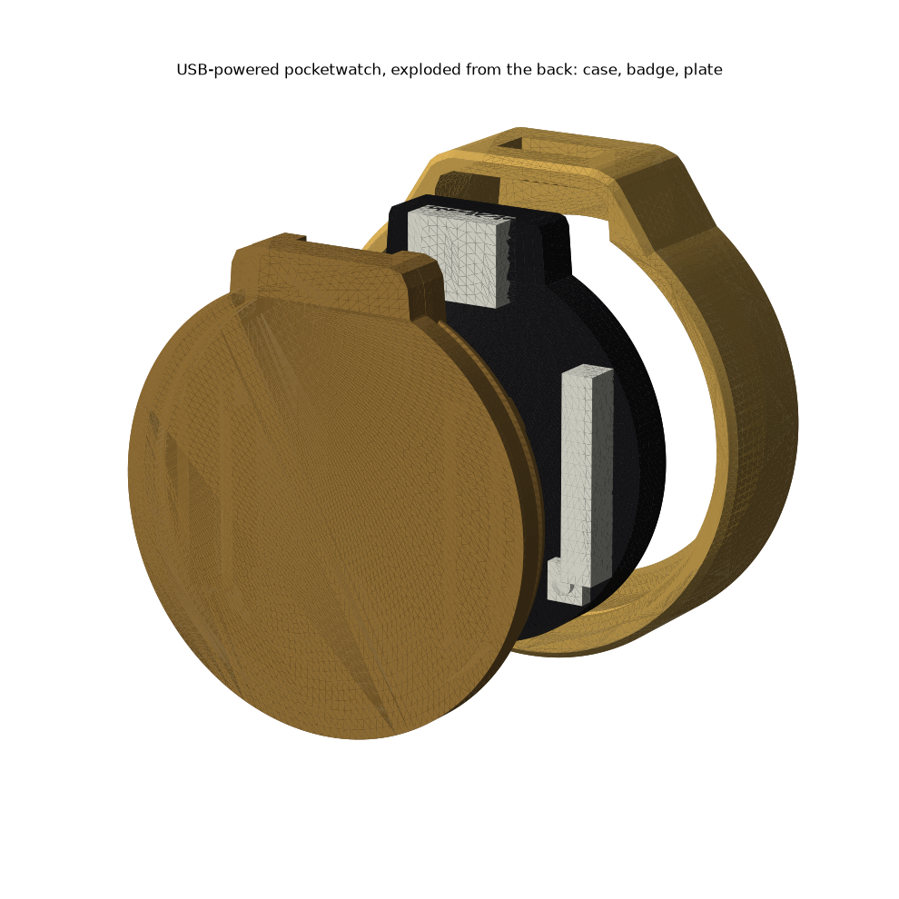
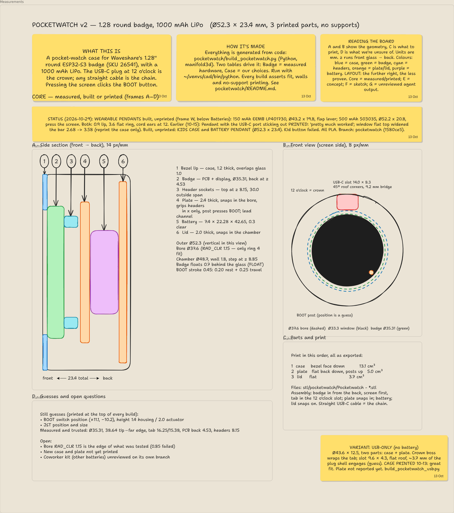
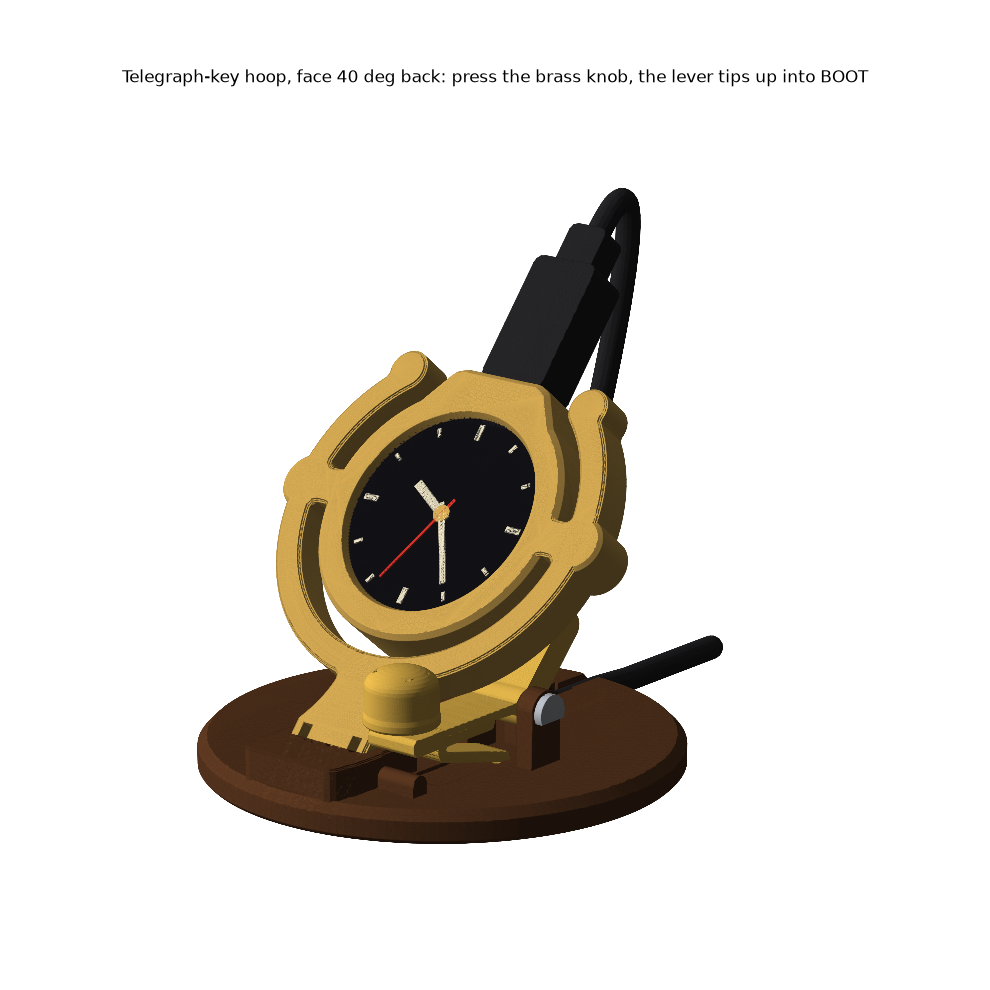
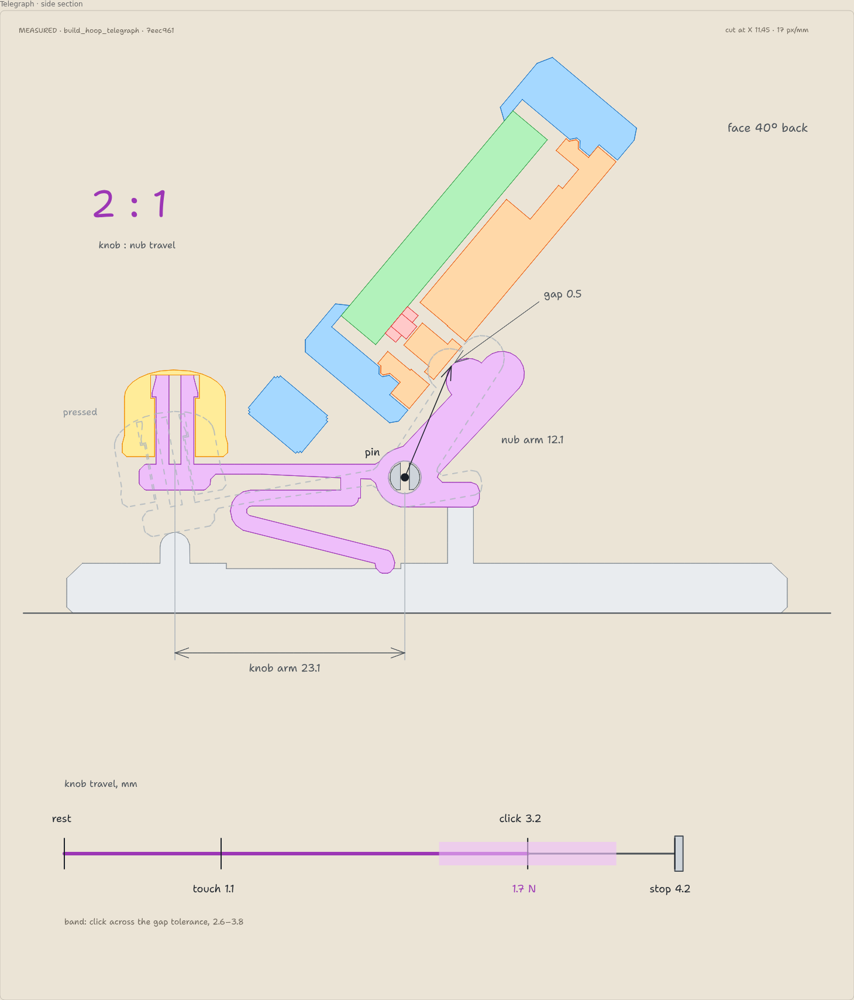

# Pocketwatch cases for Waveshare's round badge

<!-- TOUR -->
[](https://draw.hypnodroid.com/b/pocketwatch-schematics/p/golden-path)

*Tap the picture for the board's camera tour.*

Printable cases and stands for **Waveshare's 1.28" round ESP32-S3 display
badge** (ESP32-S3-LCD-1.28). Every model is a **parametric Python script**:
change a number, rerun it, read its checks, print the STL it writes. Two
designs lead: the **pocketwatch case** and the **telegraph key stand**.

- **Have a printer?** Read **[docs/FOR-PRINTERS.md](docs/FOR-PRINTERS.md)**.
  Print one 10-minute gauge, then the case.
- **Just want files?** Every STL, with its print status:
  **[stl/README.md](stl/README.md)**.
- **Using Claude or another agent?** It starts at **[AGENTS.md](AGENTS.md)**.

**Proven** means printed and logged as working in
[docs/PRINT-LOG.md](docs/PRINT-LOG.md). **Concept** means it passes its
script's checks and has never been printed. **Printed** means it came off
a printer with the result partial or not recorded. **Needs work** means it
printed with a problem; the current file may already have the fix.

## 1. Pocketwatch case





The badge drops into a round watch case, screen first; the USB-C plug at
12 o'clock is the crown and the cable is the chain. The **USB-only** version
is Ø43.6 × 12.5 mm in two parts. Its **back plate is proven** (2026-10-13);
the case needs one reprint to confirm the fix from its 2026-10-14 print.

**Print:** [`Pocketwatch USB-only - plate.stl`](<stl/pocketwatch/Pocketwatch USB-only - plate.stl>)
and [`- case.stl`](<stl/pocketwatch/Pocketwatch USB-only - case.stl>).
**More:** [docs/models/pocketwatch-case.md](docs/models/pocketwatch-case.md).

## 2. Telegraph key stand





The same case leans back 40° in a brass-look hoop. Press the knob in front:
a **2:1 lever on a pin** tips its short arm into the BOOT button. It clicks
after 3.2 mm of knob travel, then the lever lands on a stop, so a hard press
never reaches the switch. **Printed** on the owner's word (2026-11-22); no
fit details are logged yet.

**Print:** the `(40 deg)` hoop, base and lever, plus the knob and pin, in
[stl/pocketwatch/stands/hoop/](stl/pocketwatch/stands/hoop/).
**More:** [docs/models/telegraph-key.md](docs/models/telegraph-key.md).

## Everything else

106 STLs: **7 proven, 6 printed, 6 printed and needing work, 87 never
printed.** One row per family; each page has pictures, files and the
numbers to edit.

| design | status | page |
|---|---|---|
| **Fit gauges** | proven | [fit-gauges](docs/models/fit-gauges.md) |
| **Pocketwatch case** | plates proven; cases need a reprint | [pocketwatch-case](docs/models/pocketwatch-case.md) |
| **Telegraph key stand** | printed, lean not recorded (40° or 50°, same script) | [telegraph-key](docs/models/telegraph-key.md) |
| Hoop stand | printed; fixes unprinted | [hoop-stand](docs/models/hoop-stand.md) |
| Pendant, kids case | plate proven; kids case concept | [pendant](docs/models/pendant.md) |
| Battery pendant | concept | [battery-pendant](docs/models/battery-pendant.md) |
| Wearable pendants | concept | [wearable-pendants](docs/models/wearable-pendants.md) |
| Monitor gauge pod | concept | [monitor-pod](docs/models/monitor-pod.md) |
| 9 stands and clips | concept | [stand-concepts](docs/models/stand-concepts.md) |

**Earlier designs:** the September wedge desk stands are retired. They were
print-proven, but in the owner's words they "didn't protect the device
enough". [docs/models/wedge-stands.md](docs/models/wedge-stands.md).

## Still undecided

Two kinds of number are not settled:

- **Printer clearances** (bore, plate, USB-C slot, telegraph pin). They
  depend on your printer; the fit gauges settle them.
- **Hardware guesses**: where the BOOT switch and the battery connector sit
  on the badge, and how tall they are. Calipers settle them.

[docs/FOR-PRINTERS.md](docs/FOR-PRINTERS.md) says which to settle first.
[docs/MEASUREMENTS.md](docs/MEASUREMENTS.md) lists every measured number and
every guess.

## Change a model

Find the design's row in [stl/catalog.toml](stl/catalog.toml): it names the
script and the constants to edit. Edit one number, then run the script from
the repo root:

```
./setup.sh                                                       # once
./tools/py pocketwatch/build_pocketwatch_usb.py --no-render     # checks only
```

Every check prints `[ok]` or `[FAIL]`. Look at the renders before you
print. The `change-a-model` skill walks through it, with a worked example.

## The draw board

The board is a zoomable, to-scale schematic of the case and the telegraph:
measurements, open guesses, fits and print results, with proven work
separate from concept art. Anyone can view it. Connect it to your Claude:

```
claude mcp add --transport http pocketwatch-board https://draw.hypnodroid.com/view/pocketwatch-schematics/mcp
```

Then ask Claude to open the board's tour. To draw on the board, ask Aaron to
add you. The draw plugin for Claude Code is
[redaphid/draw-mod](https://github.com/redaphid/draw-mod):

```
claude plugin install draw --marketplace redaphid/draw-mod
```

More: [docs/BOARD.md](docs/BOARD.md).

## Printer trouble

Since June 2026 most prints on the owner's printer have failed at the first
layer or with a filament error. What has been tried and what to check next:
[docs/PRINTER-TROUBLE.md](docs/PRINTER-TROUBLE.md). Help is welcome.

## More

| doc | what |
|---|---|
| [docs/STATUS.md](docs/STATUS.md) | state of every family, branch and loose end |
| [docs/MEASUREMENTS.md](docs/MEASUREMENTS.md) | every measured dimension, who measured it, which constant uses it |
| [docs/PRINT-LOG.md](docs/PRINT-LOG.md) | every print and what happened |
| [docs/DESIGN.md](docs/DESIGN.md) | design decisions, dated |
| [docs/TOOLCHAIN.md](docs/TOOLCHAIN.md) | the CAD libraries and the renderer |
| [BOARDS.md](BOARDS.md) | board outlines and pin maps |
| [.claude/skills/](.claude/skills/) | step-by-step procedures for agents |

## Licence

MIT. See [`LICENSE`](LICENSE).
