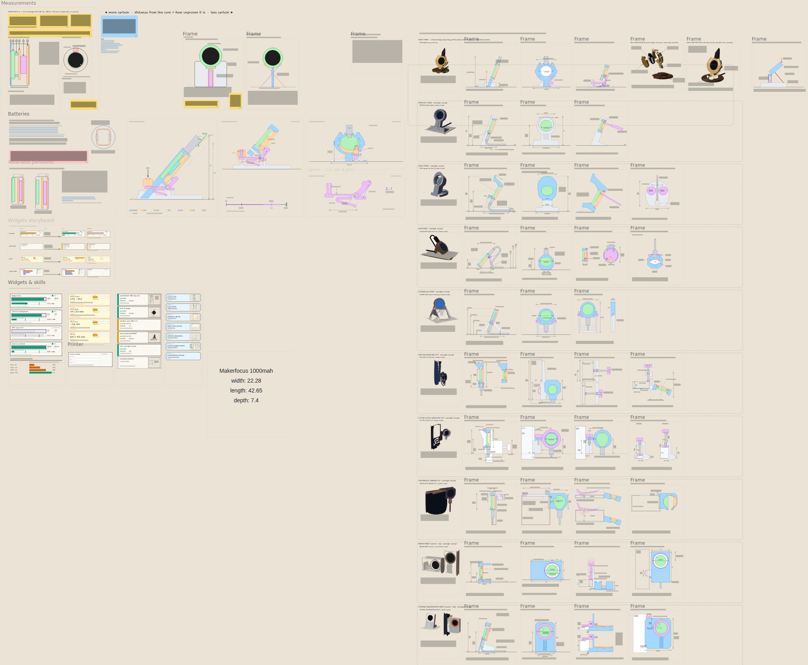
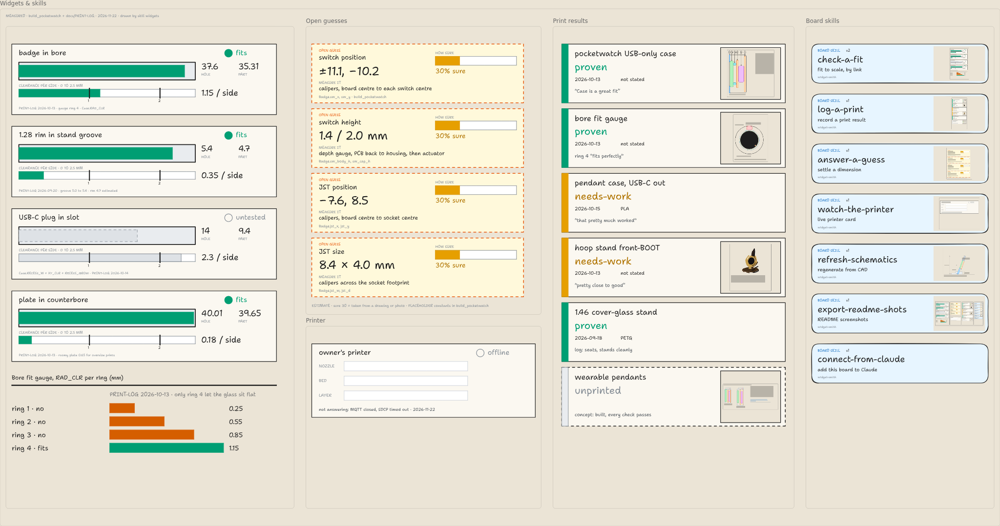
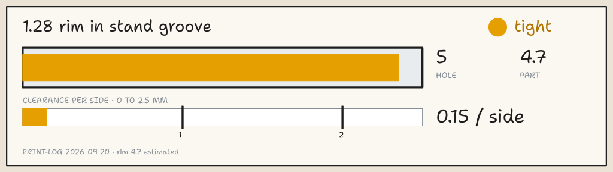
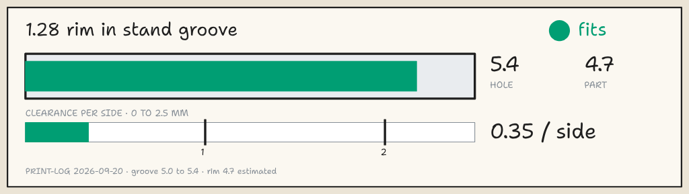

# The draw board

**`pocketwatch-schematics` is a zoomable, to-scale schematic of this repo:**
the pocketwatch case and the telegraph key cut from the CAD, the
measurements, the open guesses, the fits and the print results. Proven work
sits on the left; the further right, the less proven, out to the concept
art. **It is documentation, not a source of truth:** the code and
[PRINT-LOG.md](PRINT-LOG.md) win when they disagree.

[](https://draw.hypnodroid.com/b/pocketwatch-schematics)

## Connect it to Claude

Anyone can view the board. Add its read-only MCP server to Claude Code:

```
claude mcp add --transport http pocketwatch-board https://draw.hypnodroid.com/view/pocketwatch-schematics/mcp
```

Then ask Claude to "open the pocketwatch board and take me to the start".
In a browser: <https://draw.hypnodroid.com/b/pocketwatch-schematics>.

**To draw on the board, ask Aaron to add you.** Editors connect to
`https://draw.hypnodroid.com/b/pocketwatch-schematics/mcp` instead, which
needs a signed-in, allowed account. The draw plugin for Claude Code is
[redaphid/draw-mod](https://github.com/redaphid/draw-mod):

```
claude plugin install draw --marketplace redaphid/draw-mod
```

## What it holds

| frame | what | open |
|---|---|---|
| `g-front` | **Start here**: the front door | [open](https://draw.hypnodroid.com/b/pocketwatch-schematics?frame=g-front) |
| `golden-path` | the camera tour, a present path through the guide | [play](https://draw.hypnodroid.com/b/pocketwatch-schematics/p/golden-path) |
| `g-print`, `g-change`, `g-prove`, `g-talk` | the four doors: Print it, Change it, Prove it, Talk to us | [print](https://draw.hypnodroid.com/b/pocketwatch-schematics?frame=g-print), [change](https://draw.hypnodroid.com/b/pocketwatch-schematics?frame=g-change), [prove](https://draw.hypnodroid.com/b/pocketwatch-schematics?frame=g-prove), [talk](https://draw.hypnodroid.com/b/pocketwatch-schematics?frame=g-talk) |
| `g-talk-1` | Connect your Claude | [open](https://draw.hypnodroid.com/b/pocketwatch-schematics?frame=g-talk-1) |
| `g-map` | proven vs concept art: 1 proven, 3 partly, 14 concept | [open](https://draw.hypnodroid.com/b/pocketwatch-schematics?frame=g-map) |
| Measurements | the battery pocketwatch cut through its centre, every measured number | [open](https://draw.hypnodroid.com/b/pocketwatch-schematics?frame=USQNRCETo-sCUMNKHuD6p) |
| `fBat` | the batteries | [open](https://draw.hypnodroid.com/b/pocketwatch-schematics?frame=fBat) |
| `fW` | the wearable pendants, side sections | [open](https://draw.hypnodroid.com/b/pocketwatch-schematics?frame=fW) |
| `tg-overview` | telegraph key, 40° with the 50° ghost | [open](https://draw.hypnodroid.com/b/pocketwatch-schematics?frame=tg-overview) |
| `tg-side` | the 2:1 lever, gap to BOOT, knob-travel ruler | [open](https://draw.hypnodroid.com/b/pocketwatch-schematics?frame=tg-side) |
| `tg-front`, `tg-lever` | front elevation; the lever alone | [open](https://draw.hypnodroid.com/b/pocketwatch-schematics?frame=tg-front) |
| `tg-fits` | the telegraph's four fits, untested | [open](https://draw.hypnodroid.com/b/pocketwatch-schematics?frame=tg-fits) |
| `wx-show` | widgets and board skills (below) | [open](https://draw.hypnodroid.com/b/pocketwatch-schematics?frame=wx-show) |
| `wx-story` | storyboard of the four widgets | [open](https://draw.hypnodroid.com/b/pocketwatch-schematics?frame=wx-story) |
| `f-hoop`, `ms-side` | the replaced front-BOOT hoop stand, cut from its CAD | [open](https://draw.hypnodroid.com/b/pocketwatch-schematics?frame=ms-side) |
| `f-<name>` | the nine stand and clip concepts, one row each | right-hand column |

## Widgets and board skills



Four custom widgets, each a card that redraws from a few values:

| widget | shows |
|---|---|
| `fit-check` | a part in a hole, to scale, with the clearance per side and fits / tight / untested |
| `guess` | an unmeasured dimension, how sure, how to measure it, the constant |
| `print-result` | a print, its status colour, the date and the owner's words |
| `printer-state` | the owner's printer: nozzle, bed, layer, or offline |

The live server may refuse custom widgets as draw ops (draw issue #724); the
cards are rendered and drawn as shapes meanwhile.

Seven **board skills**, stored on the board itself, encode its conventions.
List them with `read({skills: true})`:

| board skill | does |
|---|---|
| `connect-from-claude` | add the MCP URL, then fly to `g-front` |
| `check-a-fit` | record a fit result as a fit-check card |
| `log-a-print` | record a print as a print-result card; needs a PRINT-LOG entry or the owner's words |
| `answer-a-guess` | replace a guess card with the measurement |
| `watch-the-printer` | refresh the printer card (owner only) |
| `refresh-schematics` | regenerate the CAD-cut frames |
| `export-readme-shots` | screenshot frames into `docs/img/` |

**A card updates from one POST.** Each frame has an edit link; posting new
values to it redraws the card in place. The 1.28 groove card, before and
after:

<p>


</p>

## Refresh the measured schematics

The section and elevation frames are cut from the same solids the build
checks; nothing is traced by hand. After a geometry change, regenerate the
ops and draw them over the same ids:

| frames | command |
|---|---|
| telegraph (`tg-*`) | `./tools/py pocketwatch/stands/hoop/board_schematics_telegraph.py /tmp/tg-ops` |
| hoop stand (`ms-side`, `ms-front`, `ms-rock`) | `./tools/py pocketwatch/stands/hoop/board_schematics.py /tmp/ops.json` |
| a concept (`f-<name>`) | `./tools/py pocketwatch/board/<name>.py /tmp/ops-<name>.json` |

The telegraph script refuses to write if any of the model's checks fail. It
writes `frames.json`, one ops file per frame and `fits.json`; each ops file
is posted to that frame's edit link, which only editors hold. The
`update-the-board` skill has the whole procedure, and which frame each kind
of change touches.

## Screenshots in the docs

The images in `docs/img/board/` were taken from the board on 2026-11-22 with
the draw MCP's `screenshot` tool. Retake them with the `export-readme-shots`
board skill after the board changes.
