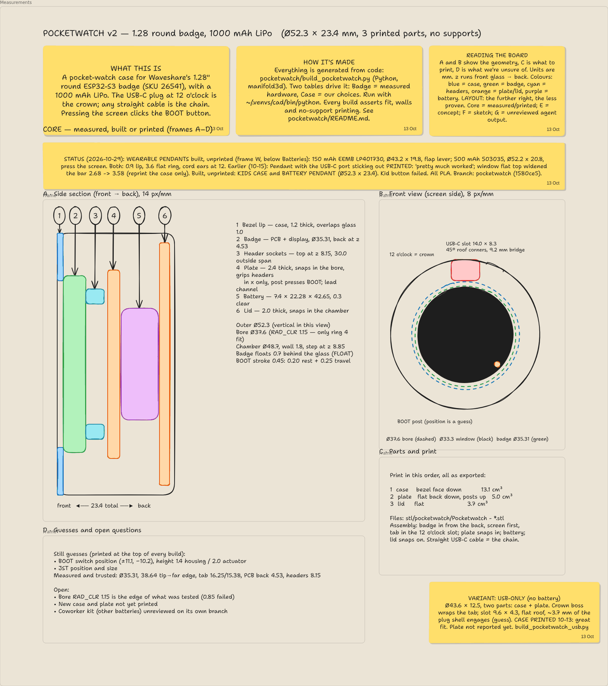
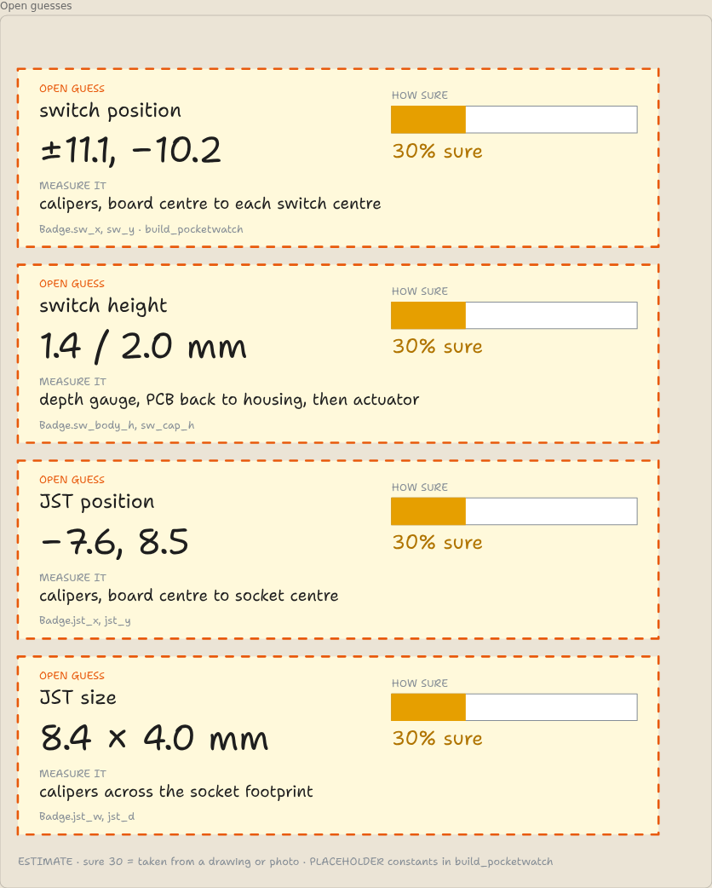

# Measurements

Every dimension of the hardware the models are built around: the 1.28"
badge, the batteries, the USB-C plug. **Three kinds, in three tables:
measured on real hardware, read from a vendor drawing, and still a guess.**
Each row names the constant that uses it. Units are mm.

The board's **Measurements** frame draws these to scale; its **Batteries**
frame (`fBat`) draws the cells. Tap the picture to open it. The code wins
when the board and the code disagree.

## Measured on real hardware

| what | value | who, how, when | constant |
|---|---|---|---|
| badge disc, across | **35.31** | owner, calipers, by 2026-10-03 | `Badge.disc_d` |
| USB-C tab tip to the far edge of the disc | **38.64** | owner, calipers | `Badge.tip_to_far_edge` |
| tab width at root / tip | **16.25 / 15.38** | owner, calipers | `Badge.tab_w_root`, `tab_w_tip` |
| PCB back, behind the glass face | **4.53** (he also wrote "~5") | owner, calipers | `Badge.pcb_back_z` |
| header socket tops, behind the glass | **8.15** | owner, calipers | `Badge.hdr_top_z` |
| battery connector (JST) top, behind the glass | **7.64** | owner, calipers | `Badge.jst_top_z` |
| USB-C port centre, behind the glass | **5.0** | owner, calipers | `Badge.port_z` |
| header sockets | **13.25 × 3.0**, outside span **30.0** | owner, calipers; the sockets were a photo discovery | `Badge.hdr_len`, `hdr_w`, `hdr_span` |
| badge thickness at the rim (PCB + display) | **about 4.7** | slot fit gauge print, 2026-09-18: drops into the 5.0 slot | `"1.28"` `thick` in `build_stands.py` |
| BOOT and RESET switch centres, back view | **(∓11.45, −10.51)**, r 15.5, ±0.4 | agent, from the owner's photo, 2026-09-20 | `SWITCH` in `build_stand_button.py` only |
| bore that lets the glass sit flat | **Ø37.6** (`RAD_CLR` 1.15); Ø37.0 did not | bore fit gauge print, 2026-10-13 | `Case.RAD_CLR` |
| Makerfocus 1000 mAh LiPo | **7.4 × 22.28 × 42.65** | owner, calipers | `Case.BATT_T`, `BATT_W`, `BATT_L` |

The caliper measurements, and the photos behind them, are in
`reference/pictures/`. The switch overlay is
`reference/esp32-s3-lcd-1.28-switch-positions-photo.png`.

**Derived:** between the two header sockets there is a pocket **24.0** wide
(30.0 − 2 × 3.0) and **3.62** deep (8.15 − 4.53). A 4.3 mm cell does not fit
it.

## From a vendor drawing

| what | value | source | constant |
|---|---|---|---|
| 1.28 PCB | Ø36.5 (R 18.25) | Waveshare outline drawing; the badge measures **35.31** | `board_d` in `build_stands.py` (the retired stands keep 36.5) |
| 1.28 active display | Ø32.4, 240 × 240 | Waveshare drawing | `Badge.active_d_drawing` |
| 1.28 header outer span | about 27.0 | Waveshare drawing; **superseded** by the measured 30.0 | none |
| 1.46 with cover glass | Ø44.77 × 12.30 | Waveshare drawing | `BOARDS` in `build_stands.py` |
| 1.46 without cover glass | Ø42.58 × 10.65 | Waveshare drawing | `BOARDS` in `build_stands.py` |
| USB-C receptacle shell | 8.94 × 3.26 × 7.35 | the USB-C standard | `Badge.port_w`, `port_h`, `port_len` |
| EEMB LP401730, 150 mAh | 4.3 × 17.5 × 32.0 | EEMB's drawing | `EEMB_401730` in `build_wearable.py` |

Drawings and their URLs: [reference/SOURCES.md](../reference/SOURCES.md).
Board outlines and pin maps: [BOARDS.md](../BOARDS.md).

## Still a guess

Fields declared with `ph(value, what)` in `Badge`
(`pocketwatch/build_pocketwatch.py`). `./tools/py pocketwatch/build_pocketwatch.py --no-render`
prints them under `PLACEHOLDERS still in use`.

| what | guess | how to measure | constant |
|---|---|---|---|
| switch actuator position, from the back | (±11.1, −10.2) | calipers, board centre to each switch centre | `Badge.sw_x`, `sw_y` |
| switch housing height behind the PCB back | 1.4 | depth gauge | `Badge.sw_body_h` |
| switch actuator top behind the PCB back | 2.0 | depth gauge | `Badge.sw_cap_h` |
| switch housing, actuator | 3.5 square, Ø1.8 | calipers | `Badge.sw_body`, `sw_cap_d` |
| battery connector (JST) centre | (−7.6, 8.5) | calipers, board centre to socket centre | `Badge.jst_x`, `jst_y` |
| battery connector footprint | 8.4 × 4.0 | calipers | `Badge.jst_w`, `jst_d` |
| tab corner radius | 1.0 | photo | `Badge.tab_corner_r` |
| switch force | 2.0 N | a force gauge, or the switch's datasheet | `Key.F_SW` in `build_hoop_telegraph.py` |
| 503035 cell, 500 mAh | 5.3 × 30.5 × 37.0 | calipers on the cell | `CELL_503035` in `build_wearable.py` |
| USB-C plug metal shell | about 8.4 × 2.6 | calipers on your cable | comment on `Case.RECESS_W`, `RECESS_T` |

**A known conflict.** The photo measurement puts the switches at
(∓11.45, −10.51); the pocketwatch guess is (±11.1, −10.2). They differ by
about 0.35 and 0.3. The pocketwatch post forgives about ±0.6, so both may
work. Calipers on a real badge settle it; the `settle-dimensions` skill says
how.

**Printer clearances** (bore, plate, USB-C slot, telegraph pin) are not
hardware dimensions. They depend on the printer:
[docs/FOR-PRINTERS.md](FOR-PRINTERS.md).
