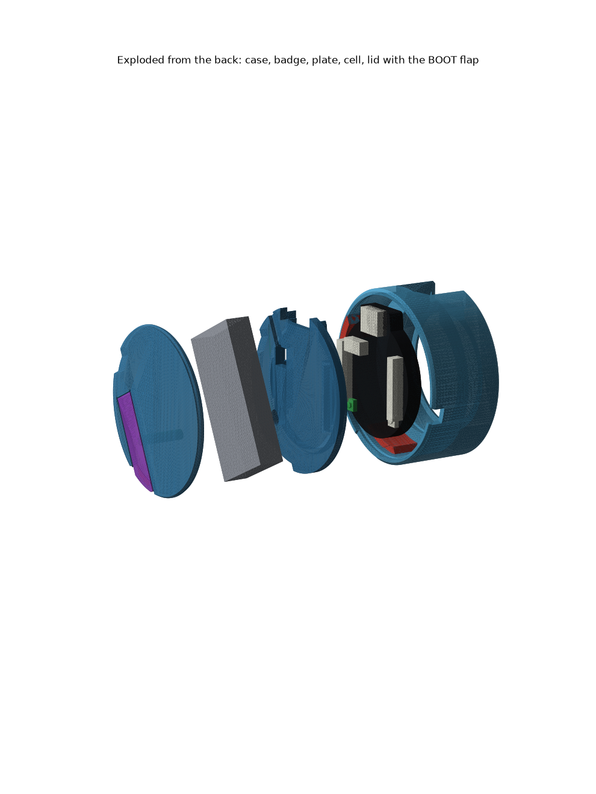

# Battery pendant

**Concept, never printed.** The battery pocketwatch (Ø52.3 × 23.4, a
1000 mAh cell) with the pendant's USB-C port sticking out and a BOOT flap in
the lid.

| file (`stl/pocketwatch/pendant/battery/`) | status |
|---|---|
| `Battery pendant - case.stl`, `- plate.stl`, `- lid (flap).stl` | unprinted |
| `- plate (roomy).stl`, `- lid (flap, roomy).stl` | unprinted |

The cell is the Makerfocus 1000 mAh LiPo, measured at 7.4 × 22.28 × 42.65.

**Change it:**
[`pocketwatch/pendant/battery/build_battery_pendant.py`](../../pocketwatch/pendant/battery/build_battery_pendant.py),
classes `Battery` and `Frame`. The battery size itself is `Case.BATT_T`,
`BATT_W`, `BATT_L` in `pocketwatch/build_pocketwatch.py`.

More: [pocketwatch/pendant/battery/README.md](../../pocketwatch/pendant/battery/README.md).
Battery sizes: [docs/MEASUREMENTS.md](../MEASUREMENTS.md).
