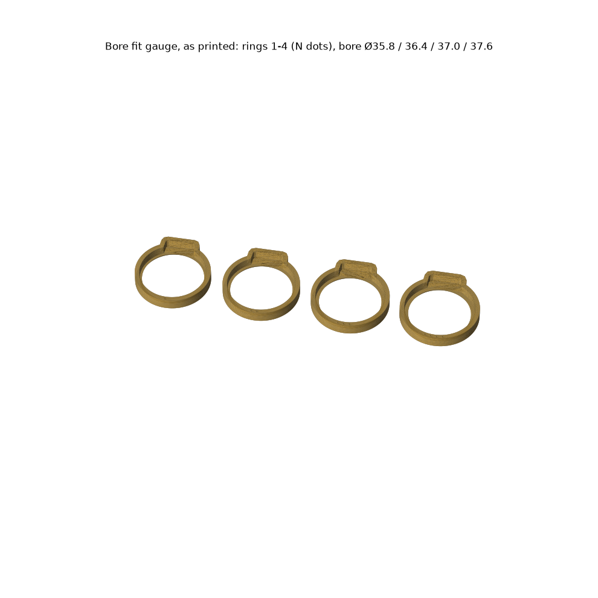
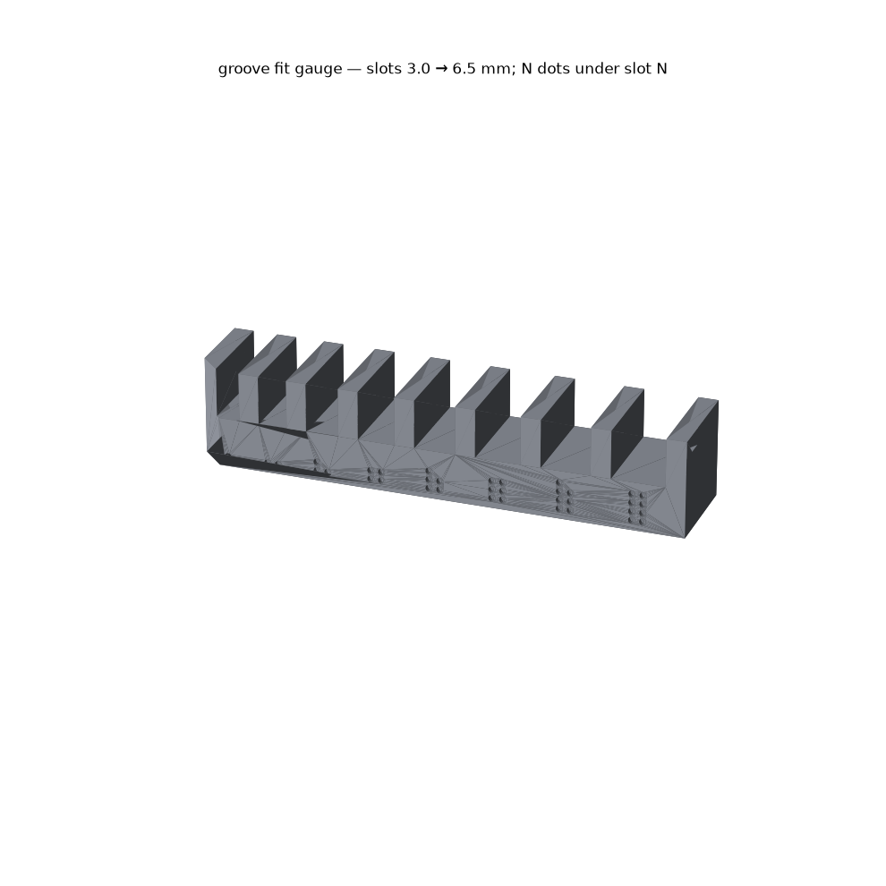

# Fit gauges

**Ten-minute prints that tell you how your printer and your badge fit,
before you spend an hour on a case.** Print the bore fit gauge first.

| gauge | status | sets |
|---|---|---|
| [`Pocketwatch - bore fit gauge.stl`](<../../stl/fit-gauges/Pocketwatch - bore fit gauge.stl>) | **proven** (PRINT-LOG 2026-10-13) | `Case.RAD_CLR`, the bore around the badge, in `pocketwatch/build_pocketwatch.py` |
| [`Slot fit gauge.stl`](<../../stl/fit-gauges/Slot fit gauge.stl>) | **proven** (PRINT-LOG 2026-09-18) | the groove of the retired wedge stands; skip it |

## Bore fit gauge

The front of the pocketwatch case, as four rings. Ring N has N dots. Print
it bezel down. Drop the badge in from the back, screen first, tab in the
slot. **The tightest ring where the glass sits flat on the lip is your
`RAD_CLR`.**

| ring | bore | `RAD_CLR` per side | owner's print |
|---|---|---|---|
| 1 | Ø35.8 | 0.25 | no |
| 2 | Ø36.4 | 0.55 | no |
| 3 | Ø37.0 | 0.85 | no |
| 4 | Ø37.6 | 1.15 | **fits** ("fits perfectly") |

1.15 is the edge of the tested range: the true minimum on the owner's
printer is between 0.85 and 1.15. No badge to test with? Print the gauge
anyway and give it to the owner with the case.

**Change it:** `CLRS = [0.25, 0.55, 0.85, 1.15]` in
[`pocketwatch/build_bore_gauge.py`](../../pocketwatch/build_bore_gauge.py),
then `./tools/py pocketwatch/build_bore_gauge.py`.

The whole procedure: [docs/FOR-PRINTERS.md](../FOR-PRINTERS.md) and the
`calibrate-my-printer` skill.
