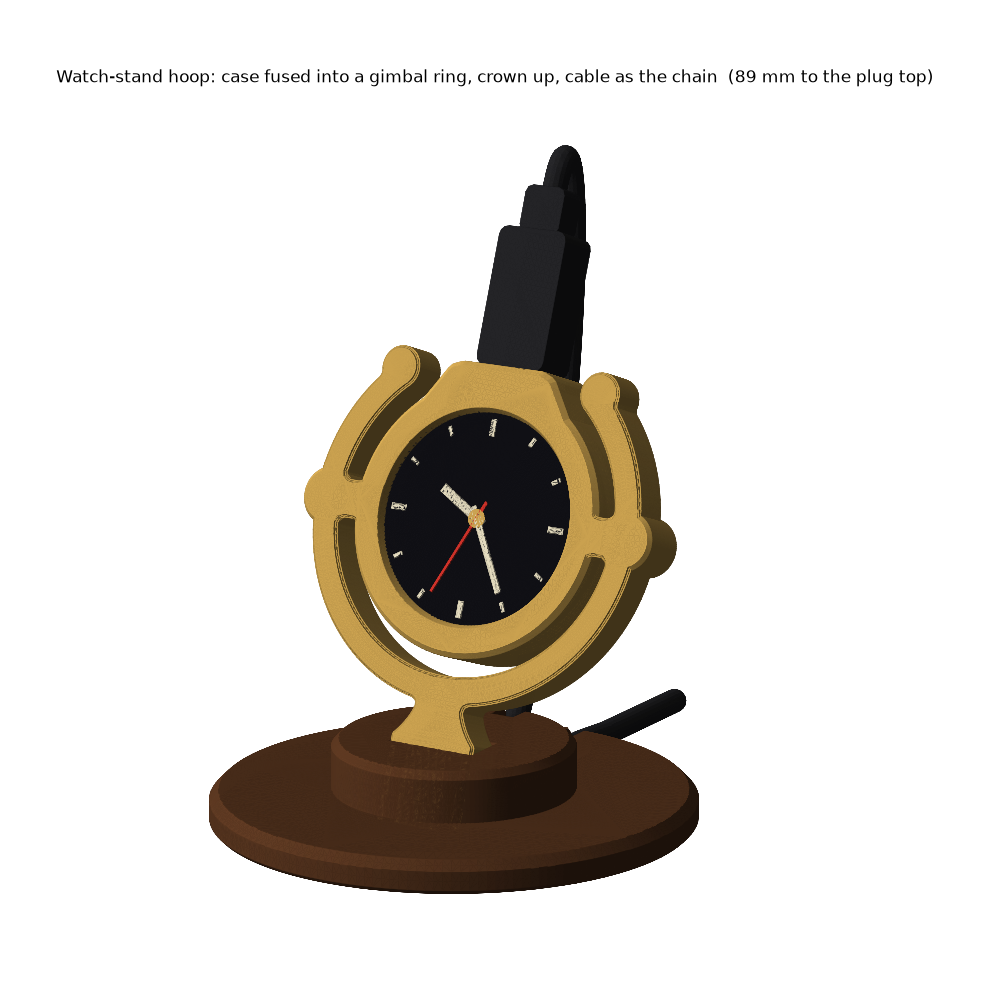

# Hoop stand

**The USB-only pocketwatch case fused into a brass-look ring on a round
base, face 20° back, crown up.** The telegraph key stand grew out of it.
Ø76 footprint, 89 mm tall to the top of the plug. Two snap arms on the neck
click into the base; no screws.



## Print status

| file (`stl/pocketwatch/stands/hoop/`) | status | evidence |
|---|---|---|
| `Hoop stand - hoop and case.stl` | needs work, fix applied | PRINT-LOG 2026-10-13: the case wobbled in the mortise; now a snap tenon |
| `Hoop stand - base.stl` | unprinted | mortise 0.08 per side |
| `Hoop stand - base (looser, 0.12).stl` | **printed** | PRINT-LOG 2026-10-13: "the case is loose on the stand" |
| `Hoop stand - base (roomier, 0.18).stl` | unprinted | for a printer that runs tight |
| `Hoop stand - back plate (button).stl` | needs work, fix applied | PRINT-LOG 2026-10-13: the finger dimple melted; removed |
| `- back plate (button, roomy).stl`, `- back plate (BOOT hole).stl` | unprinted | |

Print the base at **100% infill**: it is the ballast. Below 20 g, the angle
the stand can lean before it tips (with 1 N pulling the cable) drops under
its 20° minimum.

## Change it

[`pocketwatch/stands/hoop/build_hoop.py`](../../pocketwatch/stands/hoop/build_hoop.py),
class `Stand`. `Stand.FIT` is the tenon clearance per side (0.08; 0.25 and
0.12 printed loose).

```
./tools/py pocketwatch/stands/hoop/build_hoop.py --no-render
```

Design notes, strength numbers and weaknesses:
[pocketwatch/stands/hoop/README.md](../../pocketwatch/stands/hoop/README.md).
The board's frames `f-hoop` and `ms-side` show the replaced front-BOOT
version of this stand.
