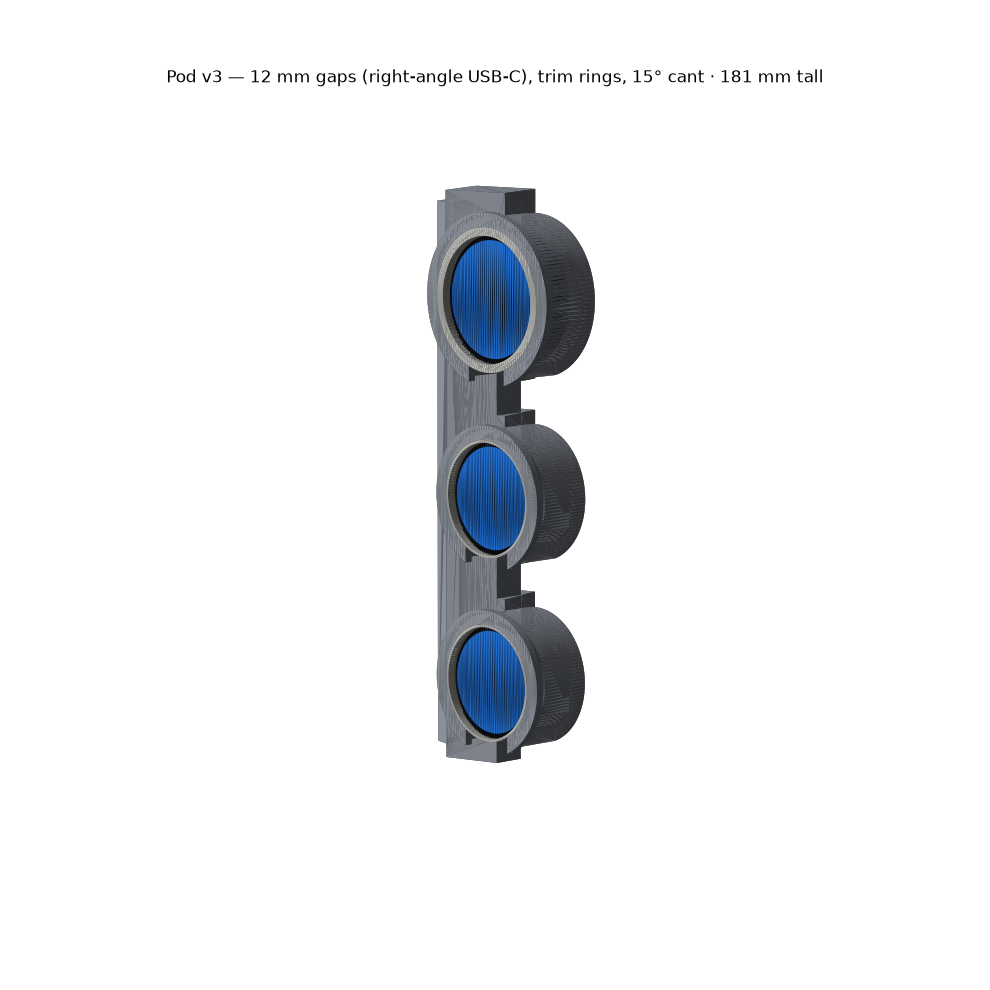

# Monitor gauge pod

**Concept, never printed.** An instrument cluster that clips to the side of
a monitor, after a car's A-pillar gauge pod: one 1.46" board on top, two
1.28" badges below, canted toward you. It predates the pocketwatch case.



| file (`stl/pod/`) | status |
|---|---|
| `Pod cup test - small.stl`, `Trim ring - small.stl`, `Trim ring - large.stl` | unprinted; **print these first** (about 10 min) |
| `Pod - right-angle cables.stl`, `Pod - straight cables.stl` | unprinted |
| `Clip - fixed jaw.stl`, `Clip - slider.stl` | unprinted |

**Change it:** [`pod/build_pod.py`](../../pod/build_pod.py). `FIT`, `CANT`,
`CUP_WALL`, `RING_PRESS` at the top; the gap between gauges is the first
argument (12 for right-angle cables, 26 for straight ones).

```
./tools/py pod/build_pod.py 12
```

More: [pod/README.md](../../pod/README.md). The pod's skill is
`pod-iterate`.
