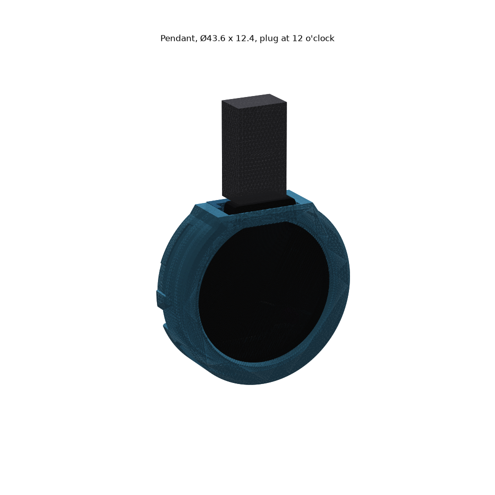
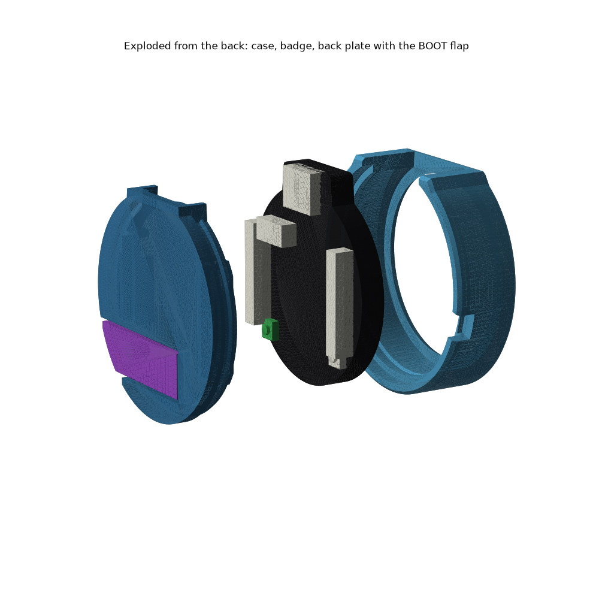

# Pendant and kids case

**A USB-powered Ø43.6 case cut flat at 12 o'clock, so the badge's USB-C
port sticks out and any plug seats.** It came from two pocketwatch prints
whose USB-C slot kept losing to the next cable's plastic overmold. The
**kids case** is the same case with a big flap on the back plate that clicks
BOOT.

## Print status

| file | status | evidence |
|---|---|---|
| `stl/pocketwatch/pendant/Pendant - back plate (button).stl` | **proven** | PRINT-LOG 2026-10-15: "that pretty much worked" |
| `stl/pocketwatch/pendant/Pendant - case.stl` | needs work, fix applied | PRINT-LOG 2026-10-15: the bar over the USB-C tab was too thin. The screen window is now flat at 12 o'clock, so the bar is 3.58 wide (was 2.68). Unprinted since. |
| `- back plate (button, roomy).stl` | unprinted | |
| `stl/pocketwatch/pendant/kids-case/` (3 files) | **concept**, unprinted | replaces a twist-lock kid button that failed (PRINT-LOG 2026-10-14) |

## Change it

| design | script | constants |
|---|---|---|
| pendant | [`pocketwatch/pendant/build_pendant.py`](../../pocketwatch/pendant/build_pendant.py) | `Pendant.PORT_OUT` (0.5, how far the port stands out), `Pendant.WIN_FLAT` (0.9) |
| kids case | [`pocketwatch/pendant/kids-case/build_kids_case.py`](../../pocketwatch/pendant/kids-case/build_kids_case.py) | `Flap` |

More: [pocketwatch/pendant/README.md](../../pocketwatch/pendant/README.md),
[kids-case/README.md](../../pocketwatch/pendant/kids-case/README.md).
