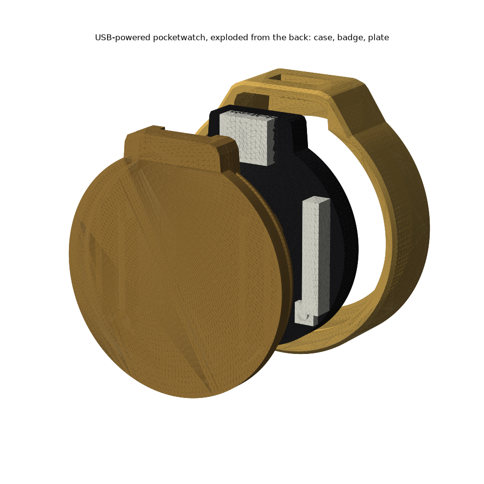
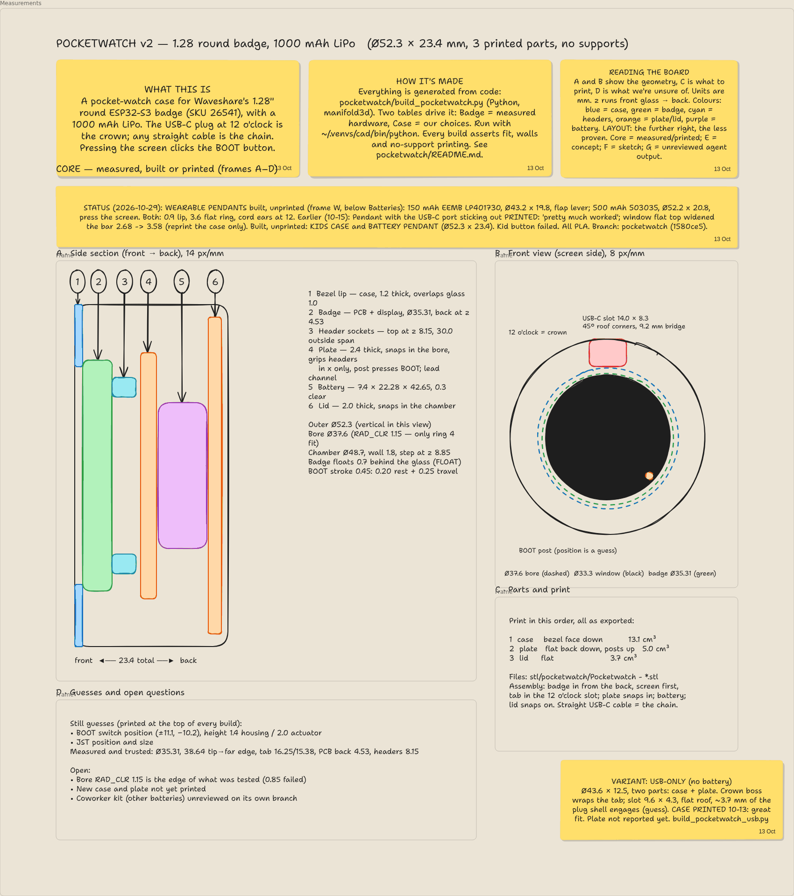
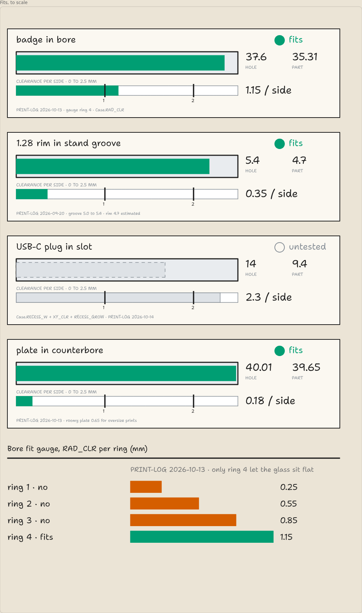

# Pocketwatch case

**The badge in a round watch case. The USB-C plug at 12 o'clock is the
crown; any straight cable is the chain.** Featured design #1: the simplest
one and the most likely to work. Every pocketwatch stand uses this case.



## Two versions

| version | size | parts | power |
|---|---|---|---|
| **USB-only** (print this one) | Ø43.6 × 12.5 mm | case, plate | the USB-C cable |
| Battery (v2) | Ø52.3 × 23.4 mm | case, plate, lid | Makerfocus 1000 mAh LiPo (7.4 × 22.28 × 42.65) |

The badge goes in from the back, screen first, with the USB-C tab in the slot
at 12 o'clock. The plate snaps in behind it and grips the two header sockets
sideways. **Press the screen to click BOOT:** the badge floats 0.7 mm, and a
post on the plate meets the switch after 0.20 mm plus 0.25 mm of switch
travel.

## Print status

| file (`stl/pocketwatch/`) | status | evidence |
|---|---|---|
| [`Pocketwatch USB-only - plate.stl`](<../../stl/pocketwatch/Pocketwatch USB-only - plate.stl>) | **proven** | PRINT-LOG 2026-10-13: one print came out about 1 mm large, the next fit |
| [`Pocketwatch USB-only - case.stl`](<../../stl/pocketwatch/Pocketwatch USB-only - case.stl>) | **needs work, fix applied, unprinted since** | PRINT-LOG 2026-10-13: "Case is a great fit". 2026-10-14: "so tight I can't pry it back off", USB-C opening "2 mm larger all around". The file now has a pry notch and the bigger slot. |
| `Pocketwatch USB-only - plate (roomy).stl` | unprinted | 0.65 per side instead of 0.18, for a printer that runs oversize |
| `Pocketwatch USB-only - plate (button).stl` | needs work, fix applied | PRINT-LOG 2026-10-13: the finger dimple melted; removed |
| `Pocketwatch USB-only - plate (BOOT hole).stl` | unprinted | press BOOT with a pin from the back; the glass takes no load |
| `Pocketwatch - plate.stl` (battery) | **proven**, weakly | PRINT-LOG 2026-10-12: "the back plate is great!", from memory; the print was lost |
| `Pocketwatch - case.stl` (battery) | needs work, fix applied | PRINT-LOG 2026-10-13: "looking better"; USB-C slot cut down to the plug's metal shell |
| `Pocketwatch - lid.stl` (battery) | unprinted | |

The owner, 2026-11-22: "The pocketwatch and telegraph are at least somewhat
verified." Every file, with its roomy variants:
[stl/README.md](../../stl/README.md#pocketwatch-case).

## The numbers, to scale



The board's **Measurements** frame: the battery version cut through its
centre (14 px/mm) and seen from the front (8 px/mm). The USB-only case is the
same front half without the battery chamber.
[Open it on the board](https://draw.hypnodroid.com/b/pocketwatch-schematics?frame=USQNRCETo-sCUMNKHuD6p).



The fits that are settled, drawn to scale. Only ring 4 of the bore gauge let
the glass sit flat, so the bore clearance is 1.15 per side.
[Open on the board](https://draw.hypnodroid.com/b/pocketwatch-schematics?frame=wx-fits).

## Change it

| what | where |
|---|---|
| the badge (measured, or `ph(...)` for a guess) | `Badge` in [`pocketwatch/build_pocketwatch.py`](../../pocketwatch/build_pocketwatch.py) |
| clearances, walls, USB-C slot, battery size | `Case` in the same file |
| plate fit in the case | `PLATE_DISC_CLR` (0.18), `PLATE_DISC_CLR_ROOMY` (0.65) in [`pocketwatch/build_pocketwatch_usb.py`](../../pocketwatch/build_pocketwatch_usb.py) |

```
./tools/py pocketwatch/build_pocketwatch_usb.py --no-render   # USB-only: checks only
./tools/py pocketwatch/build_pocketwatch.py --no-render       # battery version
```

`Badge` and `Case` are shared by every pocketwatch design, so a change there
moves them all. Rebuild everything with `./build_all.sh --no-render`.

## Still open

| number | today | settled by |
|---|---|---|
| bore clearance, `Case.RAD_CLR` | 1.15 per side | the bore fit gauge on *your* printer |
| plate clearance, `PLATE_DISC_CLR` | 0.18 per side | printing the plate |
| USB-C slot, `Case.RECESS_W` × `RECESS_T` + `RECESS_GROW` | 9.4 × 3.6, grown 2.0 all round | printing the case: does your plug go in? |
| BOOT switch position and height | guesses | calipers on a badge |
| battery connector position and size | guesses | calipers on a badge |

Every measured number and every guess, with its source:
[docs/MEASUREMENTS.md](../MEASUREMENTS.md). The design notes and assembly
steps: [pocketwatch/README.md](../../pocketwatch/README.md).
