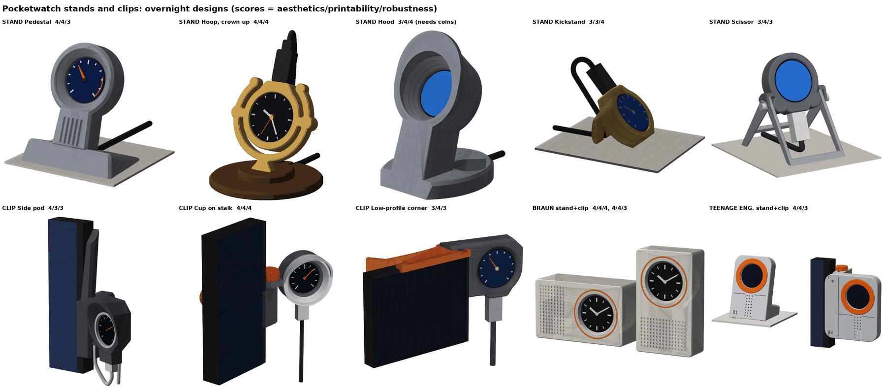

# Stand and clip concepts

**Concept art: none of these has been printed.** Nine designs generated
overnight on 2026-10-13, each with its own script, STLs, renders and README.
Every one holds the USB-only pocketwatch case and passes its script's
checks; that is all anyone knows about them. Print a small part first.

The hoop in the picture was later printed and became the
[hoop stand](hoop-stand.md) and the [telegraph key](telegraph-key.md).

| design | what | script and constants |
|---|---|---|
| Pedestal | the watch as a puck on its crown stem, on a low plinth | [`build_pedestal.py`](../../pocketwatch/stands/pedestal/build_pedestal.py): `THETA`, `SHAPES`, `FINAL` |
| Hood | the case under a hood on one pillar | [`build_hood.py`](../../pocketwatch/stands/hood/build_hood.py): `Hood` |
| Kickstand | a slim case with a hinged leg that folds flat | [`build_kickstand.py`](../../pocketwatch/stands/kickstand/build_kickstand.py): `Kick` |
| Scissor | crossing legs that fold flat behind the case | [`build_scissor.py`](../../pocketwatch/stands/scissor/build_scissor.py): `LEAN`, `A_FRONT`, `B_REAR`, `ARM_T` |
| Side pod | a gauge pod on a pillar, clamped to a monitor's side | [`build_sidepod.py`](../../pocketwatch/clips/sidepod/build_sidepod.py): `CANT`, `HOOD_D0`, `LIP` |
| Stalk | a gauge cup on a stalk, left or right monitor edge | [`build_stalk.py`](../../pocketwatch/clips/stalk/build_stalk.py): `R_C`, `CUP_WALL`, `DEPTH` |
| Low-profile | a thin housing on a flexure clip, three edge sizes | [`build_lowprofile.py`](../../pocketwatch/clips/lowprofile/build_lowprofile.py): `Mount`, `SIZES` |
| Braun style | grey body, orange ring; stand or clip | [`build_braun.py`](../../pocketwatch/styles/braun/build_braun.py): `FACE`, `DEPTH`, `WELL_CLR` |
| TE style | slab body, orange accents; stand or clip | [`build_te.py`](../../pocketwatch/styles/te/build_te.py): `HW`, `FIT`, `COVER_T` |

STLs are in the matching folder under `stl/pocketwatch/` (`stands/`,
`clips/`, `styles/`); [stl/README.md](../../stl/README.md#4-concepts-never-printed)
lists every file. Each design's measured schematics are on the board, in the
right-hand column (frames `f-<name>`), cut from the CAD by
`pocketwatch/board/<name>.py`.
