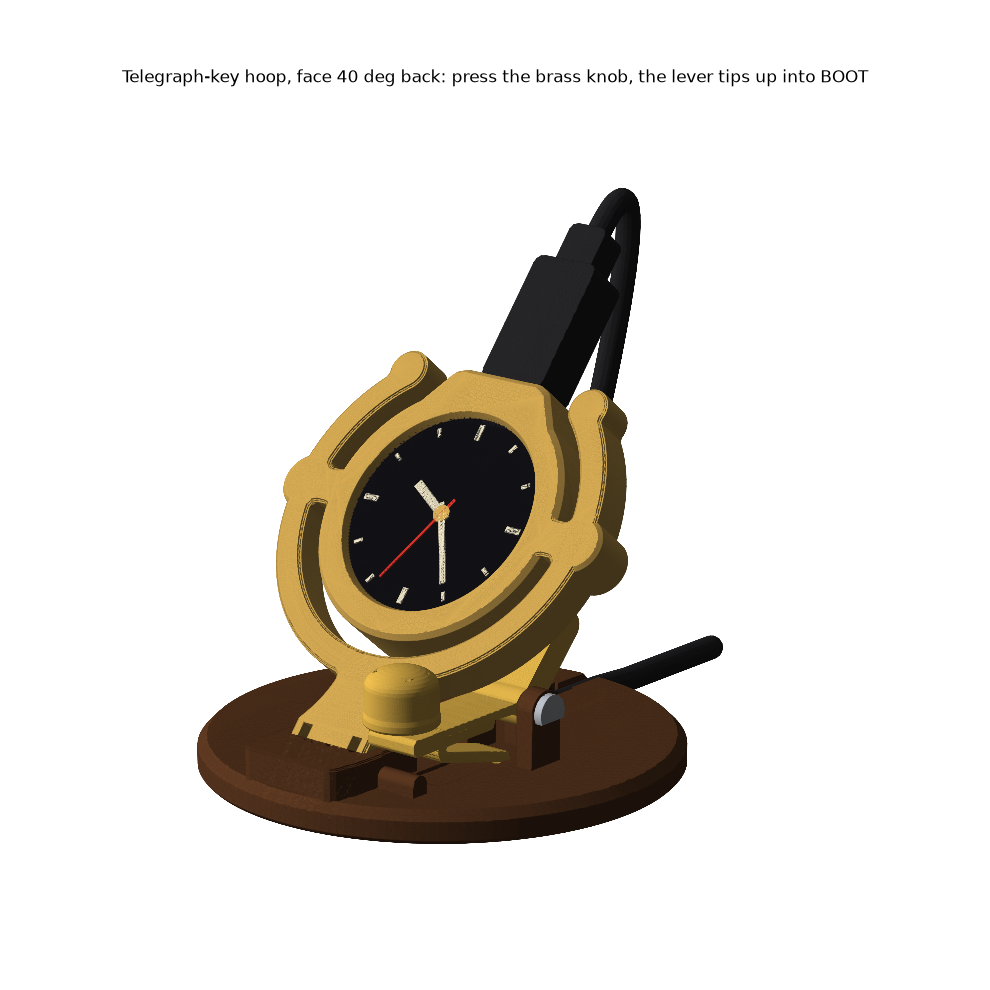
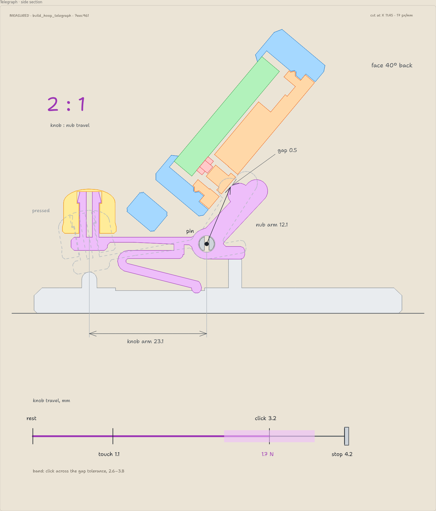
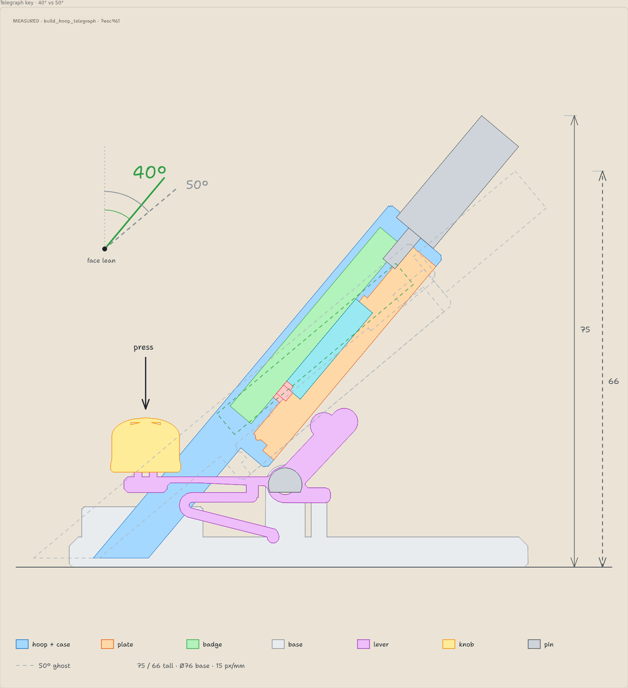
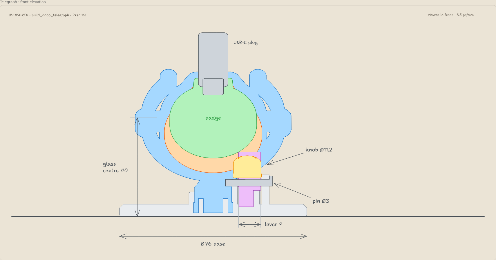
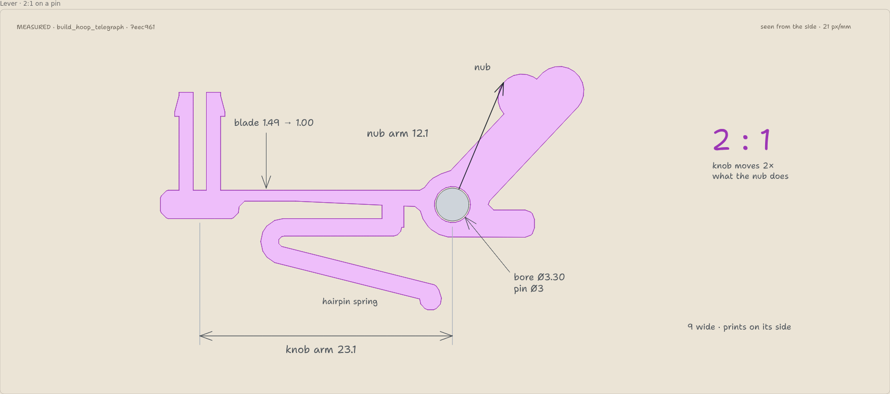
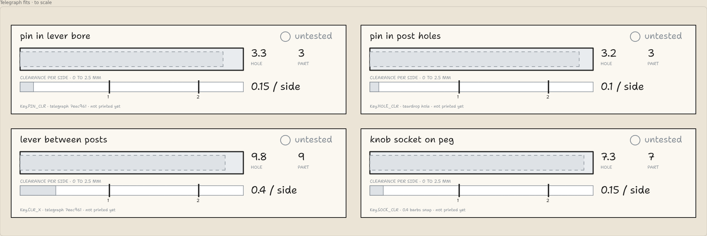

# Telegraph key stand

**The pocketwatch case leans back 40° in a brass-look hoop. Press the brass
knob in front: a lever on a pin tips its short rear arm into the BOOT tab on
the back plate.** Featured design #2.



## How it clicks



- **2:1 lever.** Knob arm 23.1 mm, nub arm 12.1 mm, on a Ø3 pin. The knob
  moves twice as far as the nub.
- **Click at 3.2 mm** of knob travel, at about 1.75 N. Across the gap
  tolerance (0.2 to 0.8 mm between nub and tab) it is 2.6 to 3.8 mm.
- **Hard stop at 4.2 mm.** The lever lands on an anvil in the base, so a hard
  press goes into the base, never into the switch. At the stop the tab sees
  at most 7.6 N, under the 8 N limit.
- A hairpin spring, printed as part of the lever, lifts the knob back up.

[Open the side section on the board](https://draw.hypnodroid.com/b/pocketwatch-schematics?frame=tg-side).

## 40° or 50°



| lean | glass centre | height | plug |
|---|---|---|---|
| **40° (default)** | 40 mm up | 75 mm | inside the Ø76 base |
| 50° | 37 mm up | 66 mm | 12 mm past the rim |

55° does not fit a Ø76 base.
[Open on the board](https://draw.hypnodroid.com/b/pocketwatch-schematics?frame=tg-overview).





All four frames are cut from the same solids the build checks, by
[`board_schematics_telegraph.py`](../../pocketwatch/stands/hoop/board_schematics_telegraph.py).
More renders: [angles](../../pocketwatch/stands/hoop/renders/telegraph-angles.png),
[exploded](../../pocketwatch/stands/hoop/renders/telegraph-exploded.png),
[pressed section](../../pocketwatch/stands/hoop/renders/telegraph-section-pressed.png),
[print layout](../../pocketwatch/stands/hoop/renders/telegraph-print-layout.png).

## Print status

| file (`stl/pocketwatch/stands/hoop/`) | status |
|---|---|
| `Hoop stand telegraph - hoop and case (40 deg).stl` | **printed** |
| `Hoop stand telegraph - base (40 deg).stl` | **printed**; print it at 100% infill, it is the ballast |
| `Hoop stand telegraph - lever (40 deg).stl` | **printed**; prints on its side |
| `Hoop stand telegraph - knob.stl` | **printed** |
| `Hoop stand telegraph - pin.stl` | **printed** |
| the three `(50 deg)` files | unprinted |
| `Hoop stand - back plate (button).stl` | needs work, fix applied; **the telegraph needs this plate** |

**Evidence:** the owner, 2026-11-22, verbatim: "The pocketwatch and telegraph
are at least somewhat verified." PRINT-LOG 2026-11-22 records it. Which lean
was printed, the click travel and any fit problems are **not recorded**; the
catalog assumes 40°. Treat the fits below as untested.

Assembly, in order: lever between the posts, pin in from the right until it
clicks, knob onto the peg, badge and plate into the hoop, hoop down onto its
neck until it clicks. Lift the hoop out before taking the plate off.

## Change it

The script is
[`pocketwatch/stands/hoop/build_hoop_telegraph.py`](../../pocketwatch/stands/hoop/build_hoop_telegraph.py)
(both leans, every check). Its numbers are in class `Key`; the hoop and the
mortise come from `Stand` in `build_hoop.py`.

| what | constant |
|---|---|
| lean | `Key.TILT` (40.0) |
| lever ratio | `Key.RATIO` (2.0) |
| pin | `Key.PIN_D` (3.0) |
| switch force, a guess | `Key.F_SW` (2.0 N) |

```
./tools/py pocketwatch/stands/hoop/build_hoop_telegraph.py --no-render
```

There is no lever-length constant: the script solves the lever from the hoop.
[AGENTS.md](../../AGENTS.md#worked-example-make-the-telegraph-lever-2-mm-longer)
has a worked example that makes it 2 mm longer. The script writes its STLs on
every run, even with `--no-render`.

## Still open: four fits, all untested



| fit | constant (per side) |
|---|---|
| pin in the lever's bore | `Key.PIN_CLR` 0.15 |
| pin in the post holes | `Key.HOLE_CLR` 0.10 |
| lever between the posts | `Key.CLR_X` 0.4 |
| knob socket on its peg | `Key.SOCK_CLR` 0.15 |
| hoop tenon in the base mortise | `Stand.FIT` 0.08 (0.25 and 0.12 printed loose) |

The BOOT position on the badge is still a guess; see
[docs/MEASUREMENTS.md](../MEASUREMENTS.md).
[Open the fits on the board](https://draw.hypnodroid.com/b/pocketwatch-schematics?frame=tg-fits).
Full design notes and the strain numbers:
[pocketwatch/stands/hoop/README.md](../../pocketwatch/stands/hoop/README.md#telegraph-key-the-badge-leans-back-40-boot-is-a-brass-key-2026-10-14).
