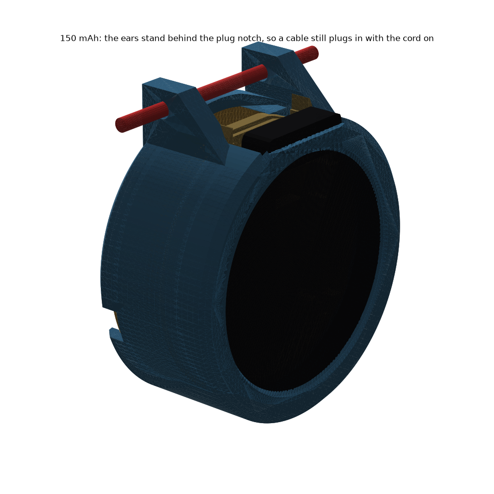
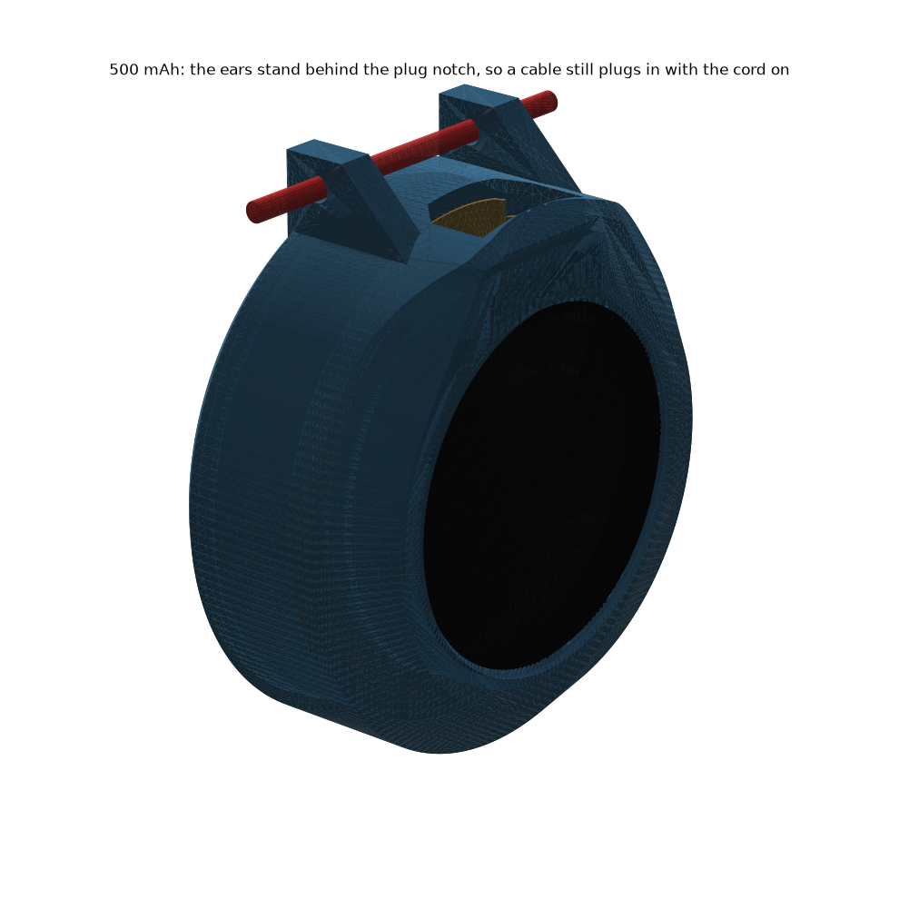
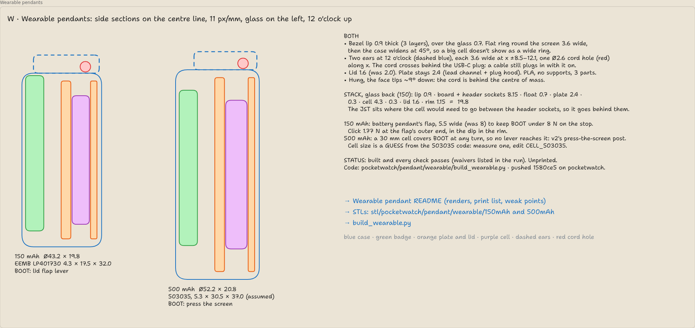

# Wearable pendants

**Concept, never printed.** Thin-bezel pendants with two cord ears at
12 o'clock, for a 150 mAh or a 500 mAh cell. A cable still plugs in with the
cord on.

| | 150 mAh | 500 mAh |
|---|---|---|
| size | Ø43.2 × 19.8 | Ø52.2 × 20.8 |
| cell | EEMB LP401730, 4.3 × 17.5 × 32.0 (EEMB's drawing) | 503035, 5.3 × 30.5 × 37.0 (**assumed** from the code) |
| BOOT | a flap in the lid | press the screen |
| files | `stl/pocketwatch/pendant/wearable/150mAh/` (5) | `stl/pocketwatch/pendant/wearable/500mAh/` (3) |

Both: bezel lip 0.9 thick over 0.7 of the glass, a 3.6 flat ring round the
screen, lid 1.6. [Open on the board](https://draw.hypnodroid.com/b/pocketwatch-schematics?frame=fW).

**Before printing the 500 mAh one, measure the cell** and edit `CELL_503035`.

**Change it:**
[`pocketwatch/pendant/wearable/build_wearable.py`](../../pocketwatch/pendant/wearable/build_wearable.py),
`Cell` (the two cells are `EEMB_401730` and `CELL_503035`), `Slim`, `Bail`.

More: [pocketwatch/pendant/wearable/README.md](../../pocketwatch/pendant/wearable/README.md).
Battery sizes: [docs/MEASUREMENTS.md](../MEASUREMENTS.md).
