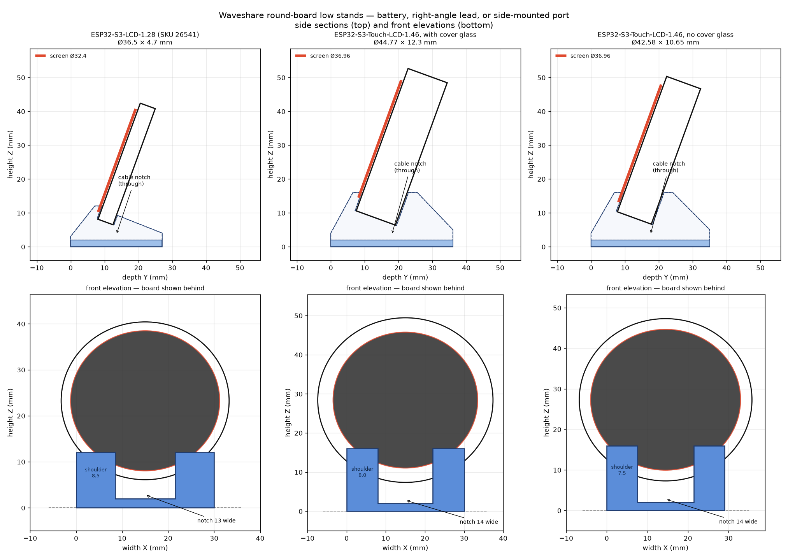
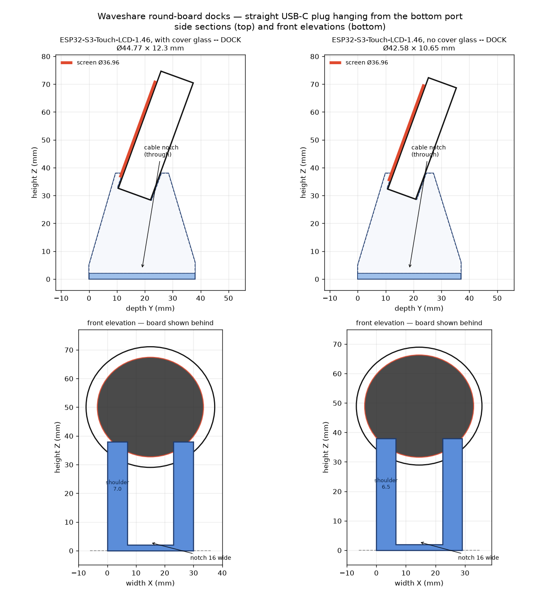

# Wedge desk stands (retired)

**Retired.** The first designs, September 2026: the bare badge leans 20°
back in the groove of a tapered wedge, with a cable notch through the
middle. Two were print-proven. The owner, 2026-11-22: "The wedge didn't
protect the device enough." Work moved to the pocketwatch case.

| file | board | status |
|---|---|---|
| `stl/small/Stand - BOOT button.stl` | 1.28 | **proven** (PRINT-LOG 2026-09-20: "works well enough") |
| `stl/large/Stand - cover glass.stl` | 1.46, cover glass | **proven** (PRINT-LOG 2026-09-18) |
| `stl/small/Stand.stl`, `- RESET button.stl` | 1.28 | unprinted |
| `stl/large/Stand - no cover glass.stl` and both `Dock for straight cable` files | 1.46 | unprinted |

**Why a groove holds a round board:** the disc touches the groove on two
lines and cannot rock. No supports, no snap features, and the board turns to
put its connectors where you want them. The solid is three slabs side by
side (wedge, floor, wedge); the middle one is the notch.

**Change it:** [`build_stands.py`](../../build_stands.py) (one parameter
table, `BOARDS`) and [`build_stand_button.py`](../../build_stand_button.py)
(`SWITCH`, `REST_CLR`). The groove was sized with the slot fit gauge.

Which file for which cable, plate orientation and header clearances:
[PRINTING.md](../../PRINTING.md). Board outlines: [BOARDS.md](../../BOARDS.md).
