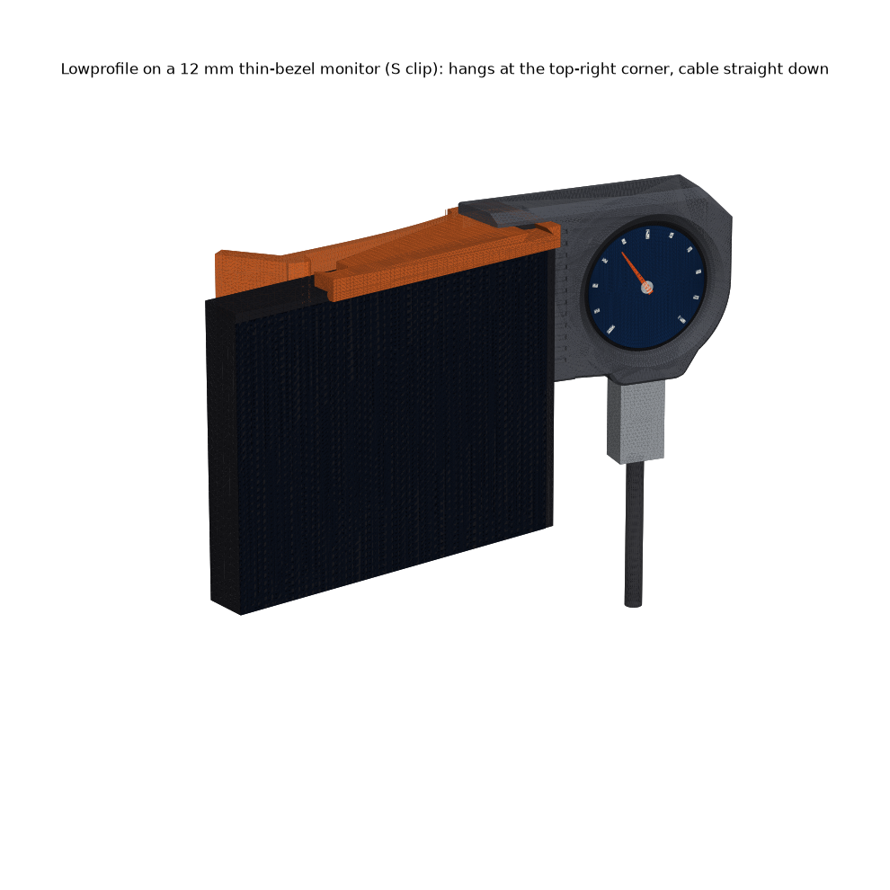
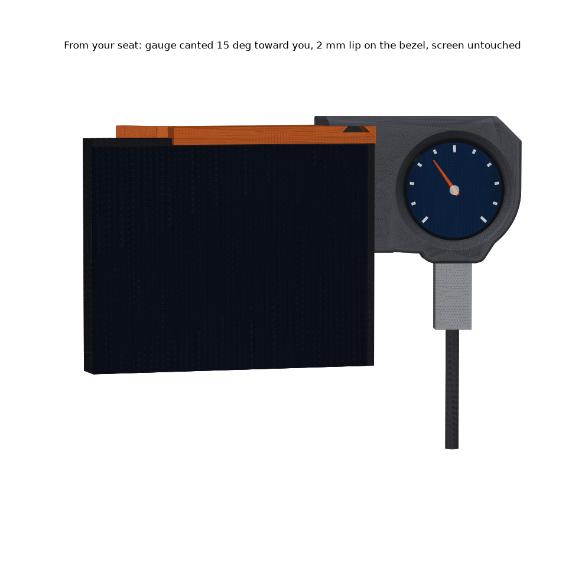
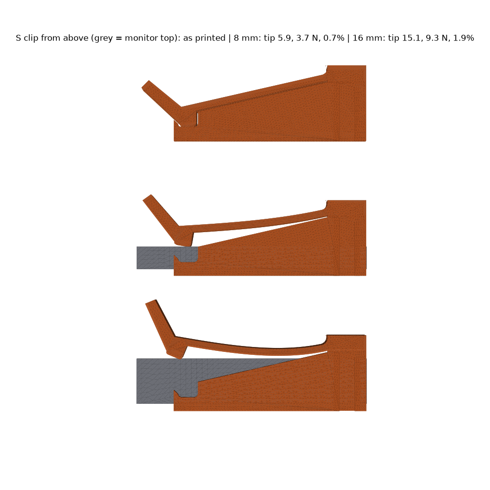

# Lowprofile: corner clip gauge pod

**The USB-only case, fused into a small hooded pod that hangs at the monitor's top-right corner on a tool-free spring clip. Three printed parts, no screws, no supports.** The deck sits on the monitor top and the ribbed spine bears on the side face, so the weight and the cable are carried by the corner itself. The clip only has to stop it sliding sideways. The face is canted 15° toward you, and the cable drops straight down beside the monitor.

| print | file (`stl/pocketwatch/clips/lowprofile/`) | orientation |
|---|---|---|
| **housing** | `Lowprofile - housing.stl` | face down, as exported |
| **back plate** | `Lowprofile - back plate (BOOT hole).stl` | flat back down (same part as the USB-only BOOT-hole plate) |
| **clip, one per edge band** | `Lowprofile - clip S (8-16 mm edge).stl`, `M (16-24)`, `L (24-32)` | top face down, as exported. The leaf bends in the bed plane, along its perimeters. |

**Assembly:** (1) Badge into the housing from the back, screen first, tab into the crown at 6 o'clock; snap the plate in flush. **Rotate the display 180° in firmware.** (2) Measure the monitor's top edge front to back and pick S, M or L. Slide the clip onto the corner from the side, horn first: the 45° horn ramps the leaf open. Or pull the horn back with a finger and drop the clip on. (3) Slide the housing onto the clip from the front, so the dovetail runs back until it stops. (4) Plug the cable into the crown. **BOOT:** reach around behind the monitor and press a 2 mm pin straight into the plate's hole. **Left-hand corner:** mirror the housing and the clip in the slicer. The bore is mirror-symmetric (checked). The plate is not mirrored.

**Pads (optional, recommended):** 0.5 mm felt or TPU tape on the lip's inner face, the nub's face and the spine's bearing band (the front 6 mm of its side face). Two pads shift each band down by about 1 mm.

## Numbers (all asserted in `build_lowprofile.py`, 101 checks)

| | |
|---|---|
| flexure | 2.4 thick (bends) × 16 tall, 54 long, PETG E 1.8 GPa, k 0.63 N/mm |
| each band, thin → thick edge | tip 5.9 → 15.1 mm, clamp **3.7 → 9.3 N**, strain 0.73 → **1.86 %** (1.71 % even 0.5 mm past the band) |
| load | housing + plate 25 g (solid), badge 20 g, 1 N cable → 38.7 N·mm about the corner → 1.0 N spine side force |
| holding | friction 2 × μ 0.3 × 3.7 N vs 1.0 N: **SF 2.2** with felt, 4.3 with TPU (μ 0.6). Vertical load sits on the deck: a seat, not friction |
| clears | screen (lip reaches 2.0 down a ≥ 2.5 bezel; nothing below or in front), plug shell, body and cable, the BOOT pin, plate removal. Every band at thin, mid and thick edge |
| dovetail | lift, push sideways or push back: blocked. Slide forward: comes off. Leaf stays ≥ 1.2 mm off the monitor back |
| size | housing 67 × 48 × 15, clip 80 × 27-43 × 16; the pod stands 6.6 mm above the monitor top, 6 mm proud of the screen |

  More in `renders/`: 20 mm quarter view, dovetail and plan sections, BOOT from behind, print layout.

## Weaknesses (honest)
- **You choose a clip size.** No single flexure covers 8-32 mm under 2 % strain. Each print covers 8 mm.
- **PETG creeps.** The leaf sits at 0.7-1.9 % strain for months, so expect clamp loss. With felt the SF is only 2.2 when new; use TPU tape if it ever walks. E is ±25 %.
- **Needs a real corner.** It wants a flat side face about 38 mm deep and a back the nub can reach 12 mm down. A back that tapers right at the top edge, or a corner radius over ~8 mm, will seat badly.
- **Nothing latches the dovetail forward.** The cable pulls it back into the stop, but a knock from behind can slide the pod off its clip.
- The lip assumes at least 2.5 mm of top bezel. On zero-bezel glass it sits on the glass edge.
- Not printed. BOOT position is still the ±1 mm guess from the USB-only plate.

**Scores:** aesthetics **3**, printability **4**, robustness **3**. Rebuild: `~/.venvs/cad/bin/python pocketwatch/clips/lowprofile/build_lowprofile.py [--no-render]` from the repo root.
