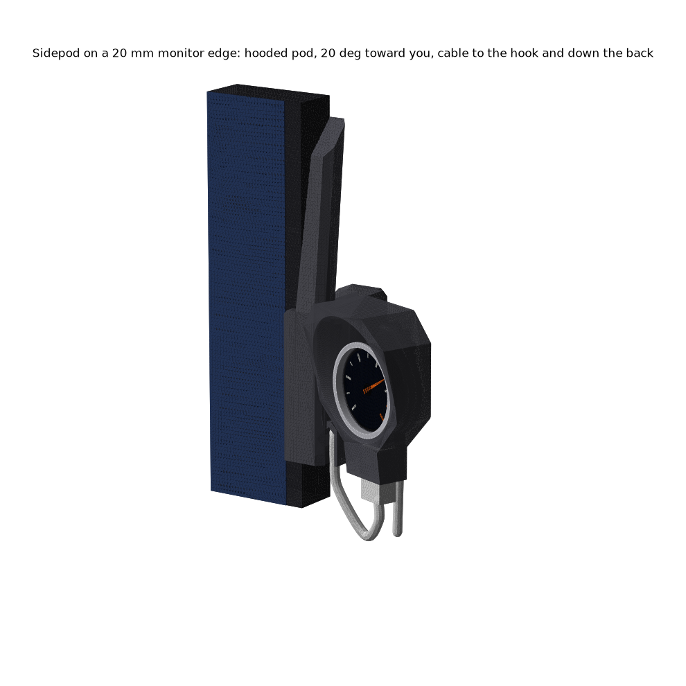
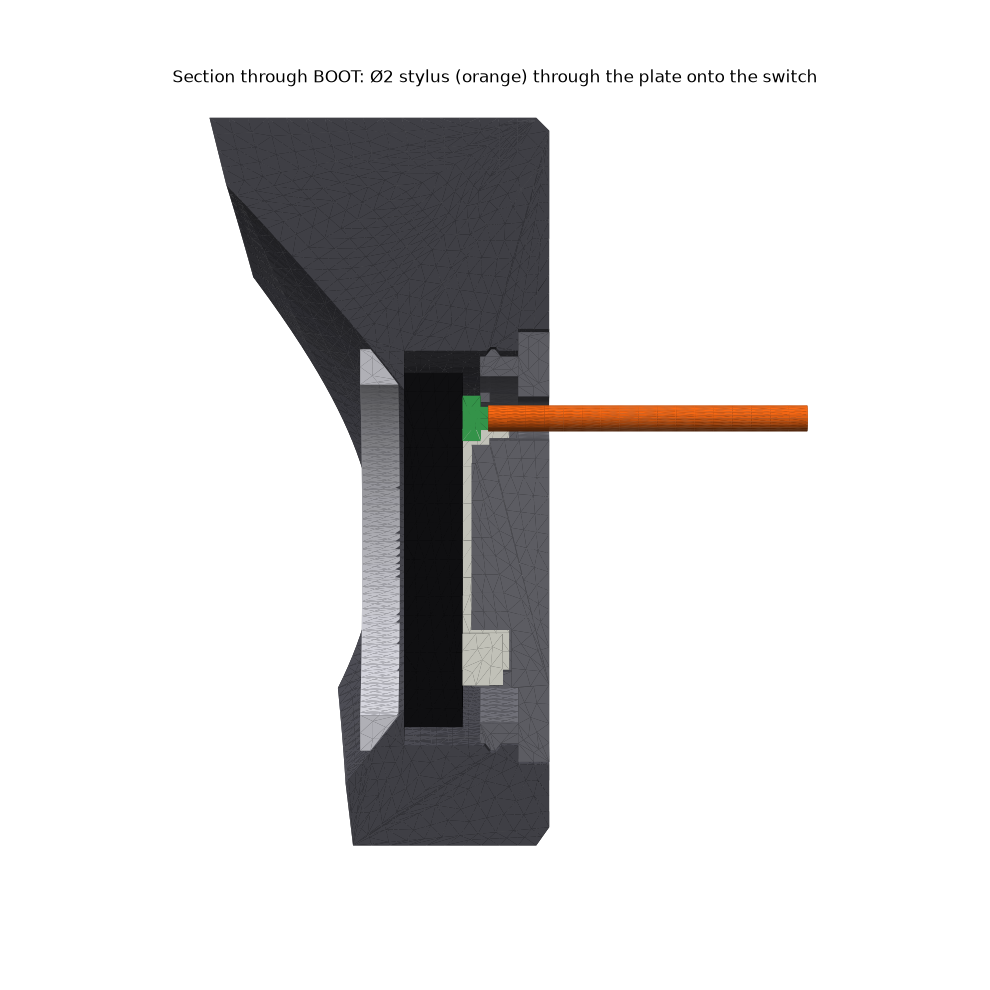

# Sidepod: A-pillar gauge pod for the USB-only pocketwatch

**One hooded single-gauge pod on a leaning pillar that clamps the RIGHT edge of a monitor (8-32 mm), turned 20° toward you.** 90s aftermarket look: matte, faceted octagon, one 45° cone bezel, a peaked brow, louvres in the clamp. The USB-only case is fused into the pod. Crown (USB-C) points down, so rotate the display 180° in firmware. Down is where the plug drops straight into the neck, and the bore's teardrop roof ends up on the side without the tab.

| print | file (`stl/pocketwatch/clips/sidepod/`) | orientation | supports |
|---|---|---|---|
| **pillar and pod** | `Sidepod - pillar and pod.stl` | **standing up, as exported** (the way it hangs); add a brim | none |
| **back plate** | `Sidepod - back plate (BOOT hole).stl` | face down, as exported | none |
| **knob**, **pad** | `Sidepod - knob.stl`, `Sidepod - pad.stl` | flat, as exported | none |
| trim ring (optional) | `Sidepod - trim ring (optional).stl` | front down; print it in silver | none |

**Hardware:** M4 × 45 **fully threaded** hex bolt (DIN 933), one M4 nut. **Cheap fit test first:** cut the body at z 70 in the slicer and print only the pod and clamp.

**Assembly:** 1) Press the bolt head into the knob. Slide the nut into the slot on the inner face of the rear arm. Thread the bolt in from behind and press the pad onto its tip. 2) Badge in from the back, screen first, tab down into the neck. Plate in after it: the teardrop goes up, it only fits one way. It snaps flush, and the pry notch is on the outer edge. 3) Optional: glue the ring onto the cone, where it sits 0.4 mm clear of the glass. 4) Hook the lip over the bezel, push the pillar against the monitor side and turn the knob hand-tight. 5) Push the plug up into the neck. Loop the cable up into the J-hook at the foot of the pillar, then let it hang down behind.

| number | value |
|---|---|
| body | 75 × 75 × 136 mm, 70 cm³ solid; 129 g with badge and hardware if solid |
| pod | glass 6 mm in front of the screen, centre 36 mm out from the side face; hood 14.5 mm deep at the brow, 4 mm at the chin |
| case | the printed USB-only case, unchanged: bore Ø37.6, 3.0 mm crown wall, plug shell 3.7 of 6.65 mm in the port |
| BOOT | Ø2 stylus through a Ø3.4 hole, 4.7 mm deep; checked clear for 60 mm behind the plate |
| grip | at an assumed 20 N clamp (0.016 N·m, barely snug), μ 0.3, 1 N pull in each of 6 directions: **SF 3.3 with the cable in the hook**, 1.5 yanked at the plug, 7 with weight alone |
| strength | 100 N hard clamp: lip 1.8 MPa, arm 0.4, spine 3.2. Every jaw bends along the layers |

**Weaknesses (honest)**
- **The case prints on its side here.** The printed USB-only case printed face down. Here the bore gets a 45° teardrop roof with an 8 mm bridge, and the window bevel is 45° (it was 26.6°). The snap groove is missing over the top 90°, so the plate snaps on 270°. Fit is not proven: do the cut-at-z-70 test first.
- **Yaw is the weak axis on thin monitors.** It relies on friction across the edge thickness. Use the hook, and tighten more than snug: hand-tight is about 100 N, against the 20 N the numbers assume.
- The 74 mm fin above the clamp is decorative and stands free while printing. Lower `H` if it wobbles.
- **Right edge only.** Mirroring the STL would mirror the case. A left-edge version needs the clamp mirrored in code, not the pod.
- The rear arm needs the monitor to be no thicker than 37 mm within 11 mm of its edge. The 6 mm lip covers image on bezel-less panels, as on the pod clip. PETG creeps, so re-snug the knob now and then.

**Scores:** aesthetics **4**/5 · printability **3**/5 · robustness **3**/5. Rebuild: `~/.venvs/cad/bin/python pocketwatch/clips/sidepod/build_sidepod.py` (`--no-render` for checks only).
