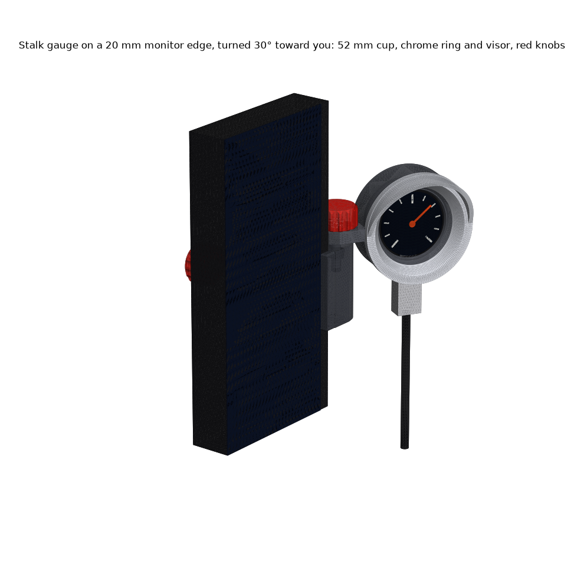

# Stalk gauge: 52 mm gauge cup on a monitor clip
**The USB-only pocketwatch fused into a Ø52.4 aftermarket gauge cup (the 2-1/16" size), on a chunky stalk clamped to the monitor's side bezel. Chrome trim ring and sun visor, red ribbed knobs. Turn it toward you in 15° clicks.**

| print | file (`stl/pocketwatch/clips/stalk/`) | orientation as exported | supports |
|---|---|---|---|
| **cup** | `Stalk gauge - cup (right edge of monitor).stl` (or `left edge`) | face down, ear standing | none |
| **back plate** | `Stalk gauge - back plate (BOOT hole).stl` | flat back down | none |
| **trim ring + visor** | `Stalk gauge - trim ring and visor.stl` (silver PETG if you have it) | visor up | none |
| **clip** | `Stalk gauge - clip (right edge of monitor).stl` (or `left edge`) | standing, toothed top up | none |
| **pad**, **knob ×2** | `Stalk gauge - clamp pad.stl`, `Stalk gauge - knob (print 2).stl` | flat | none |

**Hardware:** M4×20 and M4×40 hex-head bolts (DIN 933), 2 M4 nuts. **Assembly.** 1) Badge into the cup from the back, screen first, USB tab into the slot in the crown. Snap the plate in. 2) Ring onto the front, visor up. Its notch keys on the ear. Add a dot of CA if it is loose. 3) Press the bolt heads into the knobs. 4) Drop an M4 nut into the slot at the top of the clip's rear leg and one into the side slot in the pillar. 5) Thread the M4×40 thumbscrew through the rear leg and put the pad on its tip. 6) Lay the cup's ear on the pillar teeth, bolt down through it with the M4×20 knob. 7) Hook the lip over the front of the bezel, push the spine against the monitor's side, and finger-tighten the back knob. 8) Rotate the display 180° in firmware (USB is at the bottom).

**Aim:** loosen the top knob 2 turns, turn the cup, tighten. It holds at **-15° to +60°** (+ turns it toward you). **BOOT:** push a Ø2 pin into the hole in the back plate. The back stays clear at every aim (`renders/05-back-boot.png`).

## Why a toothed face, not a ball or a friction hinge
A printed ball joint's grip depends on the print. Here gravity acts **across** the vertical axis, so on a level monitor the weight puts zero torque on the joint. 24 meshed 45° teeth hold the aim mechanically, and the bolt only has to keep them meshed. Pitch is not adjustable: on the bezel the gauge already follows the monitor's tilt.

## Numbers (all asserted by `build_stalk.py`; 94 checks, exits non-zero on failure)
| | |
|---|---|
| grip | **8-32 mm** edge, 6 mm lip, M4×40 thumbscrew, pad on the back |
| hanging mass | 65 g (counted as solid PETG); clip 41 g |
| preload | 187 N from 0.15 N·m finger-tight, **counted as 56 N** for creep |
| slide / twist | SF **16.5** / **2.8** (friction only) to **7.8** (spine against the monitor) |
| joint, 1 N sideways + 20° monitor tilt | teeth SF **11**; if the teeth print mushy, SF **1.8** on friction alone |
| teeth stay meshed under weight + 1 N down | SF **5.8** |
| pillar (only section across layers) | 0.25 MPa, SF 40 |
| plug | 3.0 mm wall in front of the port (unchanged), 3.7 of 6.65 mm shell engaged; body and cable clear at every aim |
| screen | nothing inboard of the 6 mm lip; ≥ 1 mm from everything at every aim, both edge sizes, both sides |

## Weaknesses
- **Teeth on a 0.6 nozzle:** only 0.8 mm tall, about 3 layers. They may print soft. Friction alone still holds (SF 1.8).
- **The pad only sits on the screw tip.** It falls off when the clip is off the monitor. A blob of Blu Tack keeps it on.
- **The lip covers 6 mm of bezel.** On a thinner bezel it covers pixels, same as the pod clip.
- **The cable hangs down beside the monitor, not behind it.** Route it back yourself. The ring's slip fit (0.05 mm) and the BOOT position (±1 mm) are unprinted guesses. Nothing here has been printed yet.

**Scores:** aesthetics 4, printability 4, robustness 4. Rebuild: `~/.venvs/cad/bin/python pocketwatch/clips/stalk/build_stalk.py` from the repo root (`--no-render` for checks only).
