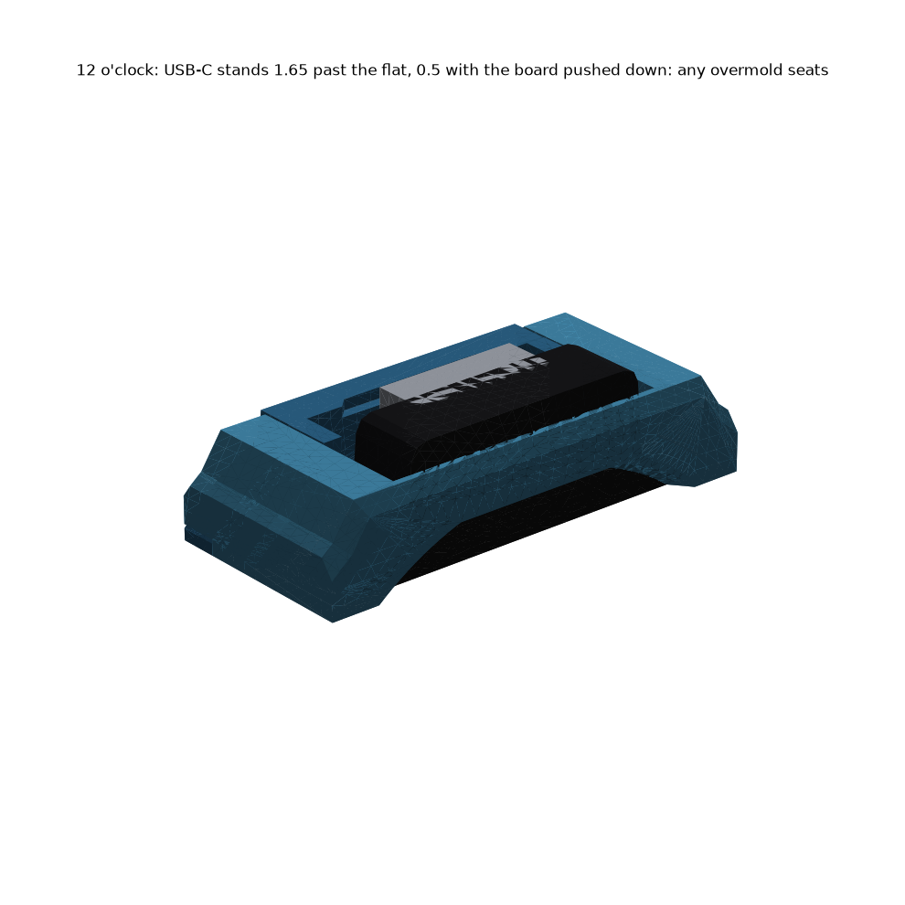
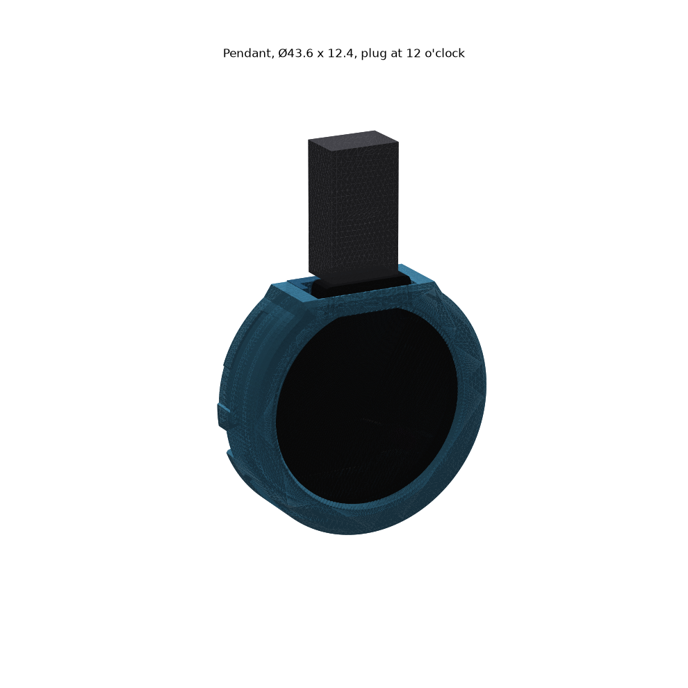
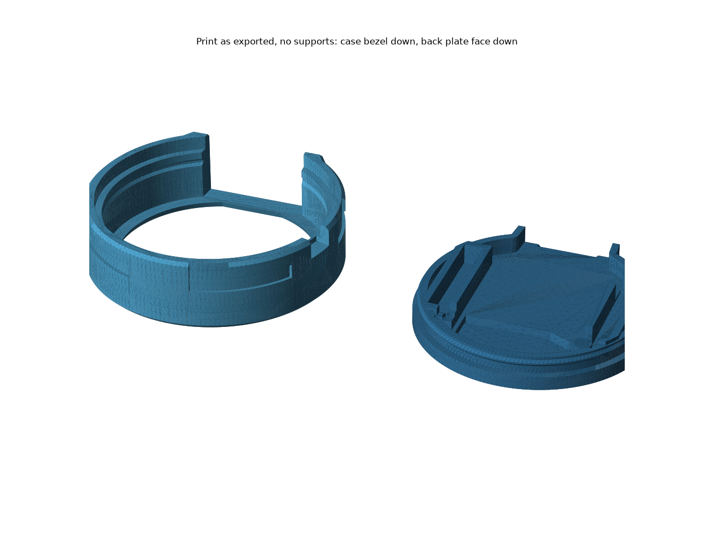

# Pendant (1.28 badge)

**Ø43.6 × 12.5 mm, cut flat at 12 o'clock so the USB-C port sticks out 1.65 mm and any cable's plug seats. USB-powered.** Designed for **PLA**. Two prints, no supports. The version with the port sticking out **printed 2026-10-15 and "pretty much worked"**. Its bar over the USB-C tab was too thin, so the screen window now has a **flat top at 12 o'clock** that widens the bar from 2.68 to **3.58**. **Reprint only the case:** the back plate is unchanged. Old case: `archive/pendant-v2 (USB-C out, round window)/`.





| print | file | orientation | mass* |
|---|---|---|---|
| **case** | `stl/pocketwatch/pendant/Pendant - case.stl` | bezel face down, as exported | 4.8 g |
| **back plate** | `stl/pocketwatch/pendant/Pendant - back plate (button).stl` | flat back down, as exported | 4.3 g |
| back plate, if the first one is too tight | `… - back plate (button, roomy).stl` | same | 4.1 g |

\*Counted as solid PLA, so a real print with infill weighs less.

The twist-lock kid button failed its first print and was deleted on 2026-11-22; its STL, renders and notes are last in commit `1580ce5`. Use the [kids case](kids-case/README.md) instead.



## What it is

- **Case:** a Ø43.6 circle, **cut flat at 12 o'clock just below the USB-C port**, so the receptacle sticks out **1.65 mm** (still **0.5 mm** with the board pushed down by a plug, since the board floats 1.15 in the bore). The plug's overmold meets the port, never the case, whatever the cable. No plug slot. A **pry notch** at about 3:30 seen from the back (8:30 seen from the screen) lets a screwdriver lever out a tight plate. Four L-shaped grooves on the outside of the wall are left from the deleted kid button.
- **Back plate:** the USB-only plate with this pendant's own **BOOT tab: 21 long, 4.4 wide at the post widening to 8, 1.2 thick**. It snaps in flush. Push the U-shaped tab on its own to click BOOT.

## Assembly

1. **Badge** into the case from the back, screen first, USB-C tab up through the opening at 12 o'clock.
2. **Back plate:** header sockets into the two guides. Press until it snaps flush.

**Child safety:** not for very young children. The board is a small part.

## Weak points (honest)

- **BOOT tab worst-case strain is 1.63%**, under the agreed 1.7%. Every normal press stays under 1%. Repeated hard mashing could whiten or crack the tab in PLA; if so, print a spare plate.
- **The case alone is a C at 12 o'clock.** Over the USB-C tab only the bezel lip (1.2 thick, 3.58 wide at its narrowest since the window's flat top, was 2.68) joins the two sides; the snapped-in back plate closes the ring at the back. Handle the bare case gently there, and the plate's snap may feel looser than on the slot version. A bridge behind the tab can't be added: it would be a 17.7 mm unsupported span or a roof a thick plug hits.
- **The window's flat top can hide the top of the picture.** None with the board centred. When the pendant hangs from its cable the board rides 1.15 up in its bore, and about 1.1 mm of the picture's top goes behind the bar. The active-display size is scaled from Waveshare's drawing, not measured.
- **Still guesses:** BOOT position (±1 mm), switch force 2 N, switch height.

## Numbers

| | value |
|---|---|
| case outline | circle **Ø43.61**, flat at y **19.34** = port mouth (20.99) − board float 1.15 − `PORT_OUT` 0.5. Case and back plate both stop there. The whole 6.65 mm plug shell seats |
| case thickness | 12.45 (lip 1.2, plate 2.4 flush) |
| walls | 1.8 case wall; ≥1.2 behind the lock channels, 1.97 behind the grooves; 1.8 beside the tab |
| BOOT tab | 21 long, 4.4 → 8 wide, 1.2 thick, post Ø3 |
| lock grooves (left from the kid button) | channels at 10°, 150°, 215°, 290° (from +x seen from the back) |

Material constants live in one place: `Material` at the top of `build_pendant.py` (PLA: E 2500 ± 25%, 1.0% for flexing parts, 1.5% for one-off flexing, 10 MPa across the layers).

## Battery variant (next)

```
~/.venvs/cad/bin/python pocketwatch/pendant/build_pendant.py --battery 5.0,20,30
```

The numbers are **thickness, width (across), length (along the USB axis)** in mm. Only `Stack.z_back` moves: the case grows `T + 0.6` behind the plate and gets a `W × L` pocket. Nothing is exported in this mode. It currently **fails on purpose**: the script still checks the deleted kid button's nub and wings, and they would pass through the battery. The separate battery pendant is in [battery/](battery/README.md).

## Rebuild

`~/.venvs/cad/bin/python pocketwatch/pendant/build_pendant.py` from the repo root (119 checks, about 30 s). Add `--no-render` for a fast check run.
