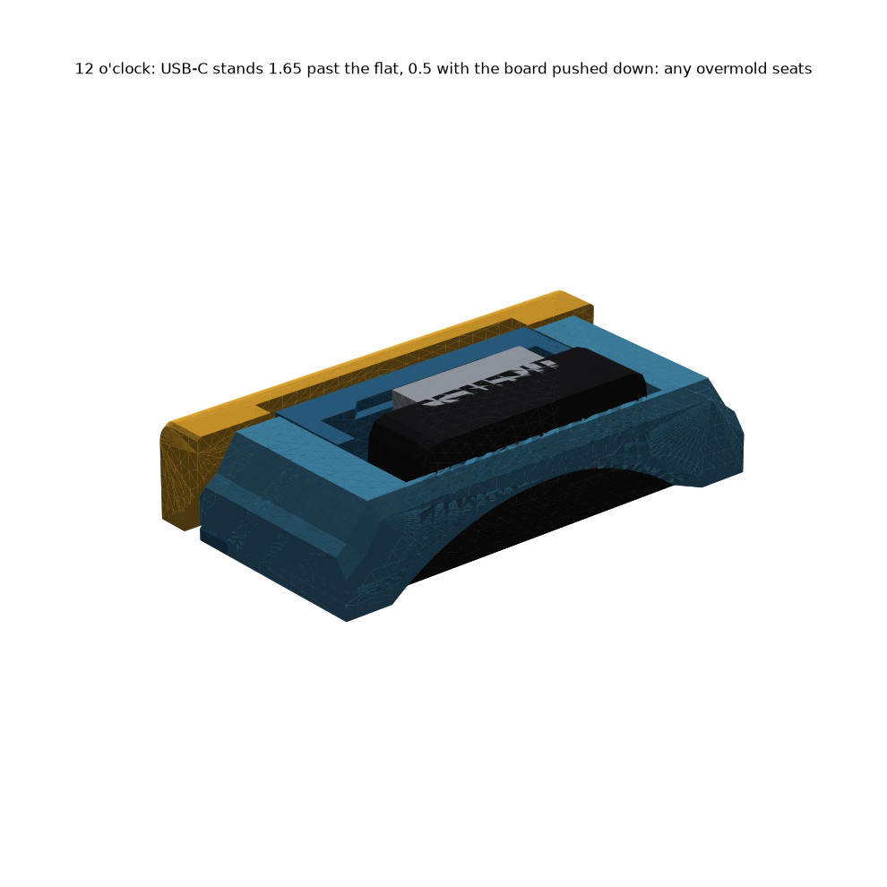
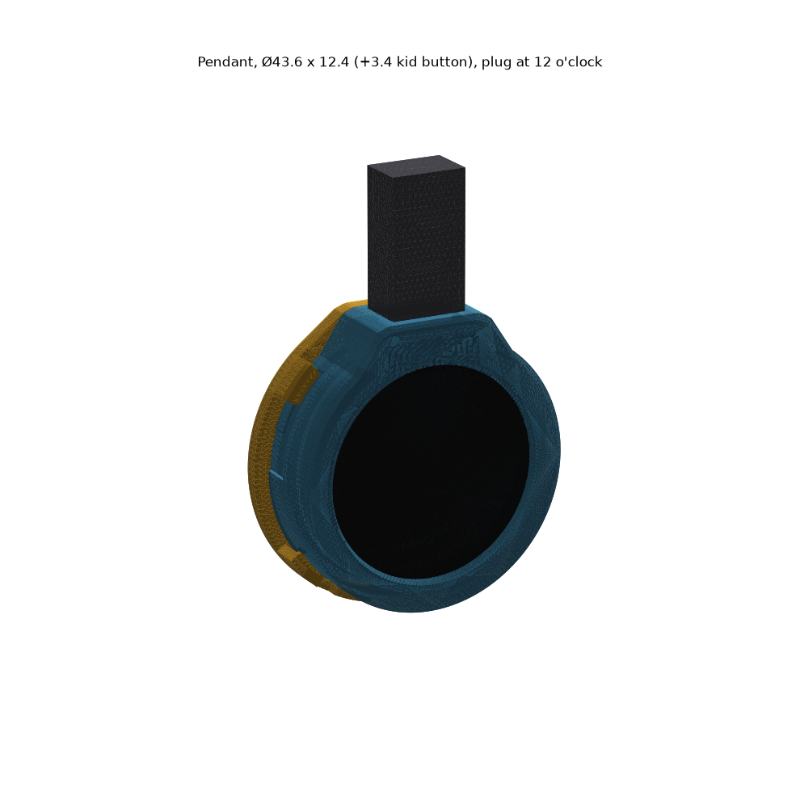
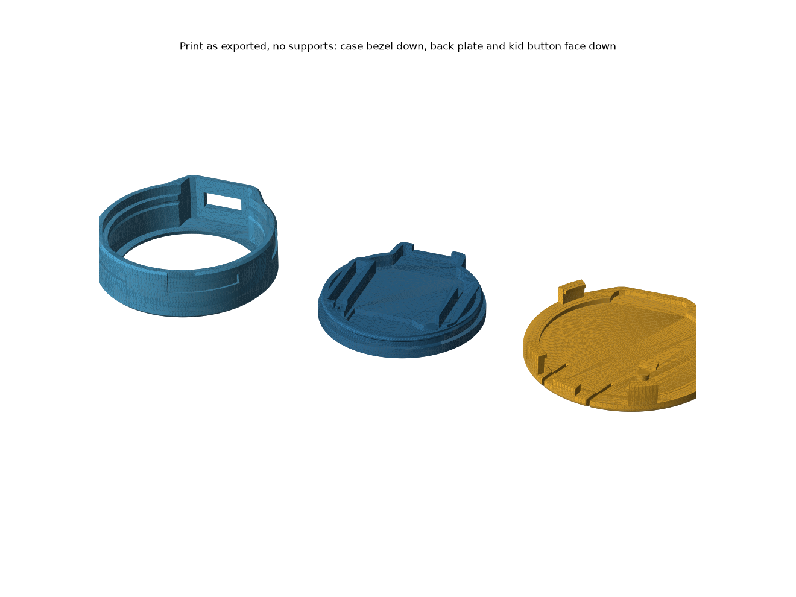
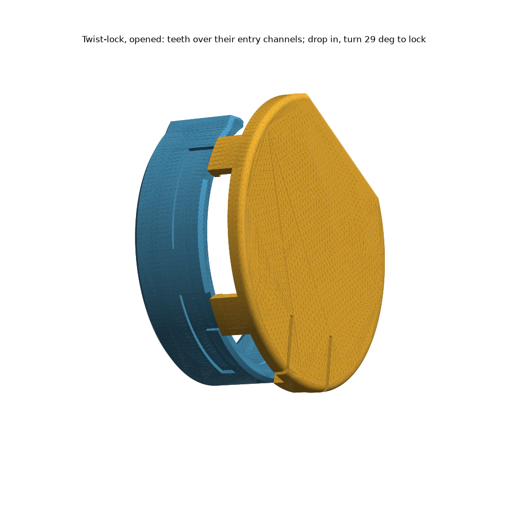
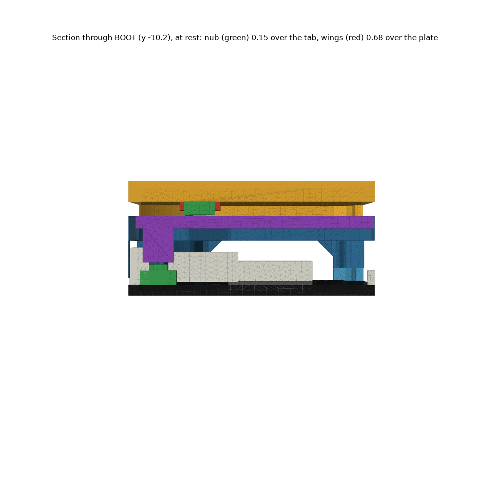
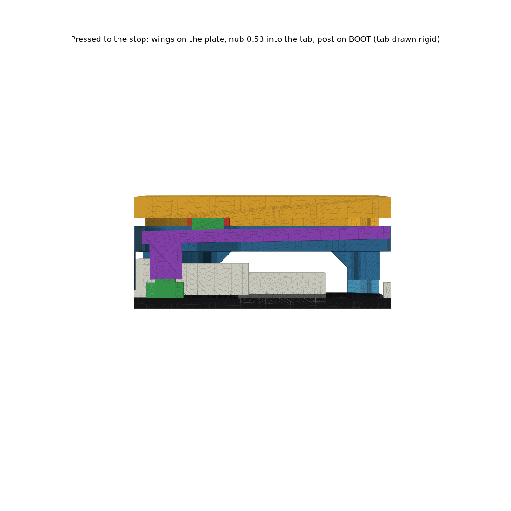

# Pendant (1.28 badge)

**Ø43.6 × 12.5 mm, cut flat at 12 o'clock so the USB-C port sticks out 1.65 mm and any cable's plug seats. USB-powered. 15.9 mm thick with the optional kid button (Ø47.4 across its lock teeth).** Designed for **PLA**. Three prints, no supports. This version is not printed yet; the 14.0 × 8.3 slot version before it was printing 2026-10-14 (`archive/pendant-v1 (14.0 x 8.3 USB-C slot)/`). **Reprint the case and the back plate together:** an old plate reaches past the new flat.





| print | file | orientation | mass* |
|---|---|---|---|
| **case** | `stl/pocketwatch/pendant/Pendant - case.stl` | bezel face down, as exported | 4.8 g |
| **back plate** | `stl/pocketwatch/pendant/Pendant - back plate (button).stl` | flat back down, as exported | 4.3 g |
| back plate, if the first one is too tight | `… - back plate (button, roomy).stl` | same | 4.1 g |
| **kid button** (optional) | `stl/pocketwatch/pendant/Pendant - kid button.stl` | flat face down, teeth up, as exported | 4.8 g |

\*Counted as solid PLA, so a real print with infill weighs less.



## What it is

- **Case:** a Ø43.6 circle, **cut flat at 12 o'clock just below the USB-C port**, so the receptacle sticks out **1.65 mm** (still **0.5 mm** with the board pushed down by a plug, since the board floats 1.15 in the bore). The plug's overmold meets the port, never the case, whatever the cable. No plug slot. Added for the kid button: four L-shaped lock grooves on the outside of the wall.
- **Back plate:** the USB-only plate with this pendant's own **BOOT tab: 21 long, 4.4 wide at the post widening to 8, 1.2 thick**. It snaps in flush. Push the U-shaped tab on its own to click BOOT.
- **Kid button:** a disc over the whole back. Press it anywhere in the lower two-thirds and BOOT clicks. It twist-locks on, and only a coin releases it.

## Assembly

1. **Badge** into the case from the back, screen first, USB-C tab up through the opening at 12 o'clock.
2. **Back plate:** header sockets into the two guides. Press until it snaps flush.
3. **Kid button** (optional): line its four teeth up with the four channels down the case side. Push it down, then **turn it anticlockwise (looking at the back) about 29°** until the latch clicks.
4. **To remove it:** slide a coin under the latch tip just right of 6 o'clock (seen from the back), beside the key. Lift about 1 mm, turn clockwise 29°, lift off.



## How the kid button clicks BOOT




It's a **rocker**. Two fulcrum pads at the top corners sit on the case back. Pressing anywhere below them tilts the disc, and a **nub** pushes the plate's BOOT tab 17 mm from its root.

| step | what happens |
|---|---|
| rest | nub **0.15** over the tab |
| click | the post on the tab clicks BOOT |
| **stop** | **two wings beside the nub land on the plate.** The tab is then pushed a fixed distance, about 0.14 past the click, however hard the press. |
| backup | ring pads land on the case back 0.10 later |

| press to click | force |
|---|---|
| 6 o'clock edge | **2.4 N** |
| centre | **5.3 N** |
| anywhere below 8.7 mm above the centre | ≤ 10 N |
| above the fulcrum (the 12 o'clock strip) | does not click |

**Numbers.** PLA E 2500 ± 25%. Worst case = wings landing 0.1 late, either end of the stiffness range, plus a 30 N mash sagging the plate.

| | nominal | worst | limit |
|---|---|---|---|
| **switch force on the stop** | 6.8 N | **14.8 N** | 8 N nominal / 16 N worst |
| BOOT tab strain | 0.86% | **1.63%** | 1.0% / 1.7% (agreed) |
| disc strain, 30 N on the centre | 0.56% | | 1.0% |
| disc strain, 30 N on the rim | 0.43% | | 1.0% |

## How it stays on (twist-lock)

The kid button has four thick teeth just outside the case wall. Each hooks a flat 0.45 mm ledge in a groove cut into the wall below the plate. A **latch** tongue in the disc carries a key that drops into the last entry channel once the button is turned home, and the key stops it turning back. Only a coin (or a stiff fingernail) under the latch tip lifts it.

| | number | limit |
|---|---|---|
| **pull-off** | **≥ 64 N** before any tooth reaches 10 MPa across its layers | ≥ 50 N |
| **rim twist a child can manage** (assumed **1 N·m**, a firm bottle-cap twist) | key 8.8 MPa across the layers, latch 18.4 MPa along them; it does not turn | 10 / 45 MPa |
| latch lifted 0.9 to release | 1.35% strain | 1.5% (flexes only when an adult removes it) |
| fitting force (latch key riding the rim) | 7.5 N | 40 N |
| coin gap under the latch | 2.4 mm | a coin is ~1.7 |

**Child safety:** not for very young children. The kid button and the board are small parts.

## Weak points (honest)

- **Known weakness: a hard mash can put about 15 N on BOOT.** That's with every tolerance stacked, plus a 30 N press right over the nub. Nominally it's 6.8 N. Tact switches are usually fine with this, but the switch part is unconfirmed.
- **BOOT tab worst-case strain is 1.63%**, under the agreed 1.7%. Every normal press stays under 1%. Repeated hard mashing could whiten or crack the tab in PLA; if so, print a spare plate.
- **The lock teeth print upright**, so pull-off is limited by layer adhesion. 10 MPa is assumed (pessimistic) for 64 N.
- **The 1 N·m child-twist figure is an assumption.** The key is at 8.8 of 10 MPa at that torque.
- **Teeth show on the case side** (Ø47.4 across them), like a cap.
- **The kid button rattles about 0.2 mm at 6 o'clock.** That's on purpose, so nothing holds BOOT down.
- **The case alone is a C at 12 o'clock.** Over the USB-C tab only the bezel lip (1.2 thick, 2.7 wide at its narrowest) joins the two sides; the snapped-in back plate closes the ring at the back. Handle the bare case gently there, and the plate's snap may feel looser than on the slot version. A bridge behind the tab can't be added: it would be a 17.7 mm unsupported span or a roof a thick plug hits.
- **Still guesses:** BOOT position (±1 mm; the nub is checked landing on the tab ±0.7 off), switch force 2 N, switch height.

## Numbers

| | value |
|---|---|
| case outline | circle **Ø43.61**, flat at y **19.34** = port mouth (20.99) − board float 1.15 − `PORT_OUT` 0.5. Case, back plate and kid button all stop there. The whole 6.65 mm plug shell seats |
| case thickness | 12.45 (lip 1.2, plate 2.4 flush) |
| kid button | disc 2.0 thick + 1.4 gap = **+3.4** on the back |
| walls | 1.8 case wall; ≥1.2 behind the lock channels, 1.97 behind the grooves; 1.8 beside the tab |
| BOOT tab | 21 long, 4.4 → 8 wide, 1.2 thick, post Ø3; nub at (−7.1, −10.2) |
| fulcrum | y 18.4 |
| lock | channels at 10°, 150°, 215°, 290° (from +x seen from the back), 29° turn, latch key in the 290° channel |

Material constants live in one place: `Material` at the top of `build_pendant.py` (PLA: E 2500 ± 25%, 1.0% for flexing parts, 1.5% for one-off flexing, 10 MPa across the layers).

## Battery variant (next)

```
~/.venvs/cad/bin/python pocketwatch/pendant/build_pendant.py --battery 5.0,20,30
```

The numbers are **thickness, width (across), length (along the USB axis)** in mm. Only `Stack.z_back` moves: the case grows `T + 0.6` behind the plate and gets a `W × L` pocket, and the kid button moves back with it. Nothing is exported in this mode. It currently **fails on purpose**: the nub and wings would pass through the battery. Before this variant can ship, someone has to decide how BOOT is reached past the cell; send me the cell's measurements.

## Rebuild

`~/.venvs/cad/bin/python pocketwatch/pendant/build_pendant.py` from the repo root (114 checks, about 30 s). Add `--no-render` for a fast check run.
