# Battery pendant (1.28 badge)

**The v2 pocketwatch with the pendant's USB-C port sticking out at 12 o'clock and the kids case's BOOT flap moved into the lid. Ø52.3 × 23.4, the same size as v2. The 1000 mAh cell is turned 26° so the BOOT pole passes beside it. Press the flap's outer end, in the dip in the rim between 6 and 7 o'clock seen from the back. BOOT clicks at 1.43 N, then a foot lands on a rib in the case, so a harder press goes into the case, not the switch.** Three prints in **PLA**, no supports. Not printed yet.

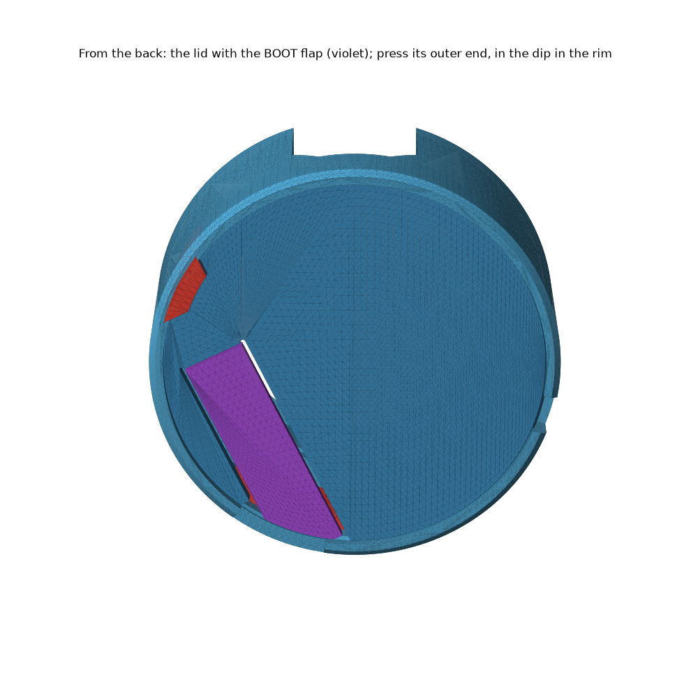

| print | file | orientation | mass* |
|---|---|---|---|
| **case** | `stl/pocketwatch/pendant/battery/Battery pendant - case.stl` | bezel face down, as exported | 16.5 g |
| **plate** | `… - plate.stl` | back face down, as exported | 5.8 g |
| **lid** | `… - lid (flap).stl` | back face down, pole up, as exported. **Print it on the same bed as the case** (see weak points) | 4.4 g |
| plate, if the first one is too tight | `… - plate (roomy).stl` | same | 5.7 g |
| lid, if the first one is too tight | `… - lid (flap, roomy).stl` | same | 4.3 g |

\*Counted as solid PLA, so a real print with infill weighs less.

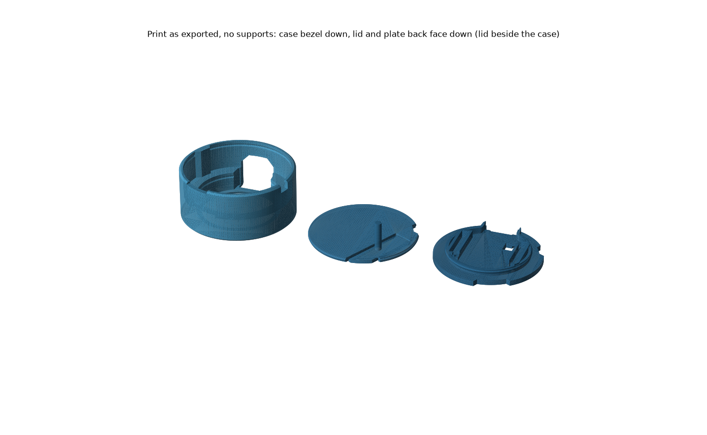

## What it is

- **Case.** v2's case: bezel lip, badge bore, step, battery chamber Ø48.7, lid groove. Three changes:
  - **12 o'clock notch.** Everything in front of the plate's back face is cut away above the pendant's flat, 16 wide, so a plug's overmold seats on the port. The port sticks out 1.65 (0.5 with the board pushed down by the plug). Behind it the chamber wall closes over the plug as a hood.
  - **Two ribs** on the chamber wall, 2 deep, red in the renders. They hold the cell's turn. The **low rib** (6 to 7 o'clock) is the flap's stop. The **tall rib** (10 o'clock) runs up to the back rim and keys the lid, so the pole finds its slot.
  - **Dip in the back rim** over the flap's outer end, down to the lid's level, so a thumb is not held off the flap by the rim.
- **Plate.** v2's plate: sits on the step, snaps into the bore, grips the headers. The BOOT post is gone (the pole comes from the lid). It has a slot for the pole, notches for the two ribs and the 12 o'clock notch. The lead channel in its back face runs along the turned cell.
- **Lid.** v2's lid: snaps into the back of the chamber and holds the cell. An **8 mm flap** is cut free by two 0.65 slits, beside the cell and never over it. It runs from a root at 9 o'clock to its tip at 6, along the cell's long edge. It is 1.2 thick, and its back face stays flush with the lid. A **Ø3 pole** hangs from it past the cell, through the plate, to BOOT. A **foot** under its outer end lands on the low rib.

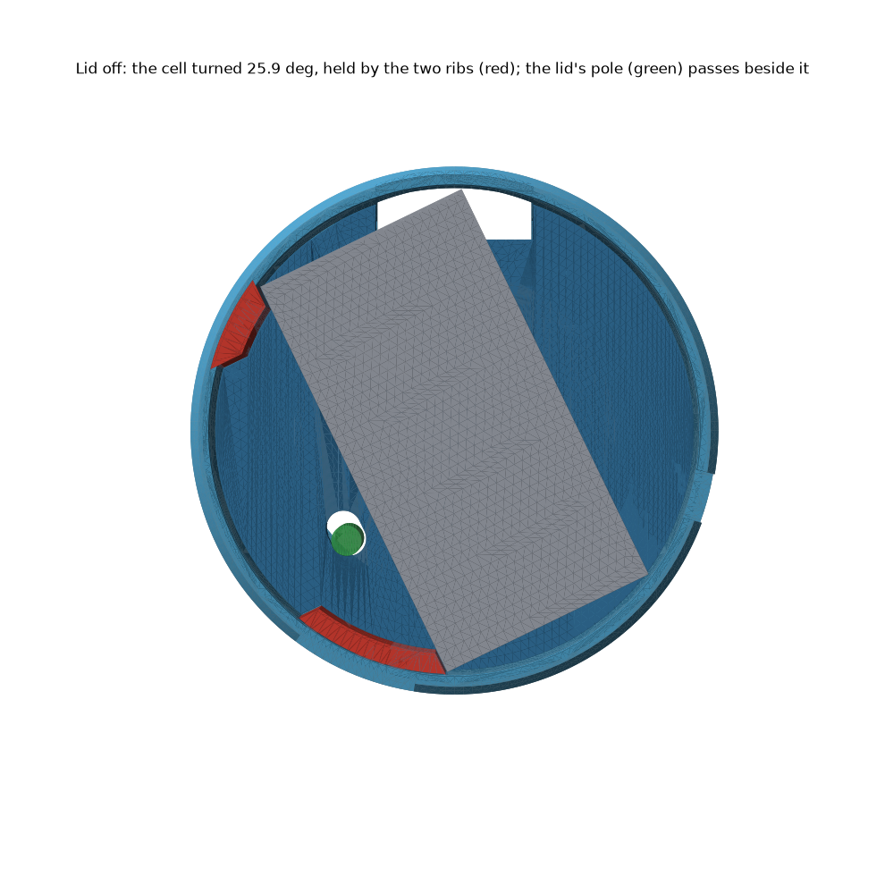

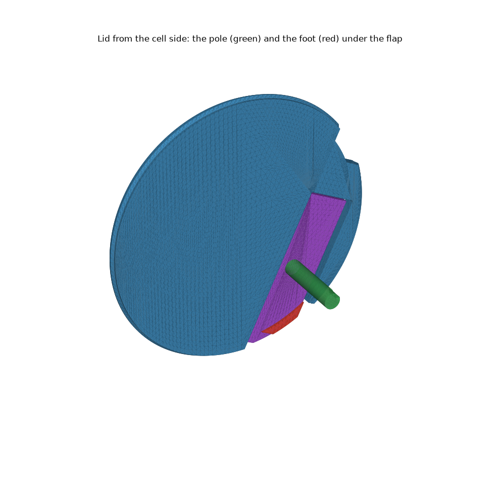

## Where to press

**Press the flap's outer end, in the dip in the rim, between 6 and 7 o'clock seen from the back.** The foot is under that end, so the case takes a hard press there.

Do not press the middle of the flap or the spot over BOOT (half past 7, near the middle of the flap). Nothing stops the flap there, so a hard press goes into the switch (see weak points).

## How it clicks

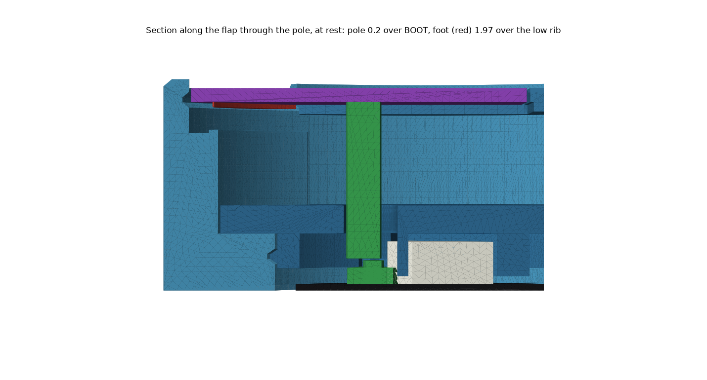
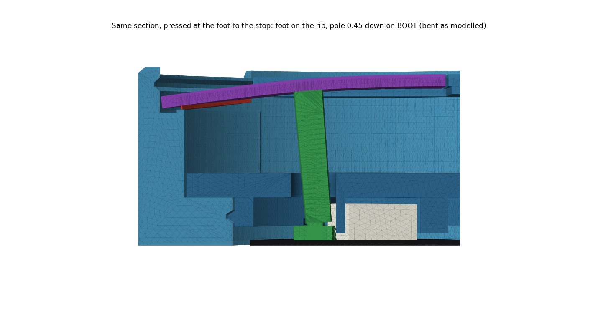

The flap is a springy strip fixed at its root. The sections run along the flap through the pole. The flap's tip is on the left, its root on the right.

| step | what happens |
|---|---|
| rest | pole **0.2** over BOOT, foot **1.97** over the low rib |
| click | **1.43 N** on the outer end bends the flap until the pole has pushed BOOT 0.45. The foot has moved 1.71 and is still 0.09 above the rib |
| **stop** | the foot lands on the rib. Pressing harder loads the case. BOOT then carries **3.4 N** |

The pole hangs 13.3 under the flap, so it tips with the flap: its end moves 1.1 toward the root by the stop. It is drawn 0.83 back from BOOT, so the switch stays under it from the first touch to the stop.

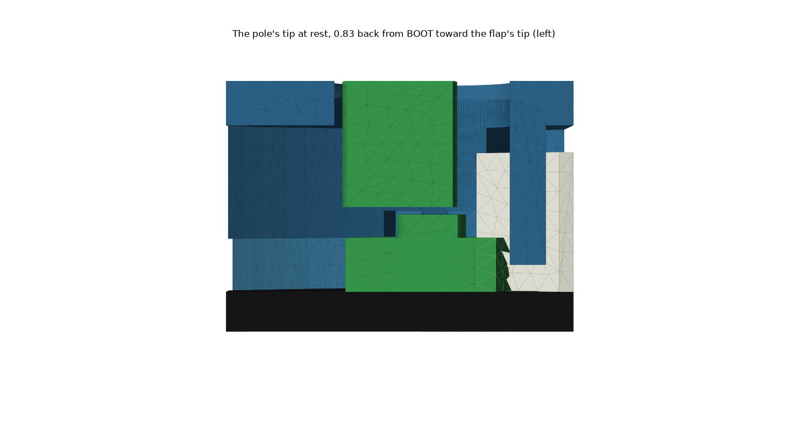
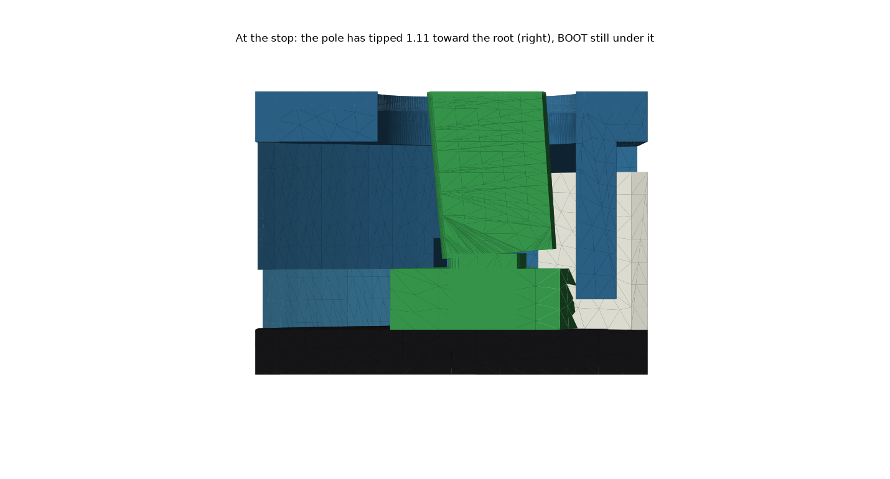

## The plug at 12 o'clock

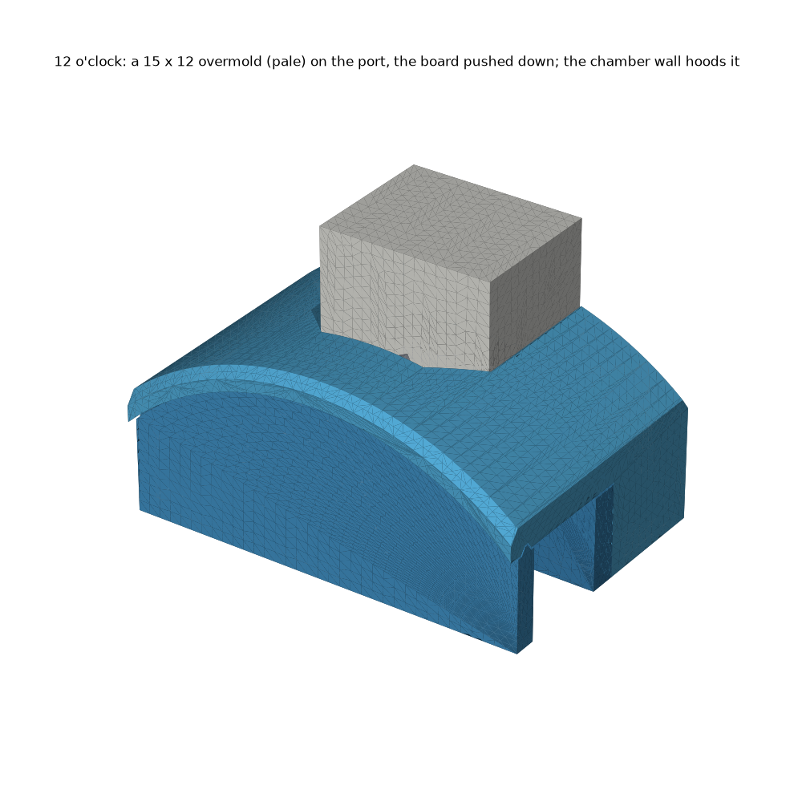
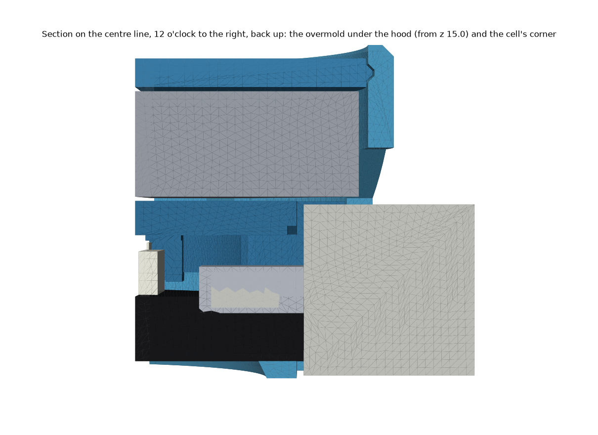

| | |
|---|---|
| notch | **16 wide**, above the pendant's flat (y 19.3), through the case's front section and the plate |
| overmold that fits | **15 wide × 12.6 thick**, keeping 0.5 off every part. A 12 mm one is checked: 0.5 off the case and plate |
| hood | the chamber wall is a full ring from 3.75 behind the plate's back face. The notch's roof is a 45° arch below that, because a flat roof over 16 mm would be a longer bridge than the printer is trusted with (10) |
| cell | its corner is over the plug, 0.55 above a 12 mm overmold. A 13.1 mm overmold would touch it |

## Assembly

1. **Badge** into the case from the back, screen first, USB-C tab into the opening at 12 o'clock.
2. **Plate.** Header sockets into the guides, rib notches over the two ribs. It only fits one way. Press round the rim until it snaps flush onto the step.
3. **Cell lead.** Plug the cell's JST into the board through the square hole up and left of the centre. Lay the lead in the channel in the plate's back face. It runs out to the plate's edge at 11 o'clock.
4. **Cell.** Lead end at 11 o'clock, its long left edge against the two ribs. It only fits turned.
5. **Lid.** Notch over the tall rib at 10 o'clock. The pole goes down beside the cell into the plate's slot. Press round the rim until it snaps. Do not push on the flap to seat it.
6. **To open.** Put a small flat screwdriver into the notch in the back rim at half past 3 seen from the back. Slide it under the lid's edge and lever up. Never lever on the flap.

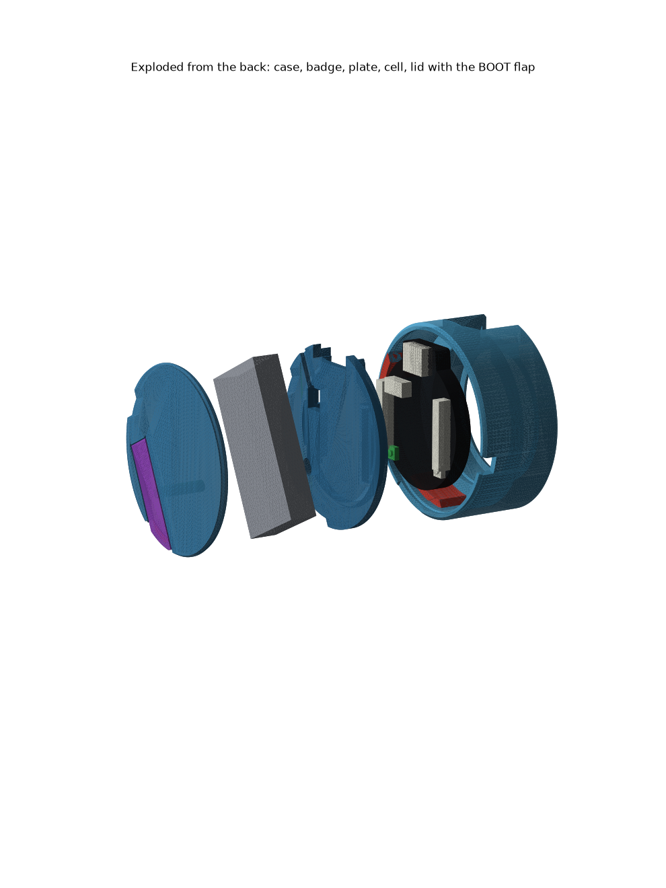

## Numbers

PLA, E 2500 ± 25%. Worst case means the foot printed 0.1 late, at either end of the stiffness range.

| | nominal | worst | limit |
|---|---|---|---|
| **press to click, at the outer end** | **1.43 N** | | ≤ 10 N |
| **BOOT force on the stop** | **3.4 N** | **4.9 N** | 8 N / 16 N |
| flap strain on the stop | 0.54% | 0.60% | 1.0% / 1.7% |
| click still happens if the foot lands 0.1 early | 0.040 of foot travel to spare | | > 0.02 |
| actuator under the pole | 88% at the first touch, 99.6% at the click, 100% at the stop | | ≥ 75%, ≥ 95% at the click |

| part | value |
|---|---|
| cell turn | **25.9°** CCW seen from the back: the least turn that keeps the pole's channel (Ø3 + 0.3) 1.2 + 0.3 off the cell. The case does not grow, because the cell's half-diagonal is the same at any turn |
| flap | **8** wide, root 9 along the cell's edge from its middle, **1.2** thick, slits 0.65, its inner edge 0.6 off the cell's edge |
| pole | Ø3, from the flap to 0.2 over BOOT, 14.2 from the root. Drawn 0.83 back from BOOT toward the flap's tip |
| foot | along the flap's outer edge, from its corner out to 2.4 short of the tip (27.0 from the root), 0.38 tall, on a ledge at a layer line |
| foot height | **1.97** above the rib = the foot's travel at the click (1.71) + 0.14 of push past the click, scaled out to the foot |
| tip | the flap ends 29.4 from the root. The rib under it is 0.3 lower, so the tip never lands before the foot (0.07 or more to spare at the stop) |
| pry notch | half past 3 (345° from +x seen from the back), 5 wide, 1.0 under the lid's front face. A 0.5 blade slides 0.80 under the lid's edge (0.35 for the roomy lid), and misses the cell |
| lead | channel 3 wide, 1.2 deep in the plate's back face, from the JST hole along the cell to the plate's edge. The lead's path is open past every part and stays 4.0 under the lid |

The model is in `pocketwatch/pendant/kids-case/build_kids_case.py` (`Flap`, `flap_model`), shared with the kids case. It treats the flap as a beam as wide as the flap at each point, with three supports under it: the switch, the foot, and the tip over the rib. The pressed checks bend the 3D flap into the model's shape, so the pole moves exactly the switch's 0.45 and the foot exactly its 1.97.

## Weak points (honest)

- **KNOWN WEAKNESS: no stop between the root and the outer end.** A 30 N press right over the pole puts **28.6 N** on BOOT. A 30 N press mid-flap puts **30.4 N** on it. Only a press on the last 3.3 mm of the flap (past 26.1 from the root) keeps a 30 N mash under 8 N in every worst case. A normal press at the outer end is 3.4 N.
- **The pole is a tall thin pin.** It is Ø3 and 13.3 tall, printed standing alone on the lid. A lone Ø4 column printed with a rough, leaning top before (print log, 2026-09-20). Print the lid on the same bed as the case, so each of the pole's layers has time to cool. Check that its end is flat before assembly. Do not knock it sideways: it can snap at the flap.
- **The pole tips as the flap bends.** Its end slides 0.8 across BOOT between the first touch and the stop. At the first touch, header H1's keepout bites 12% of the switch from under it (the pole must not reach H1 at the stop). At the click 99.6% is under it. BOOT's centre stays under the pole if BOOT is up to 0.39 off at the touch, 0.84 at the click.
- **BOOT and the JST positions are guesses (±1 mm).**
- **Spare lead.** The check runs one length of lead from the cell's end to the JST. The only room for a coil of spare lead is the gap past the cell's end, about 2.8 wide. That is not checked.
- **The very tip is thin.** 10 N on the tip corner strains it 1.21%, over the 1% for repeated flexing. A 30 N jab there reaches 2.3% and could crack the corner.
- **Long travel.** The outer end moves 1.71 to the click and 1.97 to the stop (the kids case: 0.72 and 0.90). The lid sits 0.95 below the case rim. The dip in the rim brings the rim down to the lid's level over the foot only.
- **Z gaps are good to ±0.15 at 0.3 mm layers.** The rib's top sits on a layer line. The foot as sliced lands 2.05 over it instead of 1.97, and BOOT then takes 4.8 N on the stop.
- **The cell's corner shows at 12 o'clock.** It sits over the plug, 0.55 above a 12 mm overmold, and shows through the arch in the notch.
- **The lid's snap is weaker.** The flap, the tall rib's notch and the pry notch have no bead. The lid grips with 22.3 mm³ of interference, against 27.7 on v2's lid.
- **The plate has no pry notch**, as on v2. It only comes out to take the badge out.

**Child safety:** not for very young children. The board, the lid and the cell are small parts, and the cell is a LiPo.

## Rebuild

`~/.venvs/cad/bin/python pocketwatch/pendant/battery/build_battery_pendant.py` from the repo root (141 checks). Add `--no-render` for a fast check run.
