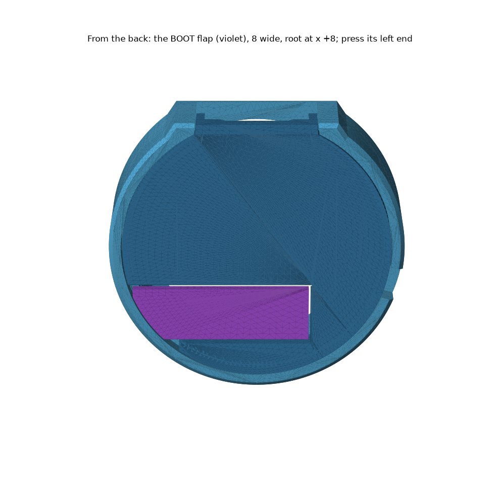
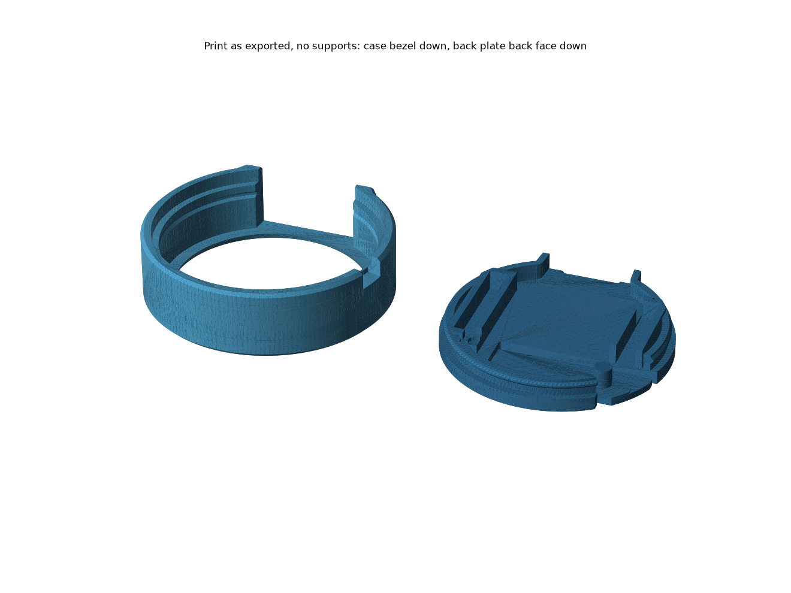
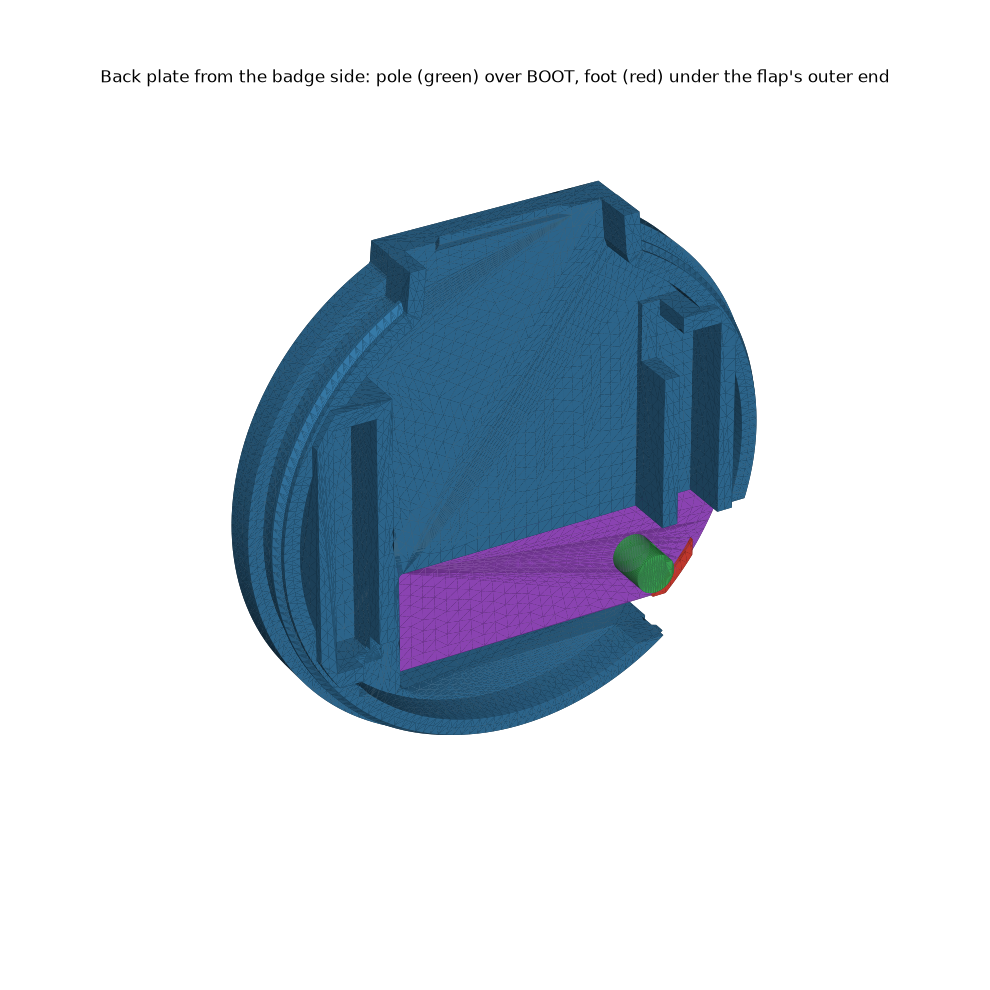
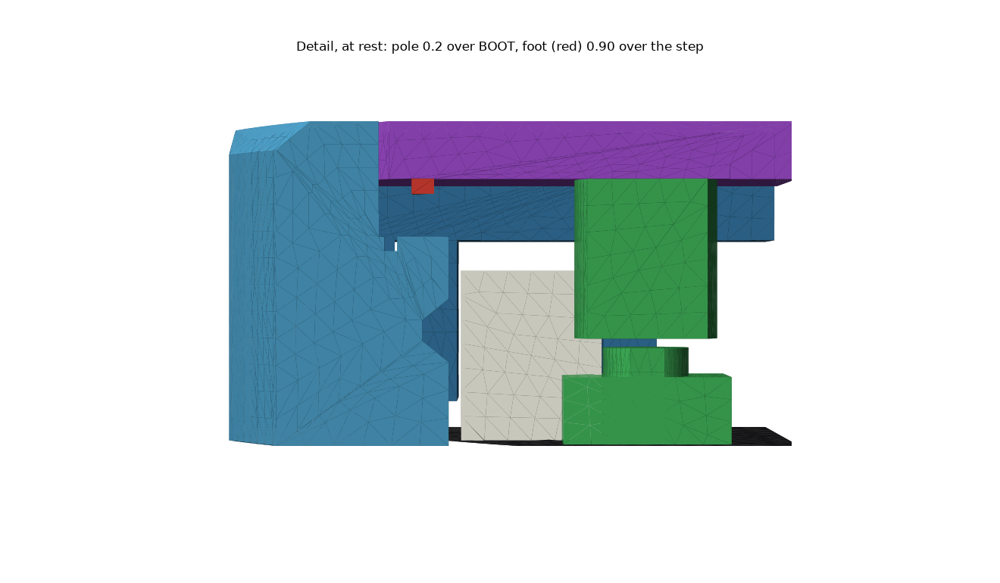
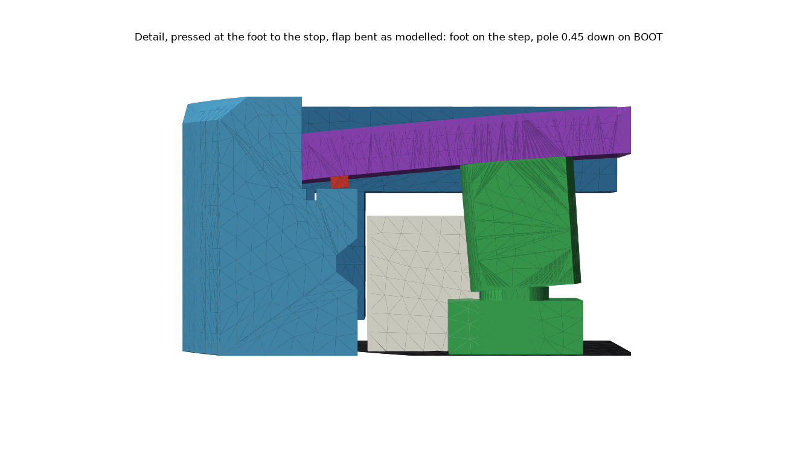
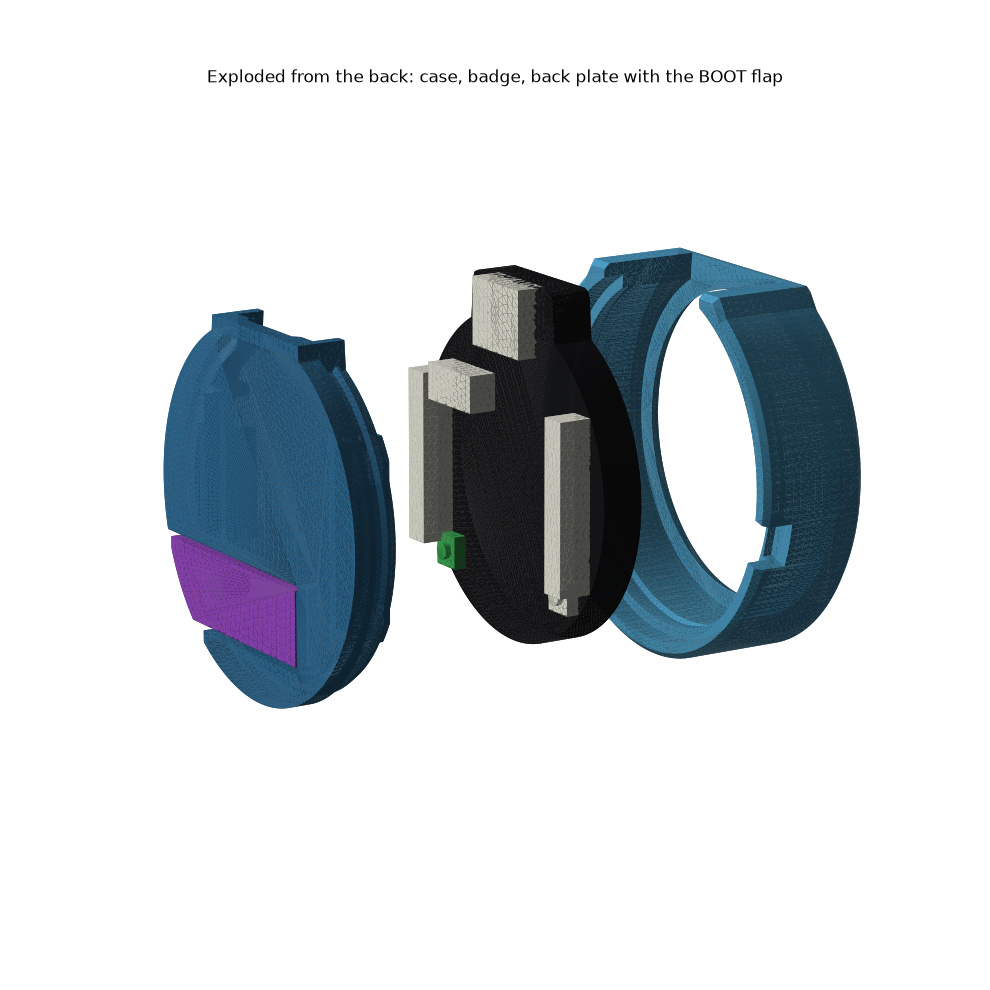

# Kids case (1.28 badge)

**The pendant without the twist-lock, and a back plate whose BOOT button is one big flap. Press the flap's outer end (seen from the back, the left end of the strip below the centre, at the rim near 8 o'clock). BOOT clicks at 1.85 N. A foot under that end then lands on the case, so a harder press goes into the case, not the switch.** Two prints in **PLA**, no supports. Not printed yet. It replaces the pendant's kid button, which did not fit on its first print.

| print | file | orientation | mass* |
|---|---|---|---|
| **case** | `stl/pocketwatch/pendant/kids-case/Kids case - case.stl` | bezel face down, as exported | 4.9 g |
| **back plate** | `stl/pocketwatch/pendant/kids-case/Kids case - back plate (flap).stl` | flat back face down, as exported | 4.1 g |
| back plate, if the first one is too tight | `… - back plate (flap, roomy).stl` | same | 4.0 g |

\*Counted as solid PLA, so a real print with infill weighs less.

## What it is

- **Case.** The pendant case: Ø43.6 circle, flat at 12 o'clock so the USB-C port sticks out 1.65 mm, same snap groove, same pry notch. It has no lock grooves. One addition: the step under the flap's tip is cut one layer (0.3) lower over a short arc, so the tip never lands before the foot.
- **Back plate.** The pendant's plate (snap skirt and bead, header guides, keyed by the USB-C tab) with an **8 mm wide flap** cut free by two 0.65 slits. The flap runs from a root at x +8 out through the plate's edge. It is 1.2 thick, and its back face stays flush with the rest.
- **Pole.** A Ø3 pole under the flap, 0.2 over the BOOT switch at rest.
- **Foot.** A 0.3 tall ridge under the flap's outer end, along the edge, over the case step. It sits 0.90 above the step at rest.

## Where to press

**Press the outer end of the flap, at the rim.** That end carries the foot, so the case takes a hard press there.

Do not press the middle of the flap, or the spot over BOOT. Nothing stops the flap there, so a hard press goes into the switch (see weak points).

## How it clicks

The flap is a springy strip fixed at its root. The sections are cut at y −11.0, through both the pole and the foot.

| step | what happens |
|---|---|
| rest | pole **0.2** over BOOT, foot **0.90** over the step |
| click | **1.85 N** on the outer end bends the flap until the pole has pushed BOOT 0.45. The foot is still 0.18 above the step |
| **stop** | the foot lands on the case step. Pressing harder loads the case. BOOT then carries **6.6 N** |

## Assembly

1. **Badge** into the case from the back, screen first, USB-C tab up through the opening at 12 o'clock.
2. **Back plate.** Header sockets into the guides, flap over BOOT. It only fits one way. Press round the rim until it snaps flush. Do not push on the flap to seat it.
3. **To take the plate out.** Put a small flat screwdriver into the notch in the case rim, just below 3 o'clock seen from the back. Slide it under the plate's edge and lever up. Never lever on the flap.

## Numbers

PLA, E 2500 ± 25%. Worst case means the foot printed 0.1 late, at either end of the stiffness range.

| | nominal | worst | limit |
|---|---|---|---|
| **press to click, at the outer end** | **1.85 N** | | ≤ 10 N |
| **BOOT force on the stop** | **6.6 N** | **11.4 N** | 8 N / 16 N |
| flap strain on the stop | 0.52% | 0.71% | 1.0% / 1.7% |
| click still happens if the foot lands 0.1 early | 0.05 of foot travel to spare | | > 0.02 |

| flap | value |
|---|---|
| width, root, thickness | **8** (centred on BOOT's y), root at x **+8**, **1.2** |
| pole | Ø3 at BOOT (−11.1, −10.2), 19.1 from the root |
| foot | along the edge from the flap's corner by the pole out to x −16 (24.0 from the root), 0.3 tall, 0.72 wide |
| foot height | **0.90** above the step = the foot's travel at the click (0.72) + 0.14 of push past the click, scaled out to the foot |
| tip | the flap ends 26.4 from the root, cut square where it would be under 1.2 wide. It clears the relieved step by 0.11 or more at the stop |
| pry notch | 345° from +x seen from the back, 5 wide, 1.0 under the plate's front face. A 0.5 blade slides 0.67 under the plate's edge (0.20 for the roomy plate) |

The model is in `build_kids_case.py` (`Flap`, `flap_model`). It treats the flap as a beam as wide as the flap at each point, with three supports under it: the switch, the foot, and the tip over the step. The pressed checks bend the 3D flap into the model's shape, so the pole moves exactly the switch's 0.45 and the foot exactly its 0.90.

## Weak points (honest)

- **KNOWN WEAKNESS: no stop between the root and the pole.** A 30 N press right over the pole puts **29 N** on BOOT. A 30 N press mid-flap puts **16 N** on it. Only a press on the last 2 mm of the flap (past x −16.4) keeps a 30 N mash under 8 N in every worst case. A normal press at the outer end is 6.6 N.
- **The very tip is thin.** 10 N on the tip corner strains it 0.96%. A 30 N jab there (a fingernail or pen) reaches 2.6%, past PLA's 1.7%, and could crack the corner. A fingertip there also rests on the case rim beside it.
- **BOOT position is a guess (±1 mm).** The Ø3 pole forgives about 0.6.
- **Z gaps are good to ±0.15 at 0.3 mm layers.** The foot and the flap's underside sit on layer boundaries, so the slicer keeps them where they are drawn. The case step does not (it is 10.05 above the bed). If the step prints a full 0.15 high, the click margin at the soft end of PLA is used up. Check that the first print clicks before the foot lands.
- **The roomy plate's foot is drawn only 0.25 wide**, under one 0.6 line. That plate is for prints that come out oversize, which also widens the foot, but check that the foot printed before relying on it.
- **The snap is weaker by the flap's width.** The bead is cut off the flap, so the plate grips over the rest of its rim (15.8 mm³ of interference, against 17.9 on the pendant plate).

**Child safety:** not for very young children. The board and the plate are small parts.

## Rebuild

`~/.venvs/cad/bin/python pocketwatch/pendant/kids-case/build_kids_case.py` from the repo root (88 checks). Add `--no-render` for a fast check run.
