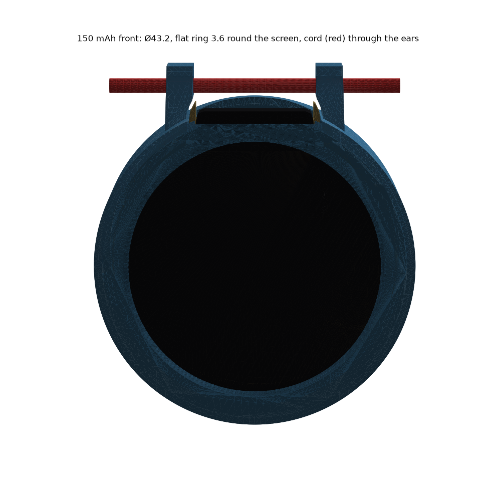
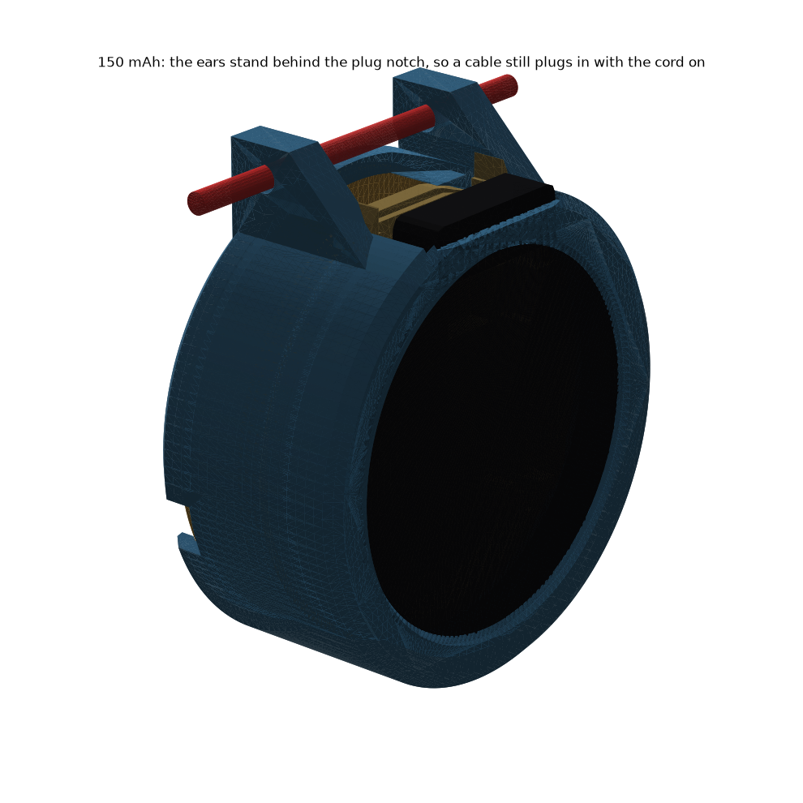
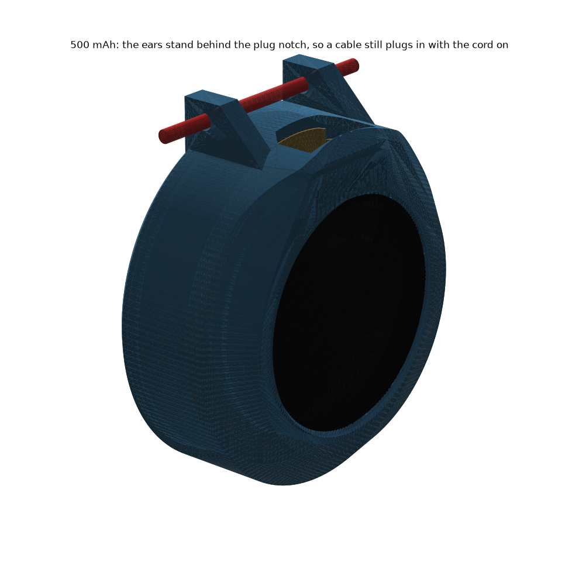

# Wearable pendant (1.28 badge)

**Two thin-bezel pendants that hang from a cord. Both have a 3.6 mm flat ring round the screen and two ears at 12 o'clock with one Ø2.6 cord hole through them.** The cord crosses over the USB-C port behind the plug, so a charging cable still plugs in with the cord on. Three prints each, **PLA**, no supports. **Not printed yet.**

| | **150 mAh** | **500 mAh** |
|---|---|---|
| cell | **EEMB LP401730**, 4.3 × 17.5 × 32.0 (EEMB's drawing) | **503035**, 5.3 × 30.5 × 37.0 (*assumed*: code + EEMB's margins, measure one) |
| size | **Ø43.2 × 19.8** | **Ø52.2 × 20.8** |
| BOOT | **press the lid's flap** (the battery pendant's lever) | **press the screen** (v2's post) |
| weight | ~19 g with the cell | ~37 g with the cell |
| built on | `pocketwatch/pendant/battery/` | `pocketwatch/build_pocketwatch.py` (v2) |

Hung from the cord, both tip their face about **9° down** (the cord sits behind the centre of mass).





## Print

| print | 150 mAh | 500 mAh | orientation |
|---|---|---|---|
| **case** | `stl/pocketwatch/pendant/wearable/150mAh/Wearable 150 mAh - case.stl` | `…/500mAh/Wearable 500 mAh - case.stl` | bezel face down, as exported |
| **plate** | `… - plate.stl` (and `plate (roomy)`) | `… - plate.stl` | back face down, as exported |
| **lid** | `… - lid (flap).stl` (and `lid (flap, roomy)`) | `… - lid.stl` | 150: back face down, pole up. **Print it on the same bed as the case.** 500: flat |

## Assembly

Same as the base design:
- **150 mAh:** follow the [battery pendant's assembly](../battery/README.md#assembly). Cell lead end up, toward 12 o'clock (see `renders/150mAh/lid-off.png`), its long edge against the two ribs.
- **500 mAh:** follow the [pocketwatch v2 assembly](../../README.md#assembly-in-order). The 503035 goes where the 1000 mAh did, wire end toward 12.

Then thread the cord through one ear, over the port, and through the other.

## What changed from the base designs

| | base | here | why |
|---|---|---|---|
| bezel lip, front to back | 1.2 | **0.9** (three 0.3 layers) | thinner face |
| lip over the glass edge | 1.0 | **0.7** | wider window, narrower ring |
| front of the case | full width to the front face | **1.8 outside the bore, then widens at 45°** | the flat ring is 3.6 wide whatever the cell's size. Without this the 500 mAh's ring would be 9.1 wide |
| lid | 2.0 | **1.6** | thinner. The 150's flap is thinned to 1.2 from the cell side either way |
| bail | none | **two ears, Ø2.6 hole** | each ear 3.6 wide, ramped at 45° underneath, teardrop hole: no supports |
| 150's flap | 8 wide | **5.5 wide** | the shorter lid lever was over 8 N on BOOT at the stop |

## Why 19.8 mm and not thinner

From the glass back on the 150 mAh: lip 0.9, board and header sockets **8.15**, float 0.7, plate 2.4, cell 4.3 plus 0.3 either side, lid 1.6, rim 0.95.

- **The board and its sockets are 8.15 of it.** The cell can't sit between the two header sockets because the JST is in the way, so it goes behind them.
- **The plate stays 2.4.** It carries the cell lead's channel, and the 150's hood over the plug needs that depth. At 1.8 both checks fail.

## Weak points (honest)

- **Not printed.** The 0.9 lip and the 0.7 overlap are both thinner than anything printed so far. The pendant (1.2 lip) is the closest proven part.
- **The 500 mAh's cell size is a guess** from the 503035 code. Measure one before printing, and change `CELL_503035` in `build_wearable.py`.
- **150 mAh: the battery pendant's flap weaknesses carry over.** Press the flap's **outer end, in the dip in the rim**. A 30 N jab right over the pole puts ~30 N on BOOT, and only a press on the outer 2.1 mm stays under 8 N.
- **150 mAh: the cell can turn about 1.07° before a rib stops it** (the big cell turned 0.8). The pole still clears it.
- **The cord crosses the port.** A cable plugs in fine, but the cord sits 3 mm behind the overmold.
- **The ears are tall** (4.5 past the rim). Cords up to 2 mm fit. Thicker cord: raise `Bail.HOLE` and `Bail.CORD` together.
- **The lid prints a tall thin pole (150).** As on the battery pendant, print it beside the case so its layers can cool.
- **Polarity.** Check red = + against the board's mark before plugging in a cell from a new seller. EEMB's drawing has red as P+.

**Child safety:** not for very young children. The board, the lid and the cell are small parts, and the cell is a LiPo.

## Rebuild

```
~/.venvs/cad/bin/python pocketwatch/pendant/wearable/build_wearable.py
```

From the repo root. Takes about a minute. `--no-render` for a fast check run, `--only 150` or `--only 500` for one variant.

Every check of the base design runs on these numbers. The few that only encode the base's own cell are **waived in the output with the reason**, and replaced where the idea still needs checking: the plate seat, the slits beside the flap, the cord path, the overmold with the cord on, and the ears' strength.
