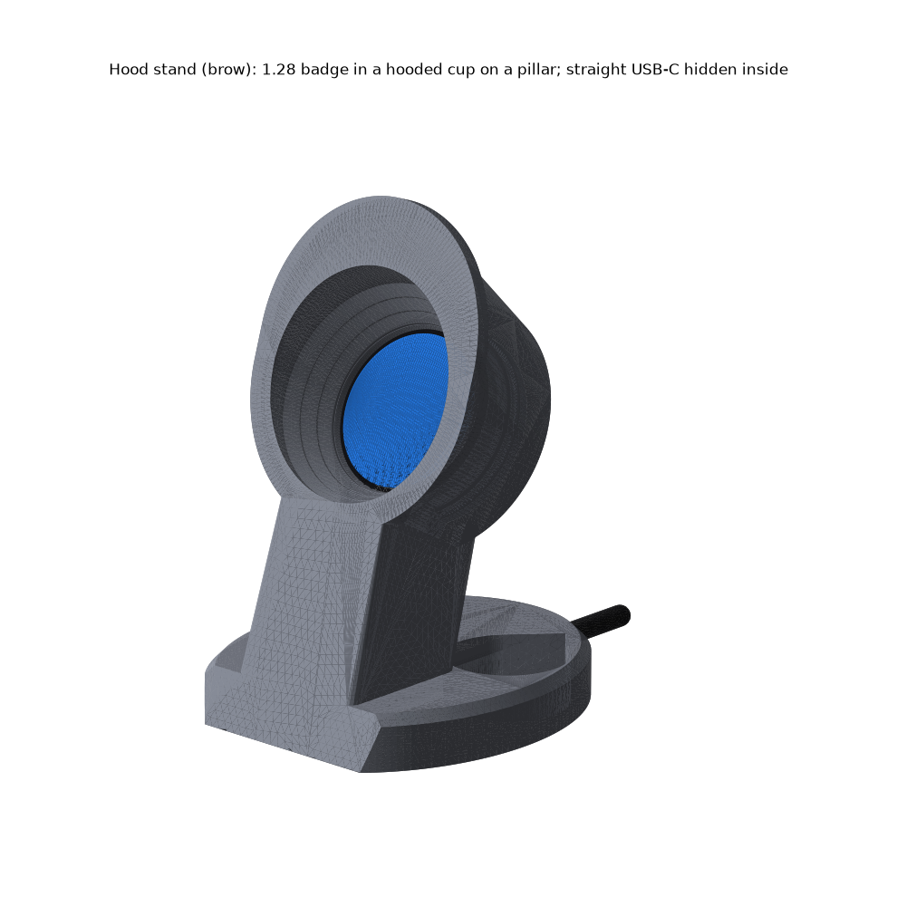

# Hood stand: the 1.28 badge as a hooded desk gauge

**The USB-only pocketwatch case, fused into a round gauge cup with a brow (the 2G DSM pod look), on a pillar with a coin-weighted oval base. 68 × 75 × 102 mm. The face looks up 30° at you, and the straight USB-C plug hides inside the pillar.**

| print | file | orientation | supports |
|---|---|---|---|
| **stand** | `stl/pocketwatch/stands/hood/Hood stand.stl` | on its front face (hood rim, pillar front and base front share one plane), as exported. 68 cm³, 72 mm tall, 2700 mm² first layer ([layout](renders/print-layout.png)) | none |
| **plate** | `stl/pocketwatch/stands/hood/Hood stand - back plate (BOOT hole).stl` | flat back down, as exported (same part as the USB-only BOOT-hole plate) | none |

## Assembly
1. **Badge** in from the back, screen first, USB-C tab down into the crown slot at 6 o'clock. **Plate** snaps in flush ([exploded](renders/exploded.png)).
2. **Lift the stand.** Push a straight USB-C plug up through the slot in the base, along the pillar, into the port. The cable lies in the tunnel under the base and leaves at the back ([section](renders/section.png)).
3. **Put 5 quarters in each well** (any coins up to Ø24.3). Rotate the display 180° in firmware.
4. **BOOT:** push a SIM tool or paperclip straight into the plate's hole from behind ([back](renders/back-boot.png)). The badge is pushed onto the lip, and nothing presses on the glass face.

## Numbers (all checked by `build_hood.py`)
| what | value |
|---|---|
| face | centre 60 mm up, tilted back 30°; an eye 400 up / 550 back sits 6° off the axis |
| hood | 24 mm proud of the glass at the top, ~12 at the bottom; whole display visible from 17.5° above to 29.7° below the axis |
| case inside | bore, lip, snap, slot unchanged; **2.95 wall in front of the port**, shell engages 3.7 |
| plug | 12×8×22 body clear; 70 mm straight path from under the base with ≥ 0.5 mm clearance; cable bend R10 |
| BOOT | Ø2 × 40 stylus reaches the actuator, clears everything; badge float 0.70 |
| stability | tip angle 40° empty, 50° with coins. A 1 N cable tug tips it at **0.86 N empty**, 1.54 N with coins (26° margin at 1 N) |

## Weaknesses (honest)
- **The quarters are required** for a 1 N tug. They sit loose: a dab of Blu Tack, or they fall out when you pick it up.
- **102 mm tall.** The straight plug plus a 10 mm bend sets the height. A right-angle plug would save ~25 mm, but the stand isn't built for it.
- **Plugging in means lifting the stand.** The plug goes in from underneath.
- The brow limits viewing to 17.5° above the axis. Standing over the desk, you lose the top of the screen.
- The plate's snap groove prints tilted 12°, so one flank is a 57° overhang. Test-fit the plate first.
- The mass and centre of mass assume 75% solid-equivalent PETG. BOOT position is still the ±1 mm guess.
## Hood shapes explored
- **brow** (shipped): round concentric bezel, with the cup's top swept up into a solid brow. It reads as a gauge from the front and as a hood from the side.
- **scoop** ([alt-scoop-hero](renders/alt-scoop-hero.png)): a plain oblique cup, closest to the real DSM pod. The hood barely shows.
- **cowl** ([alt-cowl-hero](renders/alt-cowl-hero.png)): the opening flares up under the brow, so it is visible from 31.5° above. From the front it looks like an egg with the screen sitting low. It passes every check.

**Scores:** aesthetics 3 · printability 4 · robustness 4
