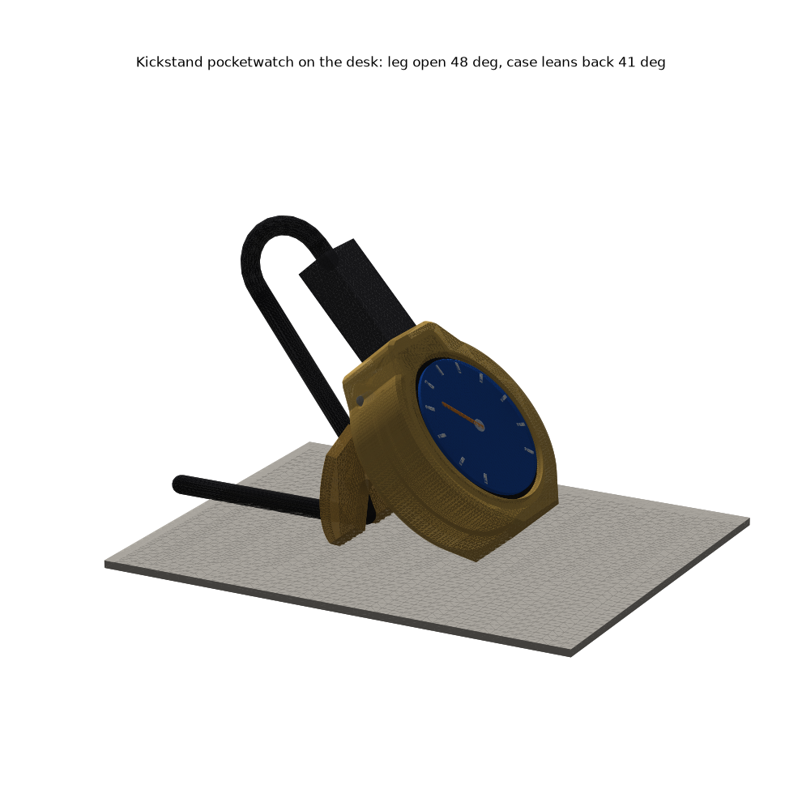

# Kickstand pocketwatch

**The USB-only case is its own stand.** The back is a hunter-style lid hinged at 12 o'clock behind the crown. Folded, it lies flush and the case is a Ø43.6 × 15.25 puck. Swung open, it is the leg: the case stands on a flat heel at 6 o'clock and on the lid's straight foot, leaning back **41°**. The leg stops hard at 47.6° and clicks at closed and at open. **Crown at 12**, the badge's own way up, so no firmware rotation: the plug stands up like a watch bow, and the cable loops back and runs down the leg into a notch in its foot.

| print | file (`stl/pocketwatch/stands/kickstand/`) | on the bed |
|---|---|---|
| **case** | `Kickstand - case.stl` | bezel down |
| **plate** | `Kickstand - back plate (BOOT hole).stl` | back face down |
| **leg** | `Kickstand - leg.stl` | back face down, barrel up |
| **pin** | `Kickstand - hinge pin.stl` | on its flat (Ø2.2 × 25.4) |

PETG, 0.30 layers, no supports; every part passes the overhang/bridge check. **Assembly:** badge in screen first, tab in the crown. Snap the plate in. Drop the folded leg into the cheeks from behind (its stub goes down the slot in the left cheek). Press the pin through both cheeks and the barrel. Cable: plug in, loop it back over the top, down the back of the leg, into the foot notch.

| number | value |
|---|---|
| **tip angle** (weight only) | forward **22.1°**, sideways **22.6°**, back 40.5° |
| **with 1 N cable pull** | ≥ **28°** every edge (back along the desk, or straight down) |
| **tug at the notch** | tips at 1.11 N, but slides at 0.13 N first (32 g total) |
| **hinge** | pin Ø2.2 in a Ø2.6 bore; 0.2 axial play per side; ≥ 0.31 swing clearance; next contact past the stop at 55.8° |
| **detent** | flexure finger 1.2 × 2.4 × 6.5 bending in the layer plane: 0.3 mm, **1.28 % strain**, ~2.3 N, ~11 N·mm click |
| **BOOT** | Ø2 stylus straight in: through leg + plate folded (7.5 deep), through the plate open (4.7). Leg clear by 0.7 |
| **plug / cable** | crown wall 2.95, shell engages 3.7; 22 mm plug, cable loop and notch all clear (≥ 0.3) |

**Why 41°, not the 15-25° asked for.** The puck stands on its heel's *back* edge and the badge makes it front-heavy. The forward margin depends on the lean alone, whatever the leg does: 15° → −4° (falls on its face), 20° → 1°, 25° → 6°, 30° → 11°, 35° → 16°, **41° → 22°**. The script prints this table. 41° also faces the glass at your eyes from a chair.

## Weaknesses (honest)
- **The plug dominates.** In use the straight plug and loop stand ~45 mm above the case. Your right-angle USB-C cable would remove the loop; the design doesn't depend on which cable.
- **15.25 thick, not 12.45**: the well the leg folds into.
- **Small hinge features** for a 0.6 nozzle: Ø1.6 stub, 0.7 bump, 0.8 slots. The click may print soft; the hard stop does not depend on it.
- **The pin is a press fit** of a printed Ø2.2 rod that is not quite round. If it walks, use a drop of glue or a 2.2 mm steel pin.
- **The stop angle rides on a 0.25 groove clearance**: the groove ends at 42°, and the stub reaches it at 47.6°, where the open dimple is. If the stub prints fat, it stops earlier (each 0.1 mm is about 2°) and the open click no longer lines up. The lean barely moves (about 0.1° per degree).
- **Plate out:** open the leg first; 5.8 mm of straight pull is free, and the snap needs 2.6.
- BOOT position is still a ±1 mm guess (the Ø3.4 holes forgive ±0.7). **Nothing here has been printed.**

**Scores:** aesthetics **3**/5 (clean puck folded; plug tower open), printability **3**/5, robustness **4**/5.

Rebuild: `~/.venvs/cad/bin/python pocketwatch/stands/kickstand/build_kickstand.py` (add `--no-render` for checks only).
