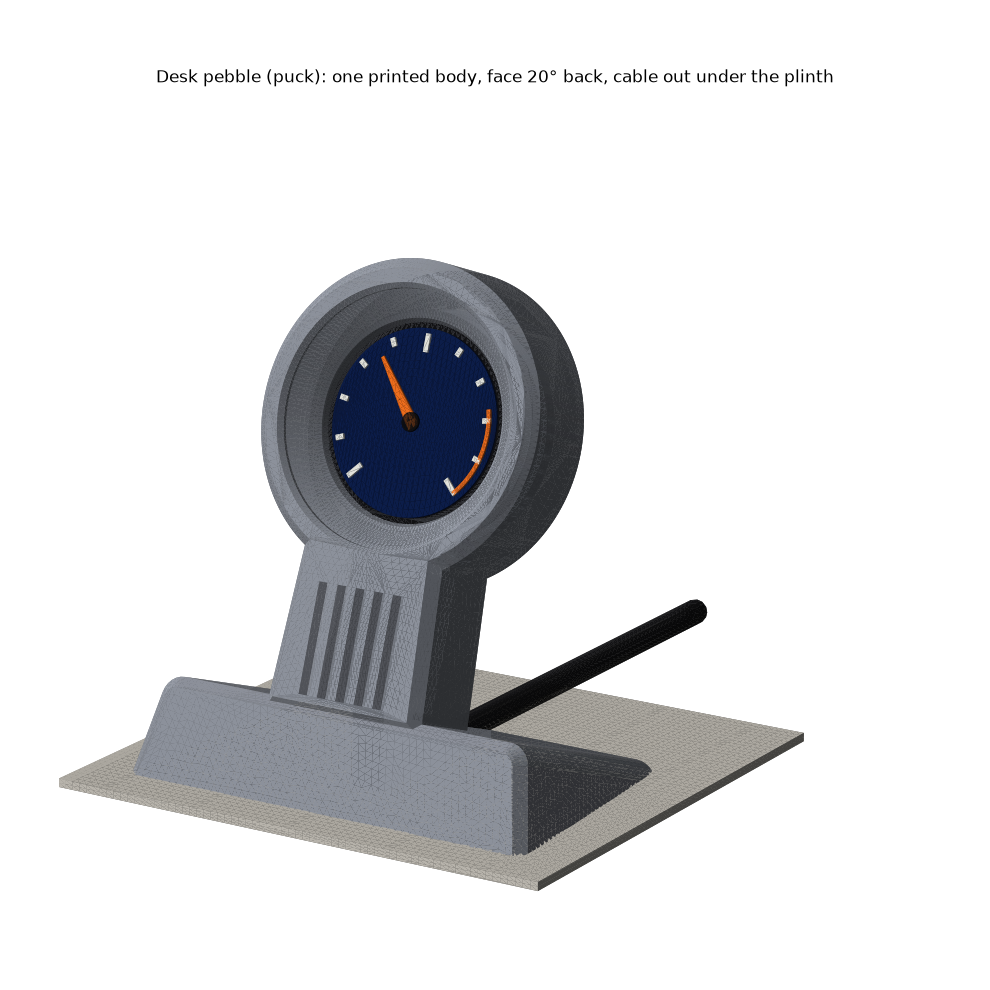

# Desk pebble: the pocketwatch standing on its crown

**One printed body with the USB-only case fused in. The face leans back 20°. The USB-C plug is the crown: it points down into a fluted stem, and the cable bends once and runs out under the plinth, flat on the desk.**

| print | file in `stl/pocketwatch/stands/pedestal/` | orientation | supports |
|---|---|---|---|
| **body** | `Pedestal - body.stl` | **front face down**, as exported | none |
| **back plate** | `Pedestal - back plate (BOOT hole).stl` (= the USB-only BOOT-hole plate) | flat, as exported | none |

PETG 260/85, 0.6 nozzle, 0.3 layers. Front face down puts the fused case on the bed **bezel-down, exactly as the USB-only case that fits** ([layout](renders/07-print-layout.png)). The textured sheet gives a matte face. Alternate shape: `Pedestal (alternate, wedge) - body.stl` ([render](renders/alt-wedge-01-hero.png)).

**Assembly** ([exploded](renders/06-exploded.png)): 1. **Plug a straight USB-C cable into the badge first.** 2. Lay the body face down on a cloth. Drop the badge in from the back, glass first; the plug lies in the trough below it and the cable goes into the groove under the plinth. 3. Snap the plate in. 4. Stand it up and rotate the display 180° in firmware (crown down).
**BOOT:** a Ø2 stylus or SIM tool through the plate's hole, upper right seen from behind, 4.7 deep ([back](renders/05-back-boot.png)). **To take it apart:** lever the plate out at the notch on the top of its rim, then pull gently on the cable and the badge comes out with it.

| numbers | |
|---|---|
| size | **77 wide × 48 deep × 86 tall**; dial centre 59 mm up, 20° back |
| body | 54.5 cm³ solid, ~47 g at 20% infill; 44 mm tall on the bed |
| glass | 7.0 mm behind the face in a 45° trim cone and cup; nothing in the sightline within 30° of square-on |
| plug | straight, overmold ≤ 12 × 8 × 22; engages 3.7 of 6.65 mm (unchanged) |
| cable | Ø ≤ 4.5, one R9 bend ([section](renders/04-section.png)); leaves under the plinth 19 mm behind the dial |
| tipping | **33.5°** unloaded; **22.5°** worst case with a 1 N sideways yank on the cable (22.2° at 15% infill) |
| case | the proven case with two changes: USB slot opened to the back, and a pry notch. The rest is identical (checked to 5 µm) |

**Weaknesses, honestly**
- **Not low.** A straight plug (22 mm) plus one bend puts the dial 59 mm up. That sets the 86 mm height. A right-angle cable would allow a lower body but is not checked.
- **Light** (~75 g with the badge). A 1 N pull lifted more than 24° off the desk raises the back, and it slides before it tips. Stick on rubber feet.
- I opened the case's USB slot to the back so the badge can go in with the cable already plugged. The 3.0 mm wall in front of the port is untouched, but this boss has never been printed.
- The pry notch leaves 0.6 of the 1.2 mm snap lip, at the notch only.
- Taking the badge out by the cable side-loads the USB-C port. The BOOT position is still a ±1 mm guess (the Ø3.4 hole forgives it).
- Renders are matplotlib, so expect some speckle. **Not printed yet.**

**Scores:** aesthetics **4**/5 · printability **4**/5 · robustness **3**/5

Rebuild from the repo root: `~/.venvs/cad/bin/python pocketwatch/stands/pedestal/build_pedestal.py`. Each run prints 131 checks and exits non-zero on any failure; add `--no-render` for checks only.
