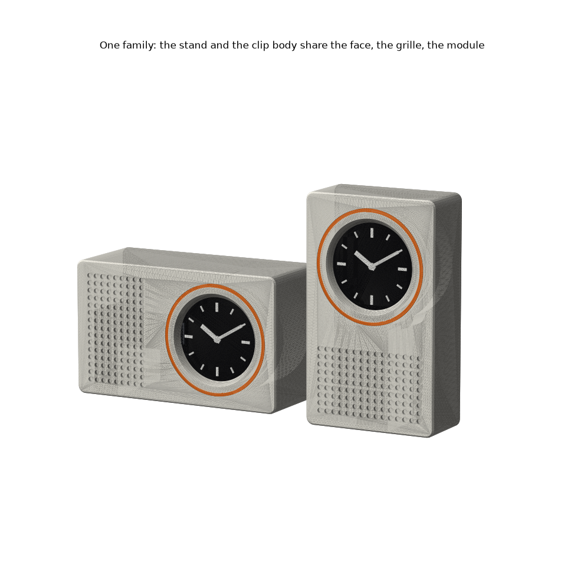

# Braun family: desk stand + monitor clip (1.28 pocketwatch, USB-only)

**One 54 × 90 body, two products.** A 54 square holds the face; a 36 × 54 grille field sits beside it (stand, landscape, crown left: **rotate the display 90°**) or below it (clip, portrait, crown down: **rotate 180°**). The USB-only case is fused in unchanged except the bezel lip (1.2 → 2.4, so the whole face is one flat plane on the bed). The plug lies hidden in a trough behind the grille, and the cord leaves out the back like a Braun clock's. That is why it isn't crown-down on the stand: there the trough turns down so the cable leaves at desk level. **One orange part:** a 1.2 × 1.2 ring pressed in around the window. Heroes: [stand](renders/stand-hero.png), [clip](renders/clip-hero.png).

**Module M = 6.** Body 15M × 9M; face 9M, grille 6M; depth 6M (stand) / 4M (clip); grille pitch M/2, holes Ø M/3; corners M/2; lip 0.4M, window bevel 0.3M; ring 0.2M × 0.2M; clamp 3M tall; knob 3M × 1.5M.

| print | file (`stl/pocketwatch/styles/braun/`) | orientation | notes |
|---|---|---|---|
| stand body | `Braun stand - body.stl` | face down, as exported | **30 % infill** (stability) |
| clip body | `Braun clip - body.stl` | face down | 15 % |
| clamp / knob / pad | `Braun clip - clamp.stl`, `- knob.stl`, `- pad.stl` | flat / pocket up / hole up | + M4 × 40 hex bolt, M4 nut |
| ring, 1 per body | `Braun - orange ring.stl` | flat | **orange** filament |
| plate, 1 per body | `Braun - back plate (BOOT hole).stl` | as exported | = USB-only BOOT-hole plate |

**Assembly.** Press the ring into the face groove. Badge in from the back, screen first, tab toward the grille. Snap the plate in flush with the well floor; to remove it, pry in the 3 mm gap round it. Plug in through the slot; the plug body lies in the trough. **BOOT:** a Ø2 stylus down the well into the plate hole (21 mm deep on the stand, 15 on the clip). **Clip:** drop the nut in its slot, press the knob onto the bolt head, thread the pad onto the tip, slide the clamp up into the body's dovetail from below, hook the lip over the bezel, turn the knob.

| numbers | stand | clip |
|---|---|---|
| size | 90 × 54 × 36, 75 g | 54 × 90 × 24 + clamp, 62 g |
| hold | tip **25.0°** (weight), 25.5° with 1 N along the cable | 8–32 mm; grip SF **34**, droop SF 9.8 (90 N at a finger-tight knob) |
| strength | n/a | spine 6.3 MPa (SF 7), lip 14 MPa (SF 3.2); stresses run along the layers |
| shared | 2.95 mm wall in front of the port, unchanged; shell engages 3.7 of 6.65; edge pixels visible to 49° off axis | |

**Weaknesses (honest).**
- **The grille is blind holes.** It marks where the plug lives and does nothing else. A strict Rams reading would delete it.
- **Stand:** a 1 N *sideways* yank at the cable exit tips it after 7.8° of tilt. Along the cable it holds 25°. At 15 % infill this drops to 21°.
- **Stand:** the 22 mm well behind the plate is empty depth. It is there for stability, not for anything inside.
- **Clip:** the body hangs on the dovetail by gravity. An upward knock can lift it off the clamp. The lip needs a bezel at least 6 mm wide. The pad threads onto the bolt, so it turns against the monitor while you tighten.
- Ø2 grille holes on the first layer: turn on elephant-foot compensation. The ring grips 0.1 over 1.2 mm of height, so it may need a drop of glue.
- **Not printed.** The thicker lip and the BOOT position (±1 mm, guessed) are untested.

| score (1–5) | aesthetics | printability | robustness |
|---|---|---|---|
| stand | 4 | 4 | 4 |
| clip | 4 | 4 | 3 |

Rebuild from the repo root: `~/.venvs/cad/bin/python pocketwatch/styles/braun/build_braun.py` (`--no-render` to skip renders). It prints every check and exits non-zero on any failure.
