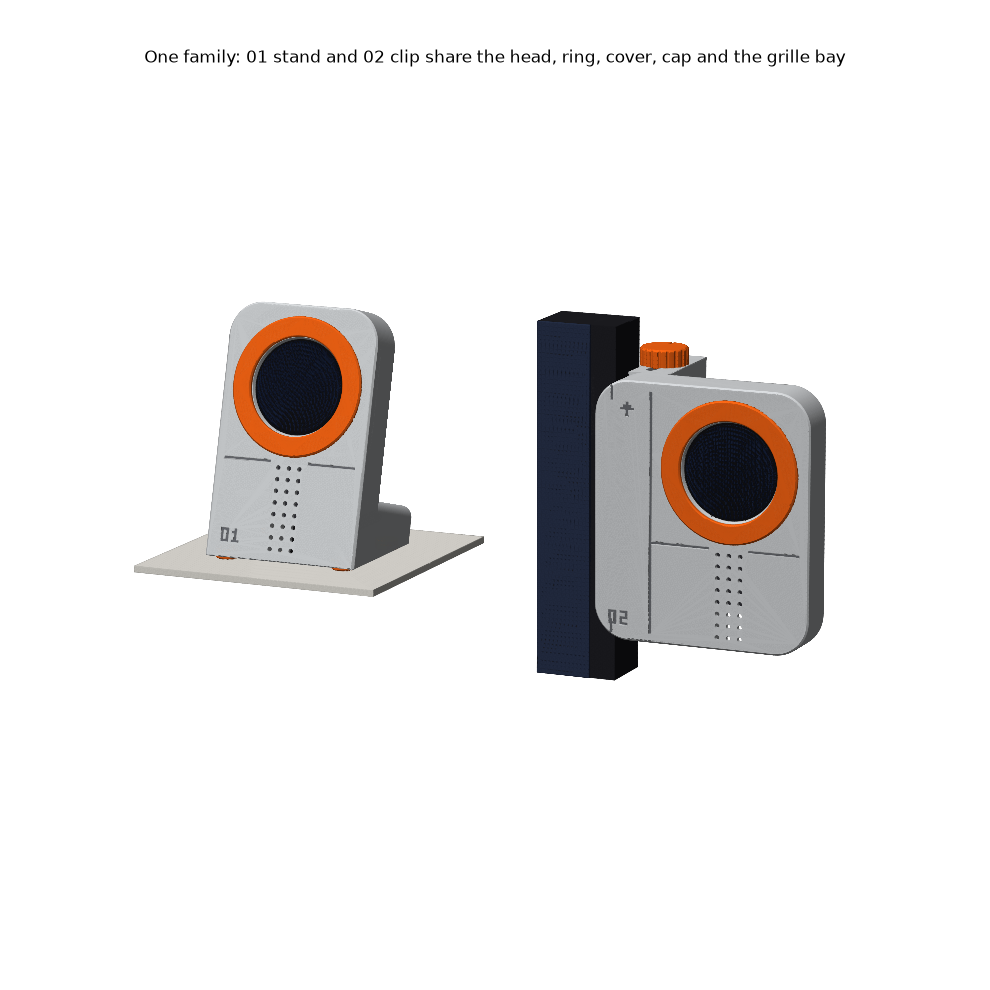
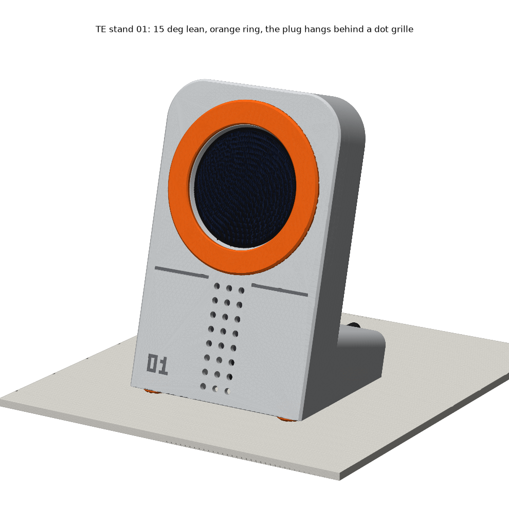
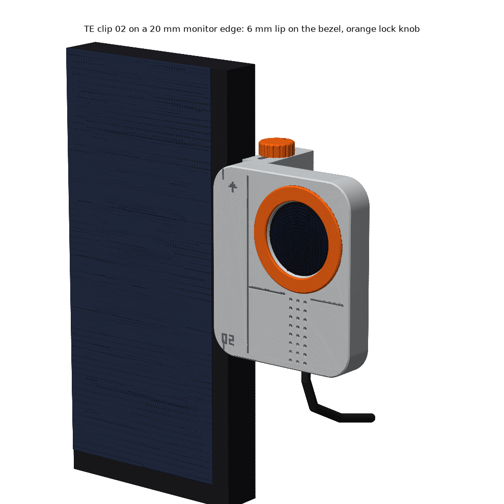
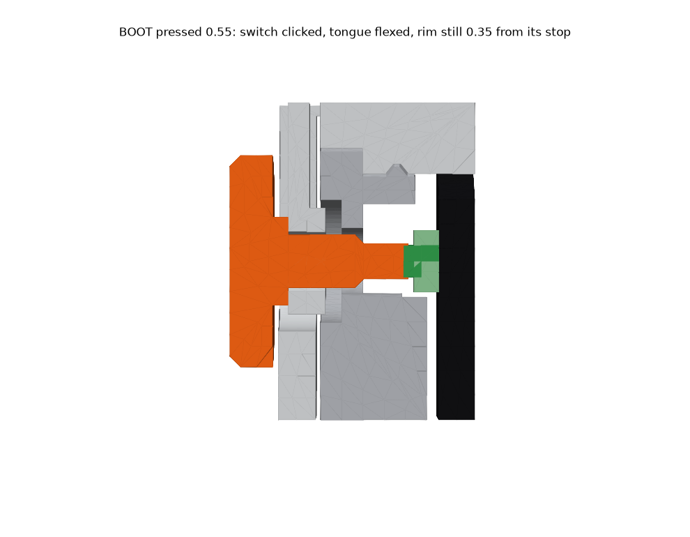

# TE family: stand 01 and clip 02 for the USB-only pocketwatch

**Two accessories, one head.** The pocketwatch case is fused into a 56 x 56 slab face with an **orange trim ring**, a dot-grille **plug bay** below it, and a back cover held by **four visible M3 hex screws** with an **oversized orange BOOT cap** on a flexure tongue. The stand leans that slab back 15° on a foot. The clip adds a spine, a 6 mm lip and a sliding rear jaw under an **orange knob**. **Grid: 4 mm module.** The face is 14 x 22 M, the ring Ø48 (12 M), the cover 12 M, the grille 4 mm pitch, plan radii 3 M, the cap 3 M, the knob 4 M and the feet 2 M. **Crown down** (rotate the display 180°), so the straight plug hangs hidden in the bay and you see it through the grille.

  

| print (`stl/pocketwatch/styles/te/`) | qty | colour | orientation, no supports |
|---|---|---|---|
| `TE stand - body` **or** `TE clip - body` | 1 | grey | front face down, as exported |
| `TE - back plate` · `TE - back cover` | 1 each | grey | back / outer face down |
| `TE clip - rear jaw` (clip only) | 1 | grey | standing, as exported |
| `TE - trim ring` · `TE - BOOT cap` | 1 each | **orange** | face down, pegs/stem up |
| `TE clip - knob` · `TE stand - foot` (x4) | 1 / 4 | **orange** | top down / flat |

**Hardware:** 4 x M3x12 socket head for the cover, plus 1 for the clip knob. All screws self-tap into Ø2.8 holes.

**Assembly:** 1. Press the ring's 4 pegs into the face. 2. Put the badge in from the back, glass first, tab toward the bay. 3. Snap in the plate. 4. With the cover face up on the table, press the cap's stem into the tongue's hex hole, then screw on the cover. 5. Feed the plug into the bay from behind and push it toward the display. **Stand:** press in the 4 feet. **Clip:** press the knob onto a screw head, slide the jaw's tongue into the channel from the back, and screw through the top slot. Hook the lip over the bezel, push the jaw until its **1.0 mm finger gap is at least half closed**, then turn the knob.

**BOOT, pressed from behind:** the stem tip is 0.30 short of the switch. It **clicks at 0.55 travel** and the cap rim stops at 0.90. The tongue is 5 x 1.2 x 11 and bends in the print plane (strain 1.3 %, 1.8 N + the switch's 1.6 N). The stem can print 1.0 mm too long before BOOT is held at power-up, or 0.35 too short and still click. 

| numbers (asserted in `build_te.py`) | stand 01 | clip 02 |
|---|---|---|
| size, mass incl. badge (40 % solid) | 56 x 88 face, 48 deep, ~57 g | 76 x 88 face, 49 deep, ~66 g |
| port wall / shell engaged / plug in bay | 2.95 (the case's) / 3.7 / clear | same |
| tip angle, bare / 1 N cable pull | 25.2° / 20.8° | n/a |
| grip | n/a | edges 8–32 mm, lip 6 mm, clamp 8.6 N (gap half shut) to 17 N, safety factor 2.8–5.6 |

**Weaknesses (honest):** the stand is light. A 1 N tug **slides** it on PETG feet (friction 0.17 N), and a cable pulled *upward* lifts it. Print the body at 40 % or more, or use TPU feet. The tip margin with a pull is only 0.8° over the target. The BOOT position is still a ±1 mm guess, and the Ø2 tip misses if it is off by more than ~1.9. The clip fits the **right** monitor edge only: a left version needs the spine mirrored in the script. The clip grips by friction, so on a bezel under 6 mm the lip lands on the panel. It is 9 printed parts plus 5 screws. Press fits and screw holes are not yet printed, so use CA if something is loose. Nothing here has been printed.

| scores (1-5) | aesthetics | printability | robustness |
|---|---|---|---|
| stand 01 | 4 | 4 | 3 |
| clip 02 | 4 | 4 | 3 |

Rebuild: `~/.venvs/cad/bin/python pocketwatch/styles/te/build_te.py` from the repo root. It prints ~160 checks, exits non-zero on any failure, and writes everything in `renders/`. Add `--no-render` for a fast check.
